# 01a — catalyst kernel: concepts, invariants, install and layout

> Read-only audit of the catalyst repository at kernel `0.45.0` (branch
> `development`, HEAD `aeccb51`). Scope: the kernel's concepts, invariants,
> install procedure and on-disk layout. Paths are relative to the repository
> root unless stated. Sizes are `wc -c` bytes; tokens are estimated at
> bytes/4. Nothing in the repository was modified or executed beyond
> read-only inspection (`check_kernel_purity.py` was run once; it writes
> nothing).

---

## 0. What catalyst really is (plain words)

catalyst is a set of Markdown rules for an AI coding agent, plus a small
Python CLI. Together they keep a second, private git repository (the
"working copy", `.criterion/`) next to a product repository. That working
copy holds numbered **rules** (statements of how the product should
behave, grouped in **domains**), numbered **work artifacts** (bugs,
requirements and so on, defined by a pluggable **process module**) that
must cite a rule, a registry of **users** whose 8-character userid is
appended to every ID they create, and an append-only **journal**. The
journal records the git blob hash of each touched file before and after
every change, so any past state can be rebuilt. The product repository
tracks only one small JSON **pointer** file (`<app-name>.catalyst`). An
optional git hook makes every product commit cite a rule or artifact ID,
or say `chore:`. Everything else (reconciliation cases, workflows,
four-eyes analyses, meta-tags, frozen definitions, plugins, shared
"criterion" repositories, roles) is built on top of that core loop:
**rule, then artifact, then journal entry, then traced commit**. The CLI
(`catalyst init/check/validate/journal/id/index/trace/...`) does the
mechanical part. About 400 KB of prose tells the agent how to do the
judgment part, and it repeats itself a lot.

---

## 1. Feature inventory

### 1.1 Features and processes

| ID | Feature / process | WHERE (file / section) | WHEN it triggers | WHAT it does | WHY it exists |
|---|---|---|---|---|---|
| K-01 | Agent entry shims | `CLAUDE.md`, `AGENT.md`, `SYSTEM.md` | Agent opens the catalyst repo | Each says "load `BOOTSTRAP.md`" and adds agent-specific detail (Claude: `catalyst init` command line, sub-agent model, hooks) | One source of truth for several agents |
| K-02 | Single install entry | `BOOTSTRAP.md` (whole) | After a shim | §0 hard rules, §1 capability detection, §1.1 agent switch, §2 install, §3 anti-drift, §4 assent | Stops the entry prompts from drifting apart |
| K-03 | Hard rules | `BOOTSTRAP.md` §0 (9 rules) | Every session, every re-ground | Restates a **subset** of `INVARIANTS.md` | Short list to re-read cheaply |
| K-04 | Capability detection and fallbacks | `BOOTSTRAP.md` §1 table | Before installing | Picks parallel or sequential sub-agents, agent-owned or in-project working copy, memory or no memory, slash commands or named procedures | Lets the docs claim to be agent-agnostic |
| K-05 | Agent-switch handling | `BOOTSTRAP.md` §1.1; `/switch-agent`; INV-6; `rules-of-rules.template.md` §14 | Session start, or on demand | Compares the pointer's `agent` with the running agent, mirrors the working copy, repoints the symlink, updates `agent`/`updated` and memory | Several AI tools can govern one project |
| K-06 | Install (`catalyst init`) | `BOOTSTRAP.md` §2; `framework/kernel/INSTANTIATION-GUIDE.md` §1; `CLI.md` "catalyst init"; `scripts/catalyst/init.py` | Only on explicit request (INV-2) | Builds the whole working copy, the pointer, the symlink and the `.gitignore` entry, writes command files, runs `git init` on the working copy and writes the first journal entry; rolls back on failure | Makes install deterministic (since 0.40.0) |
| K-07 | Deployment ledger | `BOOTSTRAP.md` §3; `templates/ledger.template.md`; `definitions/ledger/` | Install, analysis, plugin activation | A checklist file in `.criterion/.ledger/<task>.todo.md`, read before and ticked after each unit of work | Anti-drift: the steps live in a file, not in the agent's memory |
| K-08 | Re-ground cadence | `BOOTSTRAP.md` §3; GLOSSARY "Re-ground" | Every 5 ledger items and after any compaction | Re-read `INVARIANTS.md` and the active checklist | Keeps the rules from fading out of the agent's context |
| K-09 | Assent gate | `BOOTSTRAP.md` §4; INV-4 | Before any commit or push | Presents the changes and waits | Safety |
| K-10 | Invariants file | `framework/kernel/INVARIANTS.md` | SessionStart hook (catalyst repo only), re-grounds | The 30 numbered invariants, 5 of them tombstones | Canonical, "lean" copy of the non-negotiables |
| K-11 | Module invariants | `<module>/INVARIANTS.module.md`; `MODULE-SPECIFICATION.md` §6.4 | Read "together with" the kernel file | Module-owned INV numbers (9, 14, 15, 27, 28) plus "(module part)" additions to INV-5, INV-16 and INV-26 | Keeps the kernel module-agnostic |
| K-12 | Kernel/module split | `MODULE-SPECIFICATION.md` §1–2; INV-3; INV-30 | Design-time | The kernel owns rules, domains, RECON, WORKFLOW, ANALYSIS, meta-tags, IAM, journal, plugins and definitions; one module per deployment owns the development-artifact types | Process-agnostic core |
| K-13 | Module manifest | `MODULE-SPECIFICATION.md` §3; `schemas/module-manifest.schema.json` | `init`, sync, CLI load | `module.yaml`: id, version, `grounding_type`, `entity_types`, commands, templates, definitions, `required_paths`, contributions, skills | Machine-readable module contract |
| K-14 | Entity Type Definition (ETD) | `MODULE-SPECIFICATION.md` §4; `schemas/entity-type-definition.schema.json`; `framework/kernel/entities/*.yaml` | CLI validate/index/id | Prefix, folder, location, naming, grounding, fields (kinds, enums, refs, backrefs, `required_when_closed`), workflow | Lets the CLI know every type without naming it |
| K-15 | Grounding model | INV-5; `MODULE-SPECIFICATION.md` §5; ETD `grounding` | `catalyst validate` (`ungrounded`) | `required` / `inherited` / `none` link to the module's `grounding_type` | Generalises the chain invariant |
| K-16 | Document composition | `MODULE-SPECIFICATION.md` §6; `scripts/catalyst/compose.py` | `init`, `recompose`, `/sync-framework` | Kernel template plus module contribution, giving `CODE-OF-CONDUCT.md`, `rules/Rules-of-Rules.md`, `Taskfile.common.yml` and `ACCESS-CONTROL.md`; `rr-META-0NN` IDs are signed with the first userid | One deployed doc per concern, kernel and module merged |
| K-17 | Module catalog | `framework/modules/catalog.md` | Install (pick a module), purity check | Lists production modules (one: `software-engineering`) | Discovery, and the purity denylist source |
| K-18 | Kernel purity check | INV-30; `scripts/check_kernel_purity.py` | Stop hook, CI | Fails if the kernel, scripts or root `*.md` name module entities | Enforces module-agnosticism |
| K-19 | Pointer file | INV-6; `FORMAT.md` §1; `templates/catalyst-pointer.template.json` | Read by every CLI call; written by init/criterion/switch | JSON: name, format, kernel_version, module, agent, sharing fields, `journal_since`, `strict_journal` | The only catalyst file the product tracks; holds no path |
| K-20 | Working copy in agent-owned space | INV-6; `BOOTSTRAP.md` §1; `CLAUDE.md` (`--at ~/.claude/projects/<slug>/.criterion`) | Install, every session start (repair) | `.criterion/` lives outside the product tree and is reached through a gitignored symlink | Governance data is not product code |
| K-21 | In-project fallback | INV-6; `AGENT.md` | Agent without owned space, or no symlinks | A real gitignored `.criterion/` in the project | Portability |
| K-22 | Shared deployment ("repoed") | INV-18; `rules-of-rules.template.md` §13; `CLI.md` "catalyst criterion" | Opt-in `catalyst criterion create [<url>]` | The working copy becomes a git submodule backed by a criterion repository; changes land as pull requests, union-merge `.gitattributes`, CI checks, `protect` | Multi-user use on plain git |
| K-23 | `/criterion` lifecycle | `CLI.md` (`create`/`join`/`status`/`push`/`sync`/`integrity`/`protect`); slash `/criterion create/get/push/sync/status` | User request | Publish, join, PR-based push with rebase and `check` + `integrity`, sync, branch protection | Same |
| K-24 | `/project` lifecycle | INV-19; `rules-of-rules.template.md` §14 | User request | `create` / `remove [force]` / `export [file]` / `import <file> [force]` | Move or bundle deployments |
| K-25 | Uniform artifact-type layout | INV-20; `ARTIFACT-LAYOUT.md`; `rules-of-rules.template.md` §15 | `init`, `check` | Every type folder has `README.md`, an index, and `templates/` (README, catalog with a Timestamp column, `TEMPLATE-<TYPE>-vN`) | Predictability and template versioning |
| K-26 | Descriptive file naming | INV-7; `FORMAT.md` §2.2; ETD `naming` | `check` | `<id>-<short-summary>.md`; a bare ID is invalid; `free-form` types are exempt | Human-findable files |
| K-27 | Rules, rule documents, rules index | INV-8; `FORMAT.md` §5 | Authoring, `check` | Rules are H2/H3 headings in rule documents with `## Contents` and `## Linked Artifacts — Quick Index`; each document is listed in `rules/rules.md` | "No orphan rules" |
| K-28 | Domains and sub-domains | `rules-of-rules.template.md` §7; `FORMAT.md` §5.4; `templates/domain.template.md` | Before writing a rule | One file per domain code under `rules/domains/`, registered in `domains.md` | Grouping; `id next-rule` refuses unknown domains |
| K-29 | Rule ID scheme | `rules-of-rules.template.md` §3 (`rr-META-003`), §20; INV-26 | `catalyst id next-rule` | `<doc>-<DOMAIN>-<NNNNNN>[-<parent>]-<userid>` | Stable, never-reused, collision-free across contributors |
| K-30 | Rule retirement | `rules-of-rules.template.md` §4; `FORMAT.md` §5.2 | Removing a rule | 🗑 marker plus reason; the ID stays resolvable | References never dangle |
| K-31 | Rules of rules (`rr-META-NNN`) | `framework/kernel/rules-of-rules.template.md` (66.8 KB), deployed as `rules/Rules-of-Rules.md` | Rule authoring and governance | 23 meta-rule sections, 4 of them module placeholders | Process rules for rules |
| K-32 | Code of conduct (rules of development) | `framework/kernel/rules-of-development.template.md` (54.9 KB), deployed as `CODE-OF-CONDUCT.md` | Any development work | §1 no work without a targeted rule, §2 signing, §3 doc types, §4 **canonical command list**, §9 journaling | Process for artifacts and commands |
| K-33 | Per-command spec | `CLI.md` "catalyst spec"; `scripts/catalyst/spec.py` | Each slash-command invocation | Prints only that command's slice of §4, held to 1,000 words | Token economy (reported ~1.3k vs ~32k tokens) |
| K-34 | Slash-command files | `templates/slash-command.template.md`; `init --commands-dir` | Install, sync | Thin `.claude/commands/<name>.md` files that call `catalyst spec <name>` | Commands stay correct across syncs |
| K-35 | Taskfile dispatch | `templates/Taskfile.common.template.yml`; `INSTANTIATION-GUIDE.md` §1 step 5; root `Taskfile.yml` | `task <command>` | Each task runs `{{.AGENT_CMD}} "/<name> ..."` (e.g. `claude -p`); the root Taskfile infers the agent binary from the pointer | Shell entry point for agent commands |
| K-36 | Users registry | INV-16, INV-26; `FORMAT.md` §6; `/user-*` | `init` (first user), `/user-add` | `IAM/users/users.json`; at least one active user; userid drawn cryptographically; users are never deleted | Accountability, and the userid ID suffix |
| K-37 | Roles and access control | `ACCESS-CONTROL.md`; `templates/roles.template.json`; `rr-META-011`; INV-25 | Every write (advisory) | 8 default roles (Scrum-flavoured), with `actions` and a `reconciliation` level of full/propose/none | Notes role mismatches; the real gate is only on `/reconcile` |
| K-38 | Signing / identity resolution | `ACCESS-CONTROL.md` §3, §5; `CLI.md` "Signer" | Every artifact write | `Signed-off-by`, `--as`; with several active users the CLI refuses to guess | Attribution |
| K-39 | Journal | INV-17; `FORMAT.md` §7; `rules-of-rules.template.md` §12; `catalyst journal append` | Every artifact, rule or status change | JSONL with actor, command, action, artifact, targets, intent, tier, per-file before/after blob hashes, writer | Transaction-log-grade history |
| K-40 | Journal pin | `FORMAT.md` §7; `catalyst journal pin` | Automatically on append | Keeps the blobs reachable under `refs/catalyst/journal` | Survives `git gc` |
| K-41 | Point-in-time restore | `/journal-restore`; `catalyst journal restore` | User request | Rebuilds files as of a timestamp into a side directory | Audit and forensics |
| K-42 | Unrecorded changes and `/adopt` | INV-17 (tail); `FORMAT.md` §1, §7; `catalyst unrecorded`, `journal adopt` | `check`, `trace`, commit-msg hook | Flags product commits after `journal_since` whose blobs no journal entry records; adopt (`origin: manual`) or revert | Catches work done outside the agent |
| K-43 | Traced commits | INV-5 (tail); `FORMAT.md` §11; `catalyst hook commit-msg`, `hook install`, `trace` | `git commit`; CI | The message must cite a resolving ID, or start with `chore:` | The chain extended to commits |
| K-44 | Ceremony tiers | GLOSSARY "Tier"; journal `tier` | Before each change | `chore` / `fix` / `feature`; the module says what each requires | Less ceremony for small changes |
| K-45 | `catalyst check` / `validate` | `CLI.md`; `FORMAT.md` (codes) | Stop hook, CI, end of commands | Structure, chain (dangling-ref, ungrounded, signer, id-shape, closed-incomplete...), journal verify, index freshness, format | Turns prose rules into errors |
| K-46 | End-of-turn hook | `agents/claude-code/settings.template.json` (`catalyst hook stop`); `.claude/settings.json` → `scripts/stop_hook.py` | Every Claude Code `Stop` | Blocks the stop (exit 2) on a failing check | The enforcement layer |
| K-47 | SessionStart invariant injection | `.claude/settings.json` (`cat framework/kernel/INVARIANTS.md`) | Session start, **catalyst repo only** | Puts the invariants in context | Anti-drift |
| K-48 | Index regeneration | `FORMAT.md` §4; `catalyst index regen` | After every artifact change | Rebuilds `<folder>/<folder>.md`; keeps rows of deleted files | Indexes never edited by hand; numbers never reused |
| K-49 | Reconciliation cases `RECON-` | INV-21; `rules-of-rules.template.md` §16; `entities/reconciliation.yaml`; `templates/reconciliation.template.md` | Push conflict, rights mismatch, contested adopt, manual | Records two versions and a human decision; `/reconcile` is role-gated | The AI never applies a merge |
| K-50 | Workflows `WORKFLOW-` | INV-24; §19; `entities/workflow.yaml` | Ad hoc (no create command) | Repeatable procedure document; RECON may reference one | Documented procedures |
| K-51 | Four-eyes analysis `ANALYSIS-` | `ANALYSIS-PLAYBOOK.md`; `entities/analysis.yaml`; `catalyst analysis`; `/run-analysis` | Retrofit bootstrap, or on demand | Two blind passes, a diff, a reconciliation, a human decision per finding | Rule extraction from existing code |
| K-52 | Meta-tags | `templates/meta-tag.template.md`; `/meta-tag` | On demand | `comment` / `version` / `link-to` annotation files | Light annotation without editing the artifact |
| K-53 | Frozen definitions | INV-23; `definitions/README.md`; `/migrate-definition` | `init`; sync creates only missing ones | Short prose per entity type, frozen once deployed | Stable meaning |
| K-54 | `.frozen` / `/freeze` | `FORMAT.md` §9; GLOSSARY "Frozen" | `/sync-framework`, `recompose` | Paths listed there are skipped by sync | Protect local customisations |
| K-55 | Plugin gate, provenance, contract, target | INV-10–13; `plugins/README.md`; `TEMPLATE-WORKING-CONTRACT.md`; `ACTIVATION-CHECKLIST.md` | `/catalyzer activate` | Requires `README.md` + `working-contract.md` (6 metadata fields); the plugin runs against the deployed project | Optional capabilities |
| K-56 | Content-contributing plugins / work items | INV-22; `rules-of-rules.template.md` §8, §17; `plugins/_prototyping/project-management/agile/` | Activation | `## Contributes` deploys folders and commands; `work-items/` (EPIC/STORY/...) exists only through such a plugin; **none exists** | Agile-methodology agnosticism |
| K-57 | `catalyst-git` plugin | `framework/kernel/plugins/repository/catalyst-git` (git submodule) | Activation | Described as a long-running monitoring sub-agent that audits unrecorded commits | Continuous compliance |
| K-58 | `/sync-framework` | `framework/kernel/SYNCHRONIZE.md` (27.6 KB) | User request | Refreshes templates, composed docs, CLI, module, and applies migrations | Upgrades |
| K-59 | Migrations | `framework/kernel/migrations/` (26 directories, 0.11.0 → 0.45.0); `migrations.md` | Sync | One-time reshaping plans | Pre-1.0 churn |
| K-60 | Recompose / `composition.json` | `FORMAT.md` §2.3; `CLI.md` "catalyst recompose" | Sync | Re-composes the governing docs with the saved parameters | Deterministic sync |
| K-61 | On-disk format and versions | `FORMAT.md`; pointer `format`, `strict_journal` | `check` | `1.0-rc`; unrecorded-change and trace strictness depend on the format | Format stability for the beta |
| K-62 | `.catalystignore` and nested deployments | `FORMAT.md` §11; `CLI.md` "What a deployment governs" | Unrecorded, trace, analysis, init | Opts paths out; an inner pointer wins | Monorepos (0.45.0) |
| K-63 | Persistent memory note | `INSTANTIATION-GUIDE.md` §6; `BOOTSTRAP.md` §1, §2 step 6 | After install, on agent switch | Caches project path, working-copy location, date | Faster recall (explicitly not load-bearing) |
| K-64 | Greenfield path | `INSTANTIATION-GUIDE.md` §3 | Install into an empty project | Toolchain decisions written as the first rules (`env`/`dx` doc) and implemented in the same pass | "Born governed" |
| K-65 | Retrofit path | `INSTANTIATION-GUIDE.md` §4 | Install into existing code | Incremental rule gathering, optionally `/run-analysis --bootstrap` | Adoption on legacy code |
| K-66 | `dev-instructions.yaml` | `INSTANTIATION-GUIDE.md` §1 step 2; `BOOTSTRAP.md` §2 | Install | Supplies the project `name`; deleted after install; a `layout` key is ignored | Pre-seeded bootstrap metadata (legacy) |
| K-67 | `/dogfood` | `README.md` "Dogfooding"; `rules-of-rules.template.md` §13, §18 | catalyst repo only | `/check-rules` plus four-eyes drift check; `recreate` mode | Self-vetting |
| K-68 | Beta kit | `beta/QUICKSTART.md`, `TRIAL.md`, `FEEDBACK.md` | Beta trial | 15-minute manual path; 4-week, 2-person trial; feedback form | Gate for `FORMAT 1.0` (RM-000026/28/29) |
| K-69 | Glossary | `framework/kernel/GLOSSARY.md` | Reference | ~45 invented terms | Jargon control |
| K-70 | Repo-level checkers | `scripts/check_deployment.py`, `check_plugins.py`, `check_plugin_contracts.py`, `check_command_parity.py`, `check_kernel_purity.py` | catalyst-repo Stop hook, CI | Parity of commands, plugins, contracts, deployment shape | Dogfood enforcement |
| K-71 | `catalyst report` | `CLI.md` | Weekly in the trial | Actors, tiers, traced commits, validate totals | Trial measurement |
| K-72 | Atomic, real-time updates | INV-29; `rr-META-023` | All artifact work | No retroactive batch updates unless announced beforehand | Honest history |
| K-73 | Act without asking | INV-25 | All routine writes | Removes advisory confirmation prompts; keeps the fundamental gates | Less friction |

### 1.2 Invariants

Legend for flags: **OVL** overlaps another invariant or doc; **CON**
contradicted somewhere; **OBS** obsolete or stale wording; **NMC** not
mechanically checkable; **TOMB** tombstone; **BIG** too long for a
"lean" invariants file.

| INV | Group | One-line summary | Enforced by | Flags and notes |
|---|---|---|---|---|
| 1 | Behavioural | Never mention local paths when referring to catalyst | Nothing | **NMC**. **CON**: `CLAUDE.md` makes the agent run `python3 <catalyst>/dist/catalyst.pyz init --kernel <catalyst>/framework/kernel` (local paths). `INSTANTIATION-GUIDE.md` §4 step 6 tells it to write `../../framework/kernel/...` links into deployed files. |
| 2 | Behavioural | Install only when explicitly asked | `init` docstring only | **NMC**. Duplicated in BOOTSTRAP §0.2, GUIDE §1 blockquote, CHECKLIST precondition, README, CLAUDE.md, AGENT.md (6 copies). |
| 3 | Behavioural | Call it "catalyst"; "kernel", never "framework core" | Nothing | **NMC**. **CON**: BOOTSTRAP §0.3 and GUIDE §1 say "after the first install", INV-3 says always. A naming preference does not need invariant status. |
| 4 | Behavioural | No push and no target-repo commit without assent | Nothing (agent conduct) | **NMC**. **OVL** with BOOTSTRAP §4, §2 step 7, INV-25. |
| 25 | Behavioural | Act without asking, except where fundamental | Nothing | **NMC**. **CON**: `README.md` "a mismatch prompts for confirmation rather than blocking" says the opposite. Numbered 25 but listed in the behavioural block, out of order. |
| 29 | Behavioural | Atomic, real-time artifact updates | Nothing | **NMC** ("explicitly stated before work begins" cannot be checked from a snapshot). Cites `Rules-of-Rules.md rr-META-023`, a deployed file name that does not exist in the repo. |
| 5 | Structural | Chain invariant: artifact → grounding type (a kernel rule) → domain; traced commits | `validate` (`ungrounded`), `hook commit-msg`, `trace` | **BIG**, **OVL** with the module's "INV-5 (module part)". **CON**: `framework/modules/sample-process/module.yaml` uses `grounding_type: policy` (a module type with `grounding: none`), so the sample never reaches a rule. |
| 6 | Structural | Working copy outside the tree; one tracked pointer; symlink, submodule or fallback; agent-switch mirroring | `check` (partially); repair "at every session start" | **BIG** (~24 lines). **OVL** with INV-18, INV-19, BOOTSTRAP §0.6, §1, §1.1, rr-META-014, GLOSSARY, FORMAT §2. **CON**: "named `.criterion/`" is not enforced by `init --at`, which uses whatever directory it is given. The "every session start" repair has no trigger in a deployed project (see G-02). |
| 7 | Structural | Descriptive `<id>-
.md` file names | `check` | OK. `rr-META-003`'s "Name format" goes further (retroactive renames). |
| 8 | Structural | No orphan rules; one current `TEMPLATE-RULE-vN.md` in `rules/templates/` | `check` | **CON**: `rules-of-rules.template.md` lines 13–19 say each rule is "stored as its own markdown file" with "exactly one template file at `{{RULES_DIR}}/TEMPLATE-RULE.md`". "Type directory / local type index" no longer matches FORMAT §5 (rules are headings inside documents). |
| 9, 14, 15, 27, 28 | Structural | Owned by the active module | n/a | **TOMB** ×5. The number line is not contiguous by meaning. |
| 16 | Structural | At least one active user; advisory role signing; never delete users | `check` (users.json, signer) | **OVL** with ACCESS-CONTROL, rr-META-011, the module's "INV-16 (module part)". |
| 17 | Structural | Append-only, replayable journal with hashes; unrecorded changes adopted or reverted; complements catalyst-git | `journal verify`, `check`, `unrecorded` | **BIG** (~21 lines). Mixes three concerns (journal schema, restore, manual-change policy). The catalyst-git sentence is a design note, not an invariant. |
| 18 | Structural | Shared deployments on git; PR-only; AI never merges | `criterion push` / `integrity`; CI | **BIG**. **OVL** with INV-6 and INV-21. Ambiguous since 0.43.0: `create` without a URL is "versioned locally"; is that `repoed: true`? |
| 19 | Structural | `/project create/remove/export/import` semantics | Agent | A command specification, not an invariant. **OVL** with rr-META-014. |
| 20 | Structural | Uniform artifact-type layout; ETDs define types; IAM templates | `check` (partial) | **BIG**. **CON**: init writes `IAM/users/templates/templates-user.md` (`scripts/catalyst/init.py:296`, `kind[:-1]`) while `ARTIFACT-LAYOUT.md:78` says `templates-users.md`. |
| 21 | Structural | RECON entity, role-gated resolution | Agent only | **BIG**. **CON**: the template status `Resolved-Accepted-with-Edits` is missing from the ETD `allowed_values` (`entities/reconciliation.yaml`), so `validate` will warn `enum-value`. |
| 22 | Structural | Content-contributing plugins; work-items only through a plugin | Nothing (no CLI support) | **OBS**-ish: describes a mechanism with zero implementations ("none exists yet"). |
| 23 | Structural | Frozen entity definitions; `/migrate-definition` | Sync procedure | OK. `definitions/README.md` "Entity types covered" omits `analysis`. |
| 24 | Structural | WORKFLOW entity, core, `Active`/`Deprecated` | `check` (`workflows.md` exists) | **CON**: `entities/workflow.yaml` has `initial: Draft` and states Draft/Active/Deprecated. `BOOTSTRAP.md` §1 lists `/create-workflow` as a plugin command, while INV-24 says there is "no `/create-workflow` command". `framework/kernel/README.md:71-73` still calls `workflows/` "optional, per agile flavor". |
| 26 | Structural | Signed entity IDs (userid suffix), 6-digit rule numbers | `check` (id-shape, userid) | **OBS**: "the sole or most-recently-active registered user is used for a rule's suffix" contradicts `catalyst id next-rule --as <signer>` (`CLI.md:397`) and `INSTANTIATION-GUIDE.md` step 10. |
| 30 | Structural | Kernel is module-agnostic | `check_kernel_purity.py` | **CON**: `framework/README.md:8` names `catalyst-software-engineering` (not scanned: the checker scans only `framework/kernel`, `scripts` and root `*.md`). The check passes trivially when the module is not checked out next to catalyst. 272 false-positive warnings (English words "Steps", "Features"). |
| 10 | Plugins | Not loaded unless activated; needs README + contract | `check_plugins.py` (repo only) | "Loaded" is undefined for a Markdown framework. |
| 11 | Plugins | Every plugin has its own repo; none sourced from the framework repo | `check_plugins.py` | **CON**: `catalyst-git` is a git submodule *inside* `framework/kernel/plugins/repository/`, and `_prototyping/` is an explicit exemption. |
| 12 | Plugins | Contract has 6 fields; UUID stable; Version matches; "framework reads `Active` at startup" | `check_plugin_contracts.py` | **CON/OBS**: no code reads `Active`. One contract file shared by all deployments cannot hold per-deployment activation state. |
| 13 | Plugins | Plugin runtime target is the deployed project | Nothing | **NMC**. |

---

## 2. Diagrams

### 2.1 Concept / entity model

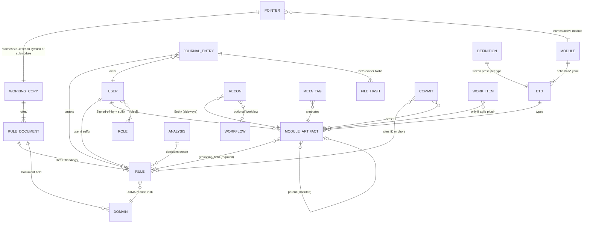

### 2.2 catalyst repository layout (what an installer reads)

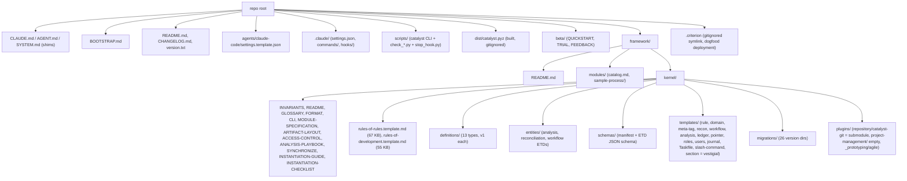

### 2.3 Deployed working copy (what `catalyst init` actually writes)

```mermaid
flowchart TD
    P["product repo root"] --> PTR["app-name.catalyst (tracked)"]
    P --> GI[".gitignore gets /.criterion"]
    P --> SYM[".criterion symlink (if --at)"]
    P --> CMD[".claude/commands/*.md (if --commands-dir)"]
    SYM --> WC["working copy (own git repo)"]
    WC --> D1["CODE-OF-CONDUCT.md (composed)"]
    WC --> D2["ACCESS-CONTROL.md (composed)"]
    WC --> D3["ANALYSIS-PLAYBOOK.md (copied)"]
    WC --> D4["DEPLOYMENT.md, README.md, version.txt"]
    WC --> D5["Taskfile.common.yml, composition.json"]
    WC --> D6["bin/catalyst.pyz"]
    WC --> D7["definitions/ (flat, frozen)"]
    WC --> D8["modules/module-id/ (whole module)"]
    WC --> RU["rules/ (Rules-of-Rules.md, rules.md, rule docs, templates/, domains/)"]
    WC --> RC["reconciliations/"]
    WC --> WF["workflows/"]
    WC --> AN["analyses/ (missing from GUIDE tree and ARTIFACT-LAYOUT)"]
    WC --> IAM["IAM/users, IAM/roles (json + templates-user.md / templates-role.md)"]
    WC --> DEV["development/ (journal.jsonl, meta-tags/, module folders with location: development)"]
    WC --> MF["module folders at root (ETD with no location)"]
    WC -.-> NOTINV["NOT deployed: INVARIANTS.md (kernel)"]
```

### 2.4 Install flow, `BOOTSTRAP.md` §2 end to end (with the traps)

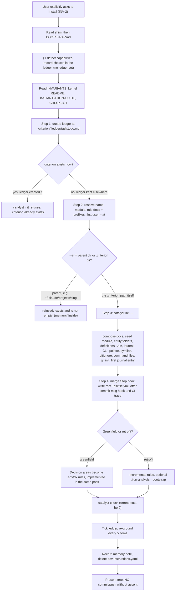

### 2.5 Session-start flow: catalyst repo vs a deployed project

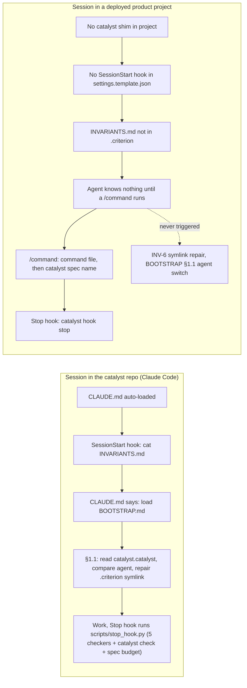

### 2.6 Invariant grouping (with overlap edges)

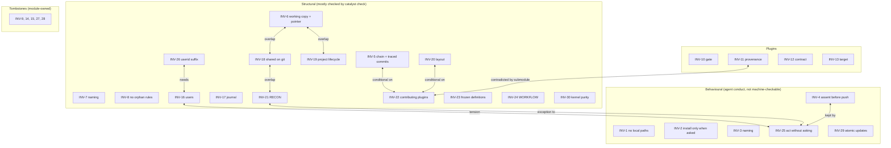

### 2.7 Module loading and composition

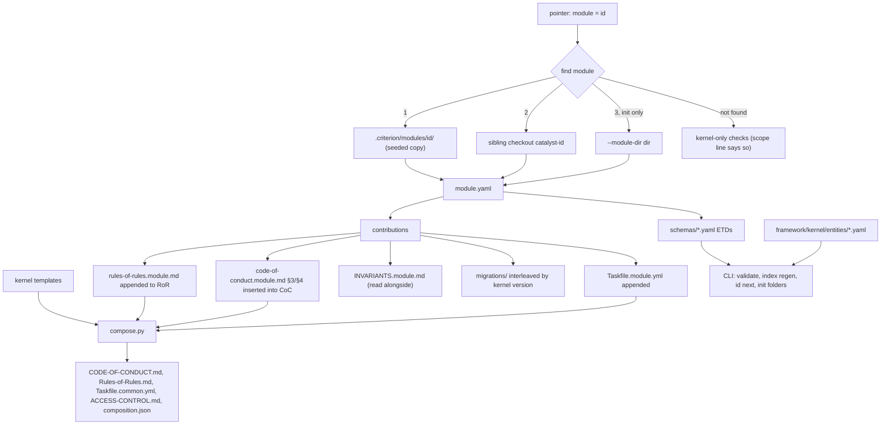

### 2.8 Access control and roles

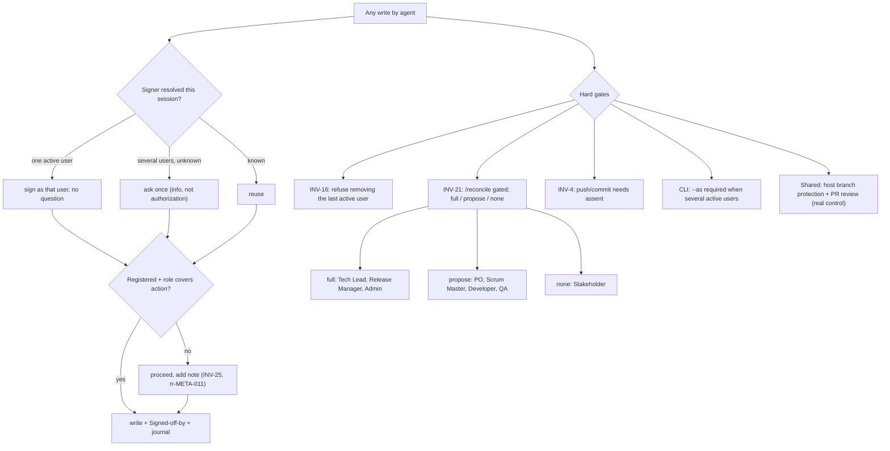

### 2.9 Artifact lifecycle states (kernel ETDs) and their contradictions

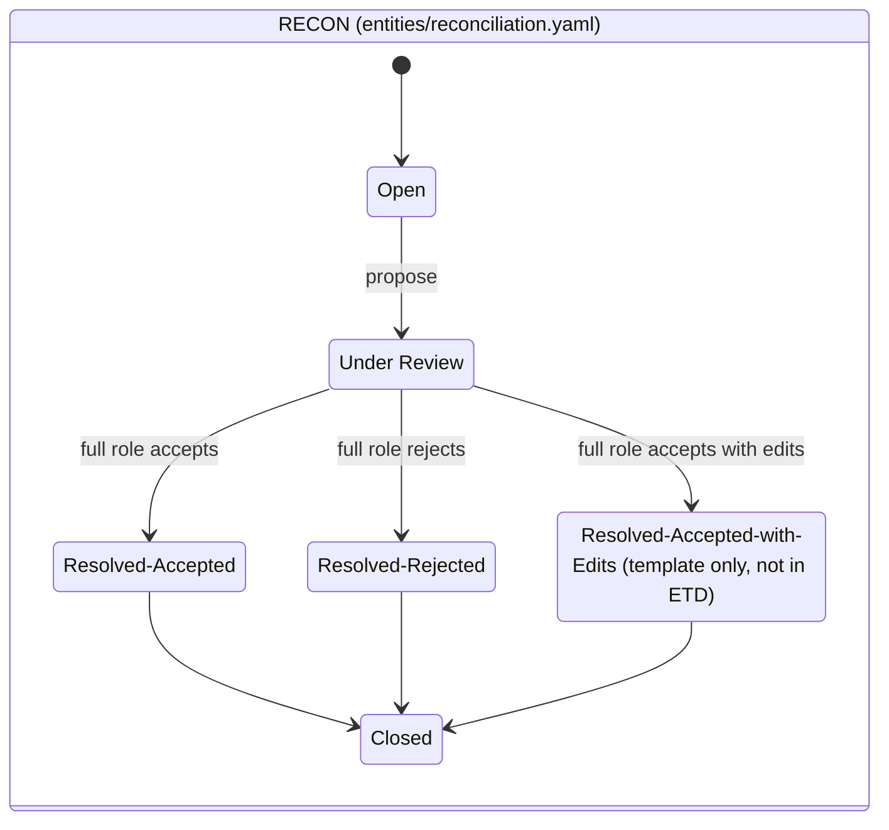

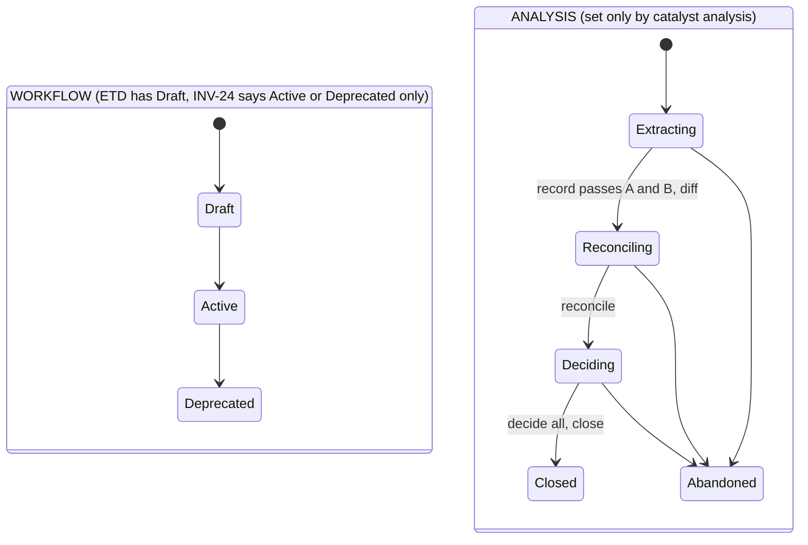

### 2.10 Agent-agnostic layering (claimed vs actual)

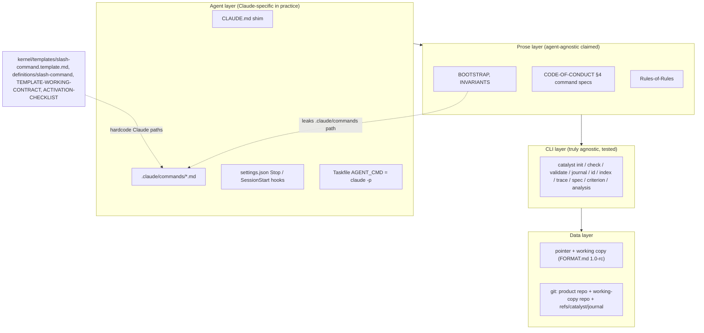

### 2.11 Doc-reading graph (who points to whom; red = duplicated content)

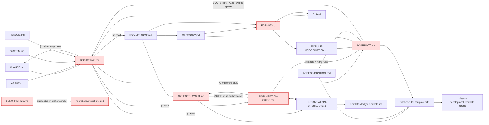

### 2.12 Change, journal and commit trace sequence

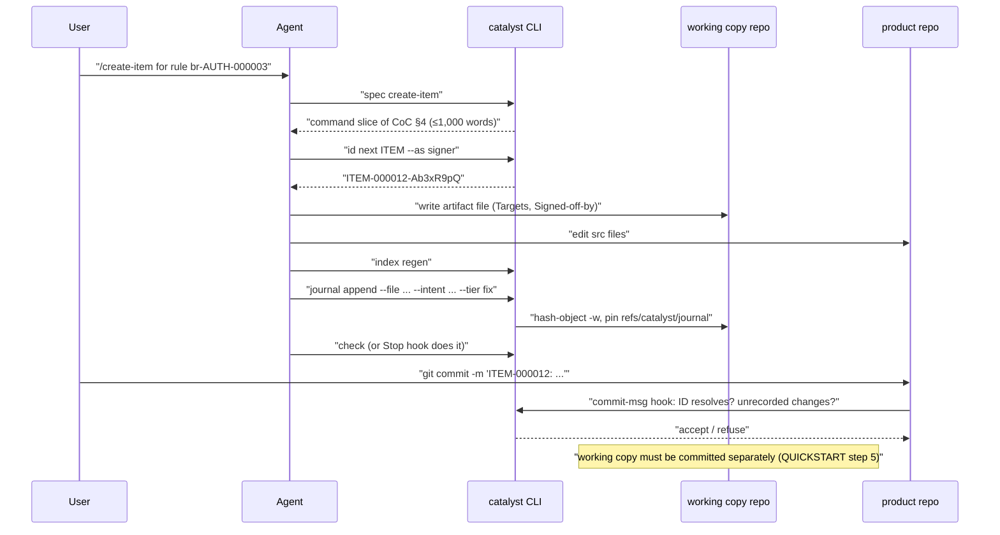

### 2.13 Plugin activation path

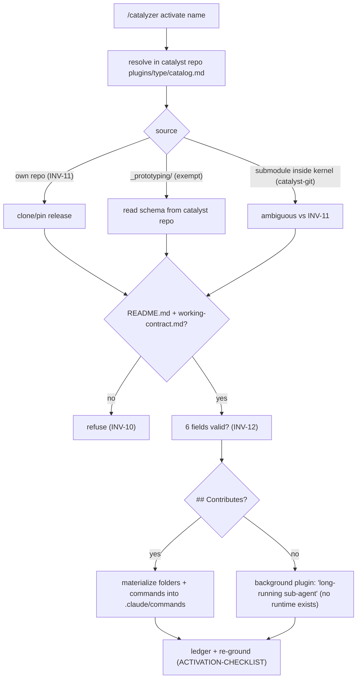

### 2.14 Version churn: how INV-6 (the working-copy location) moved

```mermaid
flowchart LR
    v010["≤0.10: .catalyst-proj/ in project"] --> v011["0.11: agent-owned space + pointer with agent-source path"]
    v011 --> v014["0.14: renamed to .criterion, thingamabob renamed criterion"]
    v014 --> v019["0.19: Taskfile.common into .criterion"]
    v019 --> v037["0.37: pointer holds no path, gitignored symlink"]
    v037 --> v039["0.39: shared = git submodule, PRs, per-user branches withdrawn"]
    v039 --> v043["0.43: create without URL = local git"]
    v043 --> v045["0.45: nested deployments, .catalystignore"]
```

---

## 3. Token cost analysis

### 3.1 Per-document size

| Document | Bytes | ≈ Tokens | Who reads it, when |
|---|---:|---:|---|
| `CLAUDE.md` | 4,825 | 1,206 | Auto-loaded by Claude Code in the catalyst repo, every session |
| `AGENT.md` | 1,454 | 364 | Generic agents, every session |
| `SYSTEM.md` | 855 | 214 | System-prompted model |
| `BOOTSTRAP.md` | 13,633 | 3,408 | Every session in the catalyst repo (shim says so); install |
| `framework/kernel/INVARIANTS.md` | 19,020 | 4,755 | SessionStart hook (catalyst repo); install (again); every re-ground |
| `<module>/INVARIANTS.module.md` (software-engineering 2.3.1) | 4,933 | 1,233 | "Read together" (install checklist, re-ground implied) |
| `framework/kernel/README.md` | 10,287 | 2,572 | Install (BOOTSTRAP §2) |
| `INSTANTIATION-GUIDE.md` | 24,431 | 6,108 | Install |
| `INSTANTIATION-CHECKLIST.md` | 6,856 | 1,714 | Install; every re-ground |
| `templates/ledger.template.md` | 1,215 | 304 | Install |
| `framework/modules/catalog.md` | 602 | 150 | Install (pick a module) |
| `CLI.md` (whole / `init` section only) | 43,678 / 2,622 | 10,920 / 656 | Install, referenced from every doc |
| `FORMAT.md` | 26,011 | 6,503 | Reference; not on the mandatory path |
| `GLOSSARY.md` | 11,947 | 2,987 | Reference (a confused smaller model will open it) |
| `MODULE-SPECIFICATION.md` | 11,582 | 2,896 | Reference |
| `ARTIFACT-LAYOUT.md` | 7,544 | 1,886 | Reference |
| `ACCESS-CONTROL.md` | 7,897 | 1,974 | Deployed; signer questions |
| `SYNCHRONIZE.md` | 27,587 | 6,897 | `/sync-framework` |
| `ANALYSIS-PLAYBOOK.md` | 10,641 | 2,660 | `/run-analysis` |
| `rules-of-rules.template.md` | 66,805 | 16,701 | Source of deployed RoR |
| `rules-of-development.template.md` | 54,913 | 13,728 | Source of deployed CoC |
| Deployed `Rules-of-Rules.md` (catalyst dogfood) | 90,995 | 22,749 | Rule authoring (greenfield/retrofit first rules) |
| Deployed `CODE-OF-CONDUCT.md` (catalyst dogfood) | 81,185 | 20,296 | Fallback when the spec "points elsewhere" |
| `catalyst spec <cmd>` output | ≤ ~5,200 (1,000 words) | ≤ ~1,300 | Every slash command |
| `README.md` | 13,127 | 3,282 | Humans; agents sometimes |
| `beta/QUICKSTART.md` | 7,771 | 1,943 | Humans (trial) |
| Total in-scope prose (kernel `*.md` + root + beta) | ~394,000 | ~98,600 | |

### 3.2 Cost to bootstrap a session

| Scenario | Documents loaded | ≈ Tokens | Duplicated content |
|---|---|---:|---|
| **Claude Code, catalyst repo** (auto) | `CLAUDE.md` 1,206 + memory index 596 + SessionStart `INVARIANTS.md` 4,755 | 6,557 | — |
| … then as instructed | `BOOTSTRAP.md` 3,408 + pointer 112 | **10,077 total** | BOOTSTRAP §0 (~1,100 t) re-says INV-1–6, 7, 10–11, 25. `CLAUDE.md` re-says the init command line from BOOTSTRAP §2 and GUIDE step 4 (~400 t). About **15% of the start budget is duplication**. |
| … with module invariants "read together" | + `INVARIANTS.module.md` 1,233 | 11,310 | Module INV-5/16/26 "(module part)" partly restate the kernel's |
| **Claude Code, deployed product project** | Nothing from catalyst (no shim, no SessionStart, no `INVARIANTS.md` in `.criterion`) | **0** | n/a. Cheap but ungrounded (see G-02). |
| … per slash command | command file (~200–300 t) + `catalyst spec` (≤1,300 t) | ~1,500 per command | Every command file repeats the same boilerplate (`catalyst <args>` is `python3 ...`, "do not push") |
| **Generic agent (AGENT.md path)** | `AGENT.md` 364 + `BOOTSTRAP.md` 3,408 + (implied) INVARIANTS 4,755 | 8,527 | Same as above |

### 3.3 Cost to install

| Phase | Reads | ≈ Tokens |
|---|---|---:|
| Entry (Claude Code, catalyst repo) | CLAUDE + SessionStart INVARIANTS + BOOTSTRAP | 9,369 |
| BOOTSTRAP §2 "read first" | INVARIANTS **again** 4,755 + kernel README 2,572 + GUIDE 6,108 + CHECKLIST 1,714 | 15,149 |
| Implied while executing | ledger template 304 + module catalog 150 + `INVARIANTS.module.md` 1,233 + CLI `init` section 656 + settings template 53 | 2,396 |
| **Mechanical minimum** | | **≈ 26,900** |
| Re-grounding (BOOTSTRAP §3) | (INVARIANTS 4,755 + CHECKLIST 1,714 [+ module 1,233]) per re-ground × ⌈31 checklist items / 5⌉ = 7 | 45,300 – 53,900 |
| **Realistic install with the mandated re-grounds** | | **≈ 72,000 – 81,000** |
| First rules (greenfield/retrofit) | deployed `Rules-of-Rules.md` §2/§3/§6/§7 (agent usually reads it all) + CoC §9 | +20,000 – 43,000 |
| **Install + first rules, fully read** | | **≈ 92,000 – 124,000** |

Observations:

- **INVARIANTS.md is read at least 2 + 7 = 9 times during one install**
  (SessionStart, BOOTSTRAP §2, and every 5 items). That is about 43k
  tokens for a file whose own header says "keep this file short".
  Roughly 45% of it (INV-17 tail, 18, 19, 21, 22, 24, 10–13) has nothing
  to do with installing.
- The re-ground cadence rereads the *whole* checklist (40 lines) when
  only the next unchecked items matter.
- Hard-rule text appears in **four** places on the install path
  (INVARIANTS, BOOTSTRAP §0, GUIDE §1 blockquote, CLAUDE.md), worth
  about 2,000 tokens of pure repetition per pass.
- The layout tree appears in **four** variants: GUIDE §1 step 4,
  ARTIFACT-LAYOUT, FORMAT §2, and `init.py`'s own output. They disagree
  (see G-08).
- `catalyst spec` (≤1,300 tokens per command, against ~43k for both
  composed documents) is the one place token economy was designed in. The
  install path has no equivalent (`catalyst spec install` does not exist).

---

## 4. Gaps, bugs, inconsistencies, ambiguities, over-engineering

Severity: **H** = an agent following the docs literally fails or does
the wrong thing; **M** = contradiction or drift that misleads or adds
cost; **L** = cosmetic, or a stale reference.

### A. Install path

**G-01 (H) Following BOOTSTRAP §2 literally, the ledger makes `catalyst init` refuse.**
BOOTSTRAP §2 step 1 creates the ledger *before* step 3 runs init. §3
says to put it at `.criterion/.ledger/<task>.todo.md`, and so does the
ledger template ("Deploy to `.criterion/.ledger/<task>.todo.md`").
`scripts/catalyst/init.py:171-172` refuses with `"{project}/.criterion
already exists"`. With `--at`, it also refuses when the target is
non-empty (`"exists and is not empty"`). BOOTSTRAP §1 even says "Record
the choices in the deployment ledger (§3)" before any install has started.
*Fix:* create the ledger after init (step 3.5), or keep it outside
`.criterion` until init runs. Better still, give `init` a
`--ledger <task>` option that seeds the ledger from the checklist.

**G-02 (H) A deployed project has no session-start grounding at all.**
`CLAUDE.md` says "its `SessionStart` hook re-injects `INVARIANTS.md`".
That is true only in the catalyst repository (`.claude/settings.json`).
`agents/claude-code/settings.template.json`, which is what gets merged
into a product project, has only `Stop`. `init` deploys no
`INVARIANTS.md` into `.criterion/` (verified: `ls .criterion`) and writes
no shim into the product. So INV-6's "repairs [the symlink] at install,
`/project import` and every session start" and BOOTSTRAP §1.1 ("When an
agent starts a session...") have **no trigger** in a deployed project.
The "re-read INVARIANTS.md every 5 items" rule also has no file to read
without the catalyst checkout.
*Fix:* deploy `INVARIANTS.md` (kernel plus module) into `.criterion/`. Add
a `SessionStart` entry to the template running a new `catalyst hook
start` that prints the invariants, repairs the symlink and runs the
agent-switch check. Make the CHECKLIST include it.

**G-03 (H) `--at` semantics are ambiguous: parent directory or the `.criterion` directory itself?**
`CLAUDE.md` passes `--at ~/.claude/projects/<slug>/.criterion`, which is
the working copy itself. `INSTANTIATION-GUIDE.md` step 3 calls `--at
<dir>` "the agent-owned location ... a per-project data directory the
running agent already maintains". Its tree shows `<agent-owned
location>/.criterion/`, which reads as the parent. `init.py` uses `--at`
*as* the working-copy root and does not check that the name is
`.criterion` (contrary to INV-6, "always named `.criterion/`"). An agent
that follows the GUIDE passes `~/.claude/projects/<slug>`. That directory
is non-empty (it holds `memory/`), so the install is refused, or, if it
happens to be empty, the agent's whole project directory becomes the
working copy.
*Fix:* rename the flag `--working-copy-dir`, require its basename to be
`.criterion` (or append `.criterion` automatically), and update the
GUIDE wording.

**G-04 (M) The default project name differs in three places.**
BOOTSTRAP §2: "defaulting to the repository name". GUIDE §1 step 2: "use
the current project root directory name as the default". CHECKLIST:
"defaults to target repo name". These differ for subfolder projects,
which 0.45.0 explicitly supports.
*Fix:* one sentence, in one place.

**G-05 (M) Retrofit step 1 says init gives "an empty `rules/domains/` directory".**
In fact init writes `rules/domains/{README.md,domains.md,templates/}`
(`init.py` `_type_folder(root, "rules/domains", ...)`).
*Fix:* say "an empty domains index".

**G-06 (M) Retrofit step 4: "top-level bullets get `NNN`".**
That is a 3-digit sequence. Rule numbers are 6-digit since 0.26.0
(INV-26, `rr-META-003`, FORMAT §5.2).
*Fix:* `NNNNNN`, allocated with `catalyst id next-rule`.

**G-07 (M) Retrofit step 6 tells the agent to write `> Instantiates [...](../../framework/kernel/rules-of-rules.template.md)` into project files.**
That relative path does not exist from a working copy in agent-owned
space, and it is a local-path reference to catalyst (INV-1).
*Fix:* cite "catalyst repository, `framework/kernel/rules-of-rules.template.md` @ vX" as text, not as a link.

**G-08 (M) Four layout descriptions, none matching what init writes.**

| Item | `init.py` | GUIDE §1 tree | ARTIFACT-LAYOUT | FORMAT §2 |
|---|---|---|---|---|
| `analyses/` | yes (`KERNEL_TYPES`) | **no** | **no** | yes |
| `ANALYSIS-PLAYBOOK.md` | yes | **no** | **no** | yes |
| `composition.json` | yes | **no** | **no** | yes |
| `bin/`, `definitions/`, `Taskfile.common.yml`, `ACCESS-CONTROL.md` | yes | yes | **no** | yes |
| IAM catalog name | `templates-user.md` / `templates-role.md` | — | `templates-users.md` / `templates-roles.md` | — |
| `modules/<id>/skills/` etc. | whole tree | whole tree | fixed list | whole tree |

ARTIFACT-LAYOUT calls itself "the canonical, illustrative tree" and in
the next sentence says the GUIDE is "authoritative".
*Fix:* generate ARTIFACT-LAYOUT from `init` (a `catalyst init --dry-run
--tree`), delete the GUIDE's copy, and fix the IAM catalog name in one
direction.

**G-09 (L) The init report says "5 kernel" entity folders; there are 6.**
`init.py:277` hardcodes 5, but `KERNEL_TYPES` has rules, domains,
reconciliations, workflows, analyses and meta-tags.
*Fix:* `len(KERNEL_TYPES)`.

**G-10 (M) BOOTSTRAP §1 hand-maintains a command shortlist, against its own rule.**
`CLAUDE.md` says "never hand-maintain a shortlist elsewhere, it drifts".
GUIDE step 5 says "never re-enumerate a subset of it anywhere else". Yet
`BOOTSTRAP.md:90` lists ~32 commands. The list has already drifted: it
omits `/adopt` and includes `/create-workflow`, which INV-24 says does
not exist.
*Fix:* replace it with "the commands in the deployed `CODE-OF-CONDUCT.md`
§4 (`catalyst spec` lists them)".

**G-11 (M) BOOTSTRAP §1 is written as an install step but used every session.**
"Before installing, establish which of these you have ... State, in one
line to the user, which mode you resolved to". In the catalyst repo,
`CLAUDE.md` loads BOOTSTRAP on every session, so a smaller model
announces capability modes and records them in a ledger that does not
exist, even when nobody asked for an install.
*Fix:* split BOOTSTRAP into "session" (§0, §1.1) and "install" (§1, §2,
§3), and load the install half only on request.

**G-12 (L) `dev-instructions.yaml` is a legacy relic with destructive cleanup.**
The step reads `name`, warns about an unused `layout` key, then deletes
the file. With INV-25 ("act without asking"), the agent deletes a
possibly-tracked user file without asking. That product change is also
not journaled, so after `journal_since` it becomes an unrecorded change.
*Fix:* drop the mechanism (`init --name` covers it), or ask before deleting.

**G-13 (M) The judgment and mechanical steps are numbered three different ways.**
BOOTSTRAP §2 has 7 steps, GUIDE §1 has 11, and the CHECKLIST has
sections that cite "GUIDE §1 steps 1–3 / 4 / 5–8". GUIDE §3 step 1 says
"run the install (§1 steps 2–5) before step 2 below", but GUIDE §1
step 1 (rule documents) must also come before init. A smaller model
cannot tell which list is authoritative.
*Fix:* make the CHECKLIST the only procedure and turn the GUIDE into
rationale only. Each checklist line then carries its own command.

### B. Contradictions between documents

**G-14 (H) Role mismatch: "prompts for confirmation" vs "never asks".**
`README.md:107-109`: "a mismatch prompts for confirmation rather than
blocking". INV-16, INV-25 and `ACCESS-CONTROL.md` §3: "No step here ever
produces a confirmation prompt or a refusal".
*Fix:* correct the README.

**G-15 (H) The rules-of-rules template preamble contradicts INV-8 and FORMAT §5.**
`framework/kernel/rules-of-rules.template.md:13-19`: "be stored as its
own markdown file in that directory ... exactly one template file at
`{{RULES_DIR}}/TEMPLATE-RULE.md`". INV-8 requires
`rules/templates/TEMPLATE-RULE-vN.md`, never at the root. FORMAT §5:
rules are headings inside rule documents. The dogfood deployment's copy
was hand-patched differently (`.criterion/rules/Rules-of-Rules.md`
lines 15–22), which shows the template drifted and was not recomposed.
`templates/rule.template.md` also describes "one concrete rule file per
rule", with `Type`/`Targets` metadata no rule heading has.
*Fix:* rewrite the preamble and `rule.template.md` to match FORMAT §5.
Add a `recompose --check` to CI.

**G-16 (M) WORKFLOW status set.**
INV-24 and `templates/workflow.template.md`: `Active`/`Deprecated`.
`entities/workflow.yaml`: `initial: Draft`, states Draft, Active and
Deprecated. `framework/kernel/README.md:71-73`: workflows are "optional,
per agile flavor" (pre-0.23 wording).
*Fix:* pick one set and fix the kernel README.

**G-17 (M) RECON status set.**
The template's Status includes `Resolved-Accepted-with-Edits`. The ETD
`allowed_values` does not, so `validate` emits `enum-value` on every
accept-with-edits. The definition (`DEFINITION-RECONCILIATION-v1.md`)
still says cases open "when `/criterion push`'s vet+merge step can't
cleanly reconcile ... a vetting-flagged semantic clash". That vet+merge
step was withdrawn in 0.39.0.
*Fix:* add the state to the ETD and issue `DEFINITION-RECONCILIATION-v2`.

**G-18 (M) The sample module violates the chain invariant it is meant to test.**
`framework/modules/sample-process/module.yaml`: `grounding_type:
policy`, and `schemas/policy.yaml` has `grounding: none`. INV-5 and
BOOTSTRAP §0.5 say the grounding type is "a kernel rule". So either
modules may ground to non-rules (then INV-5, README and BOOTSTRAP are
wrong) or the sample is invalid. The sample is also incomplete per
MODULE-SPECIFICATION §2: no `version.txt`, `templates/`, `definitions/`,
`code-of-conduct.module.md` or `INVARIANTS.module.md`, and
`commands/create-policy.md` is missing although `module.yaml` references
it. It has an undocumented `ui/`. Its `TASK` prefix collides with the
agile schema's `TASK-` (INV-22).
*Fix:* decide whether `grounding_type` must be `rule`, then complete or
remove the sample.

**G-19 (M) INV-26's rule-signer limitation is stale.**
"the sole or most-recently-active registered user is used for a rule's
suffix (`rr-META-020`'s documented limitation)" (also
`rules-of-rules.template.md:1150`). Today `catalyst id next-rule ...
--as <signer>` takes an explicit signer (`CLI.md:397`) and the GUIDE
step 10 uses `--as`.
*Fix:* drop the limitation from INV-26.

**G-20 (M) Hard-rule wording differs between copies.**
INV-3 "Always 'catalyst'" vs BOOTSTRAP §0.3 and GUIDE "After the first
install". INV-4 covers "no target-repo commit" while BOOTSTRAP §0.4
covers only push. INV-5 includes traced commits; BOOTSTRAP §0.5 does
not. INVARIANTS says "BOOTSTRAP §0 mirrors it", but it mirrors 9 of 30.
*Fix:* BOOTSTRAP §0 should contain only "read INVARIANTS.md", or be
generated from it.

**G-21 (M) INV-11 vs reality.**
"no plugin is sourced from the framework repository", yet `catalyst-git`
is a git submodule at `framework/kernel/plugins/repository/catalyst-git`
(`.gitmodules`; its key still says the old path `plugins/repository/catalyst-git`).
`_prototyping/` is an explicit exemption that INV-11 itself does not
mention (only INV-22 does).
*Fix:* state the actual rule: "plugins are pinned by catalog; source of
truth is their own repo; the kernel may carry a submodule pointer."

**G-22 (M) INV-12: "The framework reads `Active` at startup to decide what loads".**
No code reads `Active`: `grep` finds it only in `check_plugin_contracts.py`,
as a format check. "Startup" is undefined. A contract file that lives
in the plugin's own repository cannot hold per-deployment activation
state, and `catalyst-git`'s contract ships `Active: true` to everyone.
*Fix:* put activation state in the deployment (pointer or
`.criterion/plugins/active.json`) and remove `Active` from the contract.

**G-23 (M) INV-30 is violated where the checker does not look, and passes vacuously where the module is absent.**
`framework/README.md:8` names `catalyst-software-engineering`.
`check_kernel_purity.py` scans `framework/kernel`, `scripts` and root
`*.md`/`*.txt`, but not `framework/README.md`, `beta/` or
`catalyst.catalyst`. Its denylist comes from *sibling checkouts*: on a
fresh clone without the module it has nothing to check. The run produced
**272 warnings**, all English words ("Steps", "Features",
"Requirement"), which trains everyone to ignore it.
*Fix:* scan all of `framework/` and `beta/`, vendor a denylist snapshot,
and drop plain-English plural matches.

**G-24 (M) ACCESS-CONTROL states things that are not true of the code.**
"deployed verbatim", but init calls `compose.access_control(kernel,
params)`. It refers to "`agent`/`chatAgents`", but `chatAgents` exists
in no format or template (undefined term). "Two genuinely enforced
exceptions" leaves out INV-4, the INV-19 force confirmations, and the
CLI's refusal to guess the signer with several active users (§5 itself).
*Fix:* list every hard gate and drop `chatAgents`.

**G-25 (M) The pointer in catalyst's own repo contradicts FORMAT §1.**
`catalyst.catalyst`: `"repoed": false` together with `catalyst_repo_url:
"git@github.com:oliben67/criterion.git"` and `criterion_branch:
"criterion"`. FORMAT: the URL is set "when shared"; `null` branch means
the default. The dogfood deployment is in an undefined state.
`catalyst_repo` vs `catalyst_repo_url` naming: both describe the
*criterion* repository, not catalyst.
*Fix:* rename to `criterion_repo_url` with a migration, and have `check`
flag `repoed:false` combined with a URL.

**G-26 (M) Slash commands: `/criterion get` vs CLI `criterion join`.**
README, GLOSSARY and BOOTSTRAP use `/criterion get`. `CLI.md`, TRIAL and
CHANGELOG use `join`. A newcomer cannot map the two.
*Fix:* one verb.

**G-27 (L) The kernel README's chain diagram lists `TAG-` as a dev-artifact prefix and `SPRINT` as a child of STORY.**
Meta-tags are stored as `tag-<key>-<id>` (lowercase, GLOSSARY). Sprints
are containers, not children (`README.md:63` has the same shape).
*Fix:* redraw.

### C. Dead or wrong references

**G-28 (M) References use deployed file names from repo-side docs.**
Kernel docs cite `Rules-of-Rules.md §N` and `CODE-OF-CONDUCT.md §N` (the
deployed names). A reader in the catalyst repo has only
`rules-of-rules.template.md` and `rules-of-development.template.md`. The
GUIDE §2 cites "`rules-of-development.md` §1", a third name that exists
nowhere. So does `plugins/TEMPLATE-WORKING-CONTRACT.md` ("the minimum
metadata `rules-of-development.md` requires").
`templates/slash-command.template.md` cites "`Rules-of-Rules.md` INV-4",
but INV-4 is in INVARIANTS, not RoR.
*Fix:* one addressing scheme: `rr-META-NNN` / `CoC §N` with a lookup
table in GLOSSARY, and fix the three wrong names.

**G-29 (L) Case-broken link: `INSTANTIATION-GUIDE.md:432` links to `analysis-playbook.md`.**
The file is `ANALYSIS-PLAYBOOK.md`; the link breaks on case-sensitive
filesystems and on GitHub.

**G-30 (M) The kernel README links to the dogfood working copy, which is not in git.**
`framework/kernel/README.md` links `../../.criterion/` twice and cites
`rules/framework/fw-framework-rules.md` as evidence that every invariant
is retrofitted into a rule. `.criterion` is a gitignored symlink into
`~/.claude/projects/...`. On any clone the link is dead and the
evidence is unverifiable.
*Fix:* publish the dogfood deployment (it already has a criterion URL)
or remove the claim.

**G-31 (M) SYNCHRONIZE's migration list has drifted from `migrations.md`.**
SYNCHRONIZE "Version-specific one-time migrations" ends at "From
`0.40.0`" (target 0.41.0). `migrations.md` has 0.42.0, 0.44.0 and 0.45.0.
`migrations/README.md` says SYNCHRONIZE "points to" migrations "so the
detailed procedure lives in one place", but the summaries are duplicated
and stale.
*Fix:* SYNCHRONIZE should say "apply every row of `migrations.md` whose
From ≥ deployed version", with no per-version prose.

**G-32 (L) The dogfood deployment's composed header is stale.**
`.criterion/rules/Rules-of-Rules.md:1-5` says "kernel 0.42.0" and module
"(v2.2.0)", while the deployment is at 0.45.0 with module 2.3.1. There
is no `composition.json` (pre-init install), so `recompose` must
re-parse.
*Fix:* stamp the header from `recompose`, and have `check` compare it
with `version.txt`.

**G-33 (L) `templates/README.md` is stale.**
users.template.json "deployment isn't complete until `/user-add` has
registered at least one active user" (init does this now). "Copy the
appropriate template ... and rename it" (init does this now).
`section.template.md` is shipped though "vestigial and unused"
(`definitions/README.md`). `definitions/README.md` omits `analysis` from
"Entity types covered".
*Fix:* delete `section.template.md` and update both READMEs.

**G-34 (L) The kernel README's file table is incomplete.**
It omits `INVARIANTS.md`, `ACCESS-CONTROL.md`, `ANALYSIS-PLAYBOOK.md`,
`INSTANTIATION-CHECKLIST.md`, `definitions/`, `entities/` and `plugins/`,
which are among the most important files.

### D. Undefined terms, jargon, and things a smaller model will trip on

**G-35 (M) Jargon load.**
A reader meets, without inline definition: *criterion* (4 meanings),
*catalyzer*, *repoed*, *shim*, *seam*, *re-ground*, *ledger*, *four-eyes*,
*tier*, *grounding type*, *ETD*, *pin*, *adopt*, *baseline*, *dogfood*,
*frozen* (2 meanings), *RECON-*, *rr-META-NNN* vs `rr-META-0000NN-<userid>`
(two spellings of the same ID), *INV-N* tombstones, *RM-000026*
(an ID from catalyst's private deployment, cited in `beta/TRIAL.md`),
*thingamabob* (migrations index). `GLOSSARY.md` misses *shim*, *seam*,
*Admin*, *DEPLOYMENT.md*, *composition.json*, *recompose*,
*greenfield/retrofit*, *TAG-*, *chatAgents*.
*Fix:* add the missing glossary terms and replace project-internal IDs
(RM-, rr-META-023) with a short name plus the ID.

**G-36 (M) Two numbering schemes for one meta-rule.**
Templates and most kernel prose say `rr-META-023`. Deployed, signed IDs
are `rr-META-000023-<userid>` (`compose.py:16,42`). Sections are also
"§23". INV-29 cites "`Rules-of-Rules.md` rr-META-023", which does not
match the deployed heading text exactly.
*Fix:* always write `§23 (rr-META-023)` and say once that deployment
signs it.

**G-37 (M) The rule-ID grammar allows a nested full ID.**
`rr-META-003`: the `[-parent-id]` "references that rule's full ID
(including its own `userid` suffix) as its own suffix", then the rule's
own userid follows. That gives `br-AUTH-000007-br-AUTH-000003-Ab3xR9pQ-Ab3xR9pQ`.
FORMAT §5.2's grammar `<doc-prefix>-<DOMAIN>-<NNNNNN>[-<parent>]-<userid>`
does not define `<parent>`. FORMAT also admits sub-domain rule headings
"are not recognised ... an open item".
*Fix:* restrict parent to `-<n>` sub-items and express specialisation as
a `Parent:` field.

**G-38 (M) "Name" is mandatory everywhere, retroactively.**
`rr-META-003` "Name format": "every rule name and development entity
must carry ... **Name** field ... must also be applied retroactively to
existing deployed items during framework deployment or synchronization.
Existing names that are only the ID must be renamed". Rules have no
Name field in FORMAT §5. ETDs do not require `Name`
(`entities/*.yaml`). `DEFINITION-ENTITY-v1` claims a "mandatory or
canonical Name field". This invites mass renames on every sync that
nothing checks.
*Fix:* make `Name` an ETD field and check it, or drop the retroactive clause.

**G-39 (M) Behavioural rules that cannot be checked are stated as hard invariants.**
INV-1, 2, 3, 4, 13, 25 and 29 are conduct rules: no tool can verify them
from a tree. INV-29 depends on "explicitly stated before work begins".
That is unobservable unless it is journaled. Putting them on the same
footing as INV-7 or INV-17 dilutes the word "invariant".
*Fix:* split INVARIANTS into "checked by `catalyst check` (cite the
code)" and "agent conduct". Record "batched-update intent" as a journal
or ledger line so INV-29 becomes checkable.

**G-40 (M) Circular authority claims.**
INVARIANTS: "this file wins". BOOTSTRAP: "single source of truth".
GLOSSARY: "that document wins". ARTIFACT-LAYOUT: "canonical", then "GUIDE
is authoritative". ACCESS-CONTROL: "those remain the source of truth".
FORMAT: "what a conforming file looks like". A smaller model resolving
G-08 or G-16 has four documents each claiming precedence.
*Fix:* one precedence list (code/FORMAT > INVARIANTS > CoC/RoR > guides >
READMEs) stated once, in INVARIANTS.

**G-41 (M) Hardcoded Claude paths in the "agent-agnostic" kernel.**
`definitions/slash-command/DEFINITION-SLASH-COMMAND-v1.md` defines the
entity as "`.claude/commands/<name>.md`". `TEMPLATE-WORKING-CONTRACT.md`
and `ACTIVATION-CHECKLIST.md` deploy commands "into `.claude/commands/`".
`templates/slash-command.template.md` links `../../../CLAUDE.md`. The
Taskfile assumes `<bin> -p`. Since the definition is frozen once deployed
(INV-23), the Claude path is baked into every deployment's definitions.
*Fix:* use "the agent's command directory (`--commands-dir`)" everywhere,
and issue a v2 definition.

**G-42 (L) The quickstart and trial are tied to one specific module.**
`beta/QUICKSTART.md` uses `software-engineering` and `BUG`, which is
fine for a trial. But the kernel claims module-agnosticism, and
`beta/` is outside the purity scan (G-23). It is the de-facto
documentation of how to write a rule by hand: heredocs into
`rules/greeting-rules.md`, hand edits of `rules.md` and `domains.md`.
That shows rule authoring has **no CLI support**: `id next-rule` is the
only helper.
*Fix:* `catalyst rule add <doc> <DOMAIN> "<text>"` and `catalyst
domain add`, which would remove most of QUICKSTART step 3 and the RoR §7
prose.

### E. Over-engineering and churn

**G-43 (M) Shape churn.**
26 shape-changing migrations between 0.11.0 and 0.45.0. Versions
0.35.0 → 0.45.0 shipped in about 7 days (2026-09-25 → 2026-10-01).
`INVARIANTS.md` changed in 8 releases over those 5 days. INV-6 alone was
rewritten in 0.11, 0.14, 0.19, 0.37, 0.39, 0.43 and 0.45 (diagram 2.14).
`/sync-kernel` was added in 0.35.0 and withdrawn in 0.35.1. The
"identity migration" was added, then withdrawn. Any deployment more than
a week old has to replay many prose migrations by agent judgment.
*Fix:* a format freeze (the beta already aims for one), and executable
migrations (`catalyst migrate`) instead of prose plans.

**G-44 (M) The ceremony-to-value ratio is high for a mostly single-user tool.**
Every type folder carries `README.md`, an index, `templates/README.md`,
a timestamped catalog and `TEMPLATE-<T>-v1`: about 5 boilerplate files
× (6 kernel + 7 module types) ≈ 65 files before any content. There are
8 default Scrum-flavoured roles (Product Owner, Scrum Master...) whose
checks are advisory, in a kernel that declares agile "plugin-territory".
Frozen prose definitions exist for non-entities (`ledger`,
`slash-command`, `templates-catalog`, `journal`). A RECON, WORKFLOW and
plugin system exists while `/create-workflow` does not, no
content-contributing plugin exists, and the only background plugin
describes a "long-running sub-agent" polling `git status`, which no
supported agent runtime can host.
*Fix:* keep `templates/` only where more than one version exists. Ship
2 roles (Admin, Contributor) and leave the rest to modules or plugins.
Move the plugin and agile prototyping text out of the kernel until a
plugin exists.

**G-45 (M) `INVARIANTS.md` is not lean.**
At 19 KB (≈4.8k tokens) its header says "Keep this file short ... A
bloated invariants file decays faster". INV-6, 17, 18, 20, 21, 22 and 26
are paragraph-length specifications with history ("Pre-0.37.0 pointers
may still carry `agent-source`", "Reverses the exception 0.12.0
introduced"). Combined with G-02 and the re-ground cadence, this is the
largest single token sink (§3.3).
*Fix:* one line per invariant (≈1.5k tokens total); move the mechanics
to FORMAT, CLI and RoR, and the history to CHANGELOG.

**G-46 (L) Taskfile dispatch spawns a headless agent per command.**
`task user-add` runs `claude -p "/user-add ..."`: a whole agent session
to add a JSON row that the CLI could write. `AGENT_ID` is parsed out of
JSON with `grep`/`sed`. The "claude-code → claude" special case is
hardcoded in every project's root `Taskfile.yml`.
*Fix:* map mechanical commands to `catalyst ...` directly, and use agent
dispatch only for judgment commands.

**G-47 (L) The memory note stores local paths.**
GUIDE §6 has it record "the deployed project path" and "where the
`.criterion` symlink points on this machine". INV-1 forbids local paths
only "when referring to catalyst", so this is technically allowed but
confusing next to "never written into a tracked file".
*Fix:* state the INV-1 scope precisely (user-facing references to
catalyst's own location).

**G-48 (M) The working copy is a separate git repository that nobody tells you to commit.**
`init` runs `git init` and makes the first commit. After that, every
journaled change to the working copy stays uncommitted until someone
runs `git -C .criterion commit` (QUICKSTART step 5: "nothing you record
in it is kept there until you commit it"). No local-only procedure in
BOOTSTRAP, GUIDE or CHECKLIST mentions this, and INV-4 ("no target-repo
commit without assent") makes it unclear whether the agent may commit
the working copy. Journal `before`/`after` hashes are pinned, but the
working tree history is not.
*Fix:* say explicitly whether working-copy commits are agent-autonomous
(INV-25) or assent-gated (INV-4), and add `catalyst commit` for the
local-only case.

---

## 5. Summary of priorities

1. **Fix the install path** (G-01, G-03, G-13): an agent following the
   documents literally can hit `init` refusals twice.
2. **Ground deployed sessions** (G-02): today grounding exists only in
   catalyst's own repository. Deploy the invariants and add a
   SessionStart hook.
3. **Collapse duplication** (G-08, G-10, G-20, G-31, G-45): one
   invariants file of one-liners, one generated layout, one migration
   index. This would cut install reading by roughly 40–50k tokens.
4. **Reconcile the entity contradictions** (G-15, G-16, G-17, G-18,
   G-19): these will produce false `validate` warnings or wrong
   artifacts.
5. **Separate checkable invariants from conduct** (G-39, G-40) and
   publish a precedence order.
