# 01b — Kernel rules, processes and commands: a critical audit

> Read-only audit of catalyst `0.45.0` (`version.txt`), branch `development`,
> 2026-10-07. Slice: the kernel's **rules** (`framework/kernel/rules-of-rules.template.md`,
> `framework/kernel/rules-of-development.template.md`), its **processes**
> (`framework/kernel/SYNCHRONIZE.md`, `framework/kernel/ANALYSIS-PLAYBOOK.md`,
> `framework/kernel/CLI.md`), and its **commands** (all 38 files in
> `.claude/commands/`), cross-checked against `framework/kernel/INVARIANTS.md`,
> the software-engineering module's `code-of-conduct.module.md` /
> `rules-of-rules.module.md`, the CLI source (`scripts/catalyst/*.py`) and
> catalyst's own dogfooded deployment (`.criterion/`).
>
> Conventions: `RoR` = `rules-of-rules.template.md` (deployed as
> `rules/Rules-of-Rules.md`); `CoC` = `rules-of-development.template.md`
> (deployed as `CODE-OF-CONDUCT.md`); `SYNC` = `SYNCHRONIZE.md`; `PLAY` =
> `ANALYSIS-PLAYBOOK.md`; `SE` = the software-engineering module. Token
> estimates use ~4 characters or ~0.75 words per token. Every claim marked
> **verified** was checked by reading code or running a read-only command
> (`catalyst spec`, `grep`, `wc`).

---

## 0. Executive summary

1. **The spec extractor silently drops four module command procedures (verified).**
   `scripts/catalyst/spec.py`'s `MENTION` regex requires a backtick or whitespace
   after the command name; the SE module writes ``When the user enters `/create-bug: ...` ``
   with a colon, so `catalyst spec create-bug|create-req|create-requirement|create-test|create-feature`
   prints only the one-line bullet, and the actual procedure ends up in
   `catalyst spec --general`. The "canonical text" design is broken for the
   most-used artifact-creating commands.
2. **User/role commands never journal, but `catalyst init` journals `IAM/users/users.json`
   (verified in `scripts/catalyst/init.py`).** The next `catalyst check` therefore
   reports an `unjournaled` **error** after any `/user-add`, `/user-remove`,
   `/user-modify` or `/user-assign-role`, which the Stop hook turns into a forced
   repair loop. The rules contradict each other about whether these writes must be
   journaled (RoR §12 vs INV-17 vs the command files).
3. **`SYNCHRONIZE.md` is three migrations behind (verified).** Its
   "Version-specific one-time migrations" list stops at `0.41.0`; `0.42.0`
   (`journal_since`, `/adopt`), `0.44.0` (ANALYSIS entity, deploys `ANALYSIS-PLAYBOOK.md`)
   and `0.45.0` (workspace scope, hook reinstall) exist in `framework/kernel/migrations/`
   and `migrations.md` but not in the document the sync procedure tells the agent to follow.
4. **`/status` bypasses the only real access gate.** `rr-META-016` says RECON
   resolution is "genuinely gated by role"; `/status <RECON-id> Resolved-Accepted`
   (or anything, with `force`) has no role check and no signer resolution at all.
5. **The rules contradict themselves on basic shape**: rule storage (one file per rule
   in RoR §5 vs rule *documents* with bullets in §1/§2/§7, and catalyst's own deployment
   keeps every rule in one file), rule-template location (preamble vs §5/INV-8),
   rule ID width (6-digit in §3 vs `NNN`/`-004`/`rr-META-001` everywhere else),
   rule authorship (RoR §20 "most recent user" vs CLI `--as`), and the IAM file shape
   ("a JSON array" vs `{"users": []}`), and the roles shape (`reconciliation` field
   mandatory in RoR §11/§16, absent from CoC §2 and from what `/role-add` writes).
6. **Most of the 38 commands are deterministic CRUD wearing an LLM costume.** 19 of 38
   are mechanical end to end (users, roles, list, journal, freeze, status, project,
   switch-agent, migrate-definition, show-backlog, roadmap-remove, meta-tag...).
   Each costs an LLM ~1–3k tokens of instructions per call and risks malformed JSON;
   a `catalyst <noun> <verb>` would cost zero judgment tokens.
7. **Ceremony is heavy and unevenly enforced.** A typo is a "chore" with a stated
   tier, a journal entry hashing and pinning blobs, a traced commit (`chore:`), an index
   regen and a `catalyst check`. Meanwhile catalyst's own journal shows 64 of 173
   entries under ad hoc commands (`(direct correction)`, `(direct framework edit)`)
   and 47 under `/sync-framework`: the process the rules describe is mostly not the
   process being run.
8. **`/sync-framework` is the costliest process and the least mechanised.** The CLI
   has `catalyst recompose`, but `SYNCHRONIZE.md` never names it; renames, migrations,
   plugin-catalog merges and a mandatory four-eyes pair of sub-agents are all prose.
   Estimated 60k–200k tokens per sync.
9. **Dangling and wrong cross-references** abound: CoC §6 cites "RoR §5" (should be §6),
   PLAY cites "RoR §6" for domain files (§7), RoR §14 / CoC cite "hard rule 4/6" (from
   `BOOTSTRAP.md`, which is not deployed), PLAY cites "the kernel's analysis rule" (does not
   exist; `ANALYSIS-` is absent from RoR §15 and §20), the slash-command template cites
   "`Rules-of-Rules.md` INV-4".
10. **CoC has no rule IDs at all.** RoR has `rr-META-NNN`; CoC sections (§1–§9) are
    referenced by number only, so they cannot be cited from the journal's `targets`, from
    commits, or from `catalyst trace`. There is no `rd-*` family.

---

## 1. Corpus size and token economics

| File | Bytes | Lines | ≈ tokens | Read when |
|---|---:|---:|---:|---|
| `framework/kernel/rules-of-rules.template.md` | 66,805 | 1,213 | 16.7k | Composed at init/sync; deployed copy (+module) ≈ 12.7k words ≈ **17k tokens** |
| `framework/kernel/rules-of-development.template.md` | 54,913 | 908 | 13.7k | Composed; deployed `CODE-OF-CONDUCT.md` ≈ 11.5k words ≈ **15k tokens** |
| `framework/kernel/SYNCHRONIZE.md` | 27,587 | 507 | 6.9k | Every `/sync-framework` (fetched from the catalyst repo) |
| `framework/kernel/CLI.md` | 43,678 | 810 | 10.9k | Referenced by most specs; rarely needed in full |
| `framework/kernel/ANALYSIS-PLAYBOOK.md` | 10,641 | 216 | 2.7k | Every `/run-analysis` (read in full, mandated) |
| `framework/kernel/INVARIANTS.md` | 19,020 | 293 | 4.8k | Re-injected by the `SessionStart` hook (every session, every compaction) |
| `.claude/commands/*.md` (38 files) | 64,934 | — | 16.2k total, **~430 avg** | One file per invocation |
| `catalyst spec <cmd>` output | 115–875 words | — | **150–1,170** | First step of every command |
| `catalyst spec --general` output | 926 words | — | **1.2k** | Whenever a spec says "Rules for every command" |
| `.criterion/development/journal.jsonl` (catalyst's own) | 341,502 | 173 | **≈ 85k** | `/journal` tells the LLM to read it line by line |

**Per-command steady state** (simple CRUD command): command file (~430) + spec (~250) +
preamble pointer to `--general` (often followed: +1.2k) + CLI output (~100–500) + the
agent's own reasoning ≈ **2–4k tokens of instruction per call**, against a deterministic
operation that needs none. Commands that "open the sources in full when a judgment needs
it" jump to **+32k** (deployed CoC + RoR).

**Measured spec footprints** (`catalyst spec <cmd> | wc -w`, read-only, verified):

| Command | words | Command | words | Command | words |
|---|---:|---|---:|---|---:|
| catalyzer | 875 | criterion | 845 | project | 697 |
| sync-framework | 535 | adopt | 466 | run-analysis | 323 |
| show-backlog | 322 | create-step | 295 | migrate-definition | 278 |
| roadmap-add | 259 | roadmap-update | 254 | status | 247 |
| user-add | 241 | reconcile | 239 | journal | 229 |
| roadmap-remove | 228 | switch-agent | 220 | audit | 219 |
| commands | 219 | list | 211 | roadmap-merge | 211 |
| check-rules | 206 | user-remove | 203 | meta-tag | 200 |
| journal-restore | 187 | user-modify | 186 | freeze | 185 |
| user-assign-role | 179 | help | 178 | create-test | **167** |
| role-add | 164 | role-modify | 157 | user-list | 143 |
| create-feature | **126** | create-requirement | **118** | create-bug | **117** |
| create-req | **115** | dogfood | 7 (not in §4) | `--general` | 926 |

The four bolded create-* figures are artificially low: their procedures were mis-filed
into `--general` (issue G-01).

---

## 2. Rule-family map

There is exactly one ID'd rule family in the kernel (`rr-META-*`). CoC is a numbered
document without IDs. INVARIANTS are a third, overlapping family (`INV-*`). The module
adds sections under the same `rr-META` numbering and its own `INV-9/14/15/27/28`.

### 2.1 `rr-META-*` (RoR) — every section

| ID | Title (RoR) | Owner | Mechanically checked by | Duplicated in |
|---|---|---|---|---|
| rr-META-001 | Conflict check before adding a rule | kernel | none (judgment, `/check-rules`) | CoC §1, PLAY, module §3 |
| rr-META-002 | Gathered/implemented/tested/documented + status markers | kernel | none | — |
| rr-META-003 | Unique stable rule ID + `Name` field + retroactive renaming | kernel | `validate id-shape` (artifacts), `id next-rule` | INV-7, INV-26, CoC §6, SYNC step 9 |
| rr-META-004 | Retiring a rule (never delete/reuse) | kernel | `validate retired-target` (warn) | CoC §8 |
| rr-META-005 | Typed rule directories + per-rule file + indexes | kernel | `validate rule-unindexed` (rules.md only) | INV-8, RoR preamble |
| rr-META-006 | Dev-artifact ID scheme (+ stray "sync before work" paragraph) | kernel + module addendum | `validate id-shape`, `id next` | CoC §6, INV-26, module addendum |
| rr-META-007 | Defining a `##` domain / sub-domains | kernel + module addendum | `id next-rule` refuses unregistered domain | INV-7, INV-20 |
| rr-META-008 | Agile work items are plugin territory (+ stray version paragraph) | kernel | none | INV-22, CoC §4 bold paragraph |
| rr-META-009 | (placeholder) → module: FEAT scheme | module | `id next FEAT` | module CoC §3 |
| rr-META-010 | (placeholder) → module: RM roadmap scheme | module | `id next RM` | module CoC §3/§4 |
| rr-META-011 | Users and roles are advisory; userid generation | kernel + addendum | `userid gen`, `validate signer` | CoC §2, CoC §3, INV-16, INV-25, INV-26 |
| rr-META-012 | Journal: schema, restore, what must append | kernel + addendum | `journal append/verify/restore/pin` | CoC §4 ending, CoC §9, INV-17, CLI.md |
| rr-META-013 | Shared deployments (criterion submodule) + `/dogfood` scope | kernel + addendum | `criterion *`, CI | CoC §4 `/criterion`, INV-18, CLI.md |
| rr-META-014 | Agent-owned working copy, pointer, switching, `/project` | kernel | partly `init`; switching/export/import = prose | CoC §4 `/project` + `/switch-agent`, INV-6, INV-19 |
| rr-META-015 | Uniform artifact-type directory shape | kernel + addendum | `check` (structure) | INV-20, CoC §3 |
| rr-META-016 | RECON reconciliation; role-gated verbs | kernel + addendum | none for the gate | CoC §4 `/reconcile`, INV-21 |
| rr-META-017 | Content-contributing plugins | kernel | `scripts/check_plugin_contracts.py` (catalyst only) | INV-22, CoC `/catalyzer` |
| rr-META-018 | Recreation drift check (`/dogfood recreate`) | kernel (catalyst-only) | none | `.claude/commands/dogfood.md` |
| rr-META-019 | WORKFLOW entity | kernel + addendum | `validate` (ETD) | INV-24 |
| rr-META-020 | Entity IDs carry the signer's userid | kernel + addendum | `id next --as`, `validate id-shape` | INV-26, CoC §2 step 5, CoC §6 |
| rr-META-021 | (placeholder) → module: STEP | module | `validate closed-incomplete` (REQ only) | module CoC §3 |
| rr-META-022 | (placeholder) → module: TEST | module | `validate dangling-ref` | module CoC §3/§4 |
| rr-META-023 | Atomic, real-time artifact updates | kernel + addendum | none (unverifiable) | INV-29 |

Observations:

- **7 of 23 kernel rr-META sections are not about rules at all** (§11 users, §12 journal,
  §13 sharing, §14 working copy, §16 reconciliation, §17 plugins, §18 dogfood). RoR is a
  grab-bag "kernel spec"; "Rules of Rules" is a misnomer for 70% of its bytes.
- **4 numbers are placeholders** that the module re-fills under the same `## N.` heading,
  which produces **duplicate `## 9.`, `## 10.`, `## 21.`, `## 22.` headings** in the composed
  deployed file (verified in `.criterion/rules/Rules-of-Rules.md` lines 335/1354, 340/1382,
  1262/1529, 1280/1597).
- The template writes `rr-META-001` (3-digit, no userid). The deployed copy writes
  `rr-META-000001-yCNjAMXO` (verified). The module and every command file cite the short
  form (`rr-META-001`, `rr-META-009`), which only resolves as a "short ID" by luck of
  the trace matcher. rr-META-003 says 6 digits are mandatory and "never left half-done".

### 2.2 CoC sections (no IDs)

| CoC § | Subject | Kernel/module | Overlaps |
|---|---|---|---|
| §1 | No development without a targeted rule (+ chore exception) | kernel | INV-5, RoR §6 |
| §2 | Users, roles, signing; signer resolution 5-step procedure | kernel | RoR §11, §20, INV-16, INV-25, INV-26, CLI "Signer" |
| §3 | Document types, individual files & indexes, hard rules | kernel + module | RoR §15, INV-16, INV-17, INV-20 |
| §4 | Command list + common ending + 30 procedure paragraphs | kernel + module | everything |
| §5 | Domain field | kernel | RoR §7 |
| §6 | Dev-artifact IDs + descriptive names | kernel | RoR §3, §6, §20, INV-7, INV-26 |
| §7 | Closing an item | kernel (module defines) | module §3 |
| §8 | Retired rules vs closed artifacts | kernel | RoR §4 |
| §9 | Journaling, tiers, traced commits, outside changes | kernel | RoR §12, INV-5, INV-17, CLI.md |

### 2.3 INVARIANTS vs RoR/CoC duplication

INVARIANTS.md claims to be "short" and canonical "if those disagree, this file wins", yet
INV-6, INV-16, INV-17, INV-18, INV-19, INV-21, INV-22, INV-26 restate RoR §11–§20 and CoC
§2/§9 at paragraph length (19 KB). Three statements of the same rule in three files (four,
counting `CLI.md`) is the main drift vector; issues G-05, G-10, G-11, G-15 are all
cases where one copy moved and another did not.

---

## 3. Process inventory (exhaustive)

Columns: **id** (this audit's), **process**, **where defined**, **when it triggers**,
**what it does**, **why**, **who** (A = agent/LLM judgment, H = human decision,
C = deterministic CLI code), **token cost** (per occurrence, instruction + work).

### 3.1 Rule and domain processes

| id | process | where | when | what | why | who | tokens |
|---|---|---|---|---|---|---|---|
| P-01 | Rule conflict check | RoR §1, CoC §1 | Before any new rule or rule-linked artifact (`/create-req`, `/create-test`, run-analysis acceptance) | Read every rule document's matching area, Cross-Cutting Notes, Linked Artifacts index; stop and ask on contradiction | Prevent silent overrides between rule documents | A (+H on conflict) | 5k–50k, grows linearly with rule base; no index of rule statements |
| P-02 | Rule definition-of-done | RoR §2 | Whenever a rule is "done" | Gathered, implemented, ≥1 test, documented with `file:line` + status marker | Avoid paper rules | A | unbounded; not verifiable |
| P-03 | Rule ID allocation | RoR §3, CLI `id next-rule` | New rule | `<prefix>-<DOMAIN>-NNNNNN-<userid>`; next number above highest seen | Stable, never reused IDs | C | ~100 |
| P-04 | Descriptive naming + retro-rename | RoR §3 "Name format", CoC §6, SYNC step 9 | Every new entity; every sync | Rename bare-ID files to `<id>-
`, update every reference | Human-readable IDs | A | 2k–30k per sync (search/replace by LLM) |
| P-05 | Rule retirement | RoR §4, CoC §8 | Rule superseded | 🗑 marker, reason + date, never reuse; artifacts closed independently | Keep references resolvable | A | ~1k |
| P-06 | Rule storage/indexing | RoR §5, INV-8 | Every rule write | Own file in type dir, local index, global `rules.md` | No orphan rules | A (C checks `rules.md` only) | ~1k |
| P-07 | Domain creation | RoR §7 | New functional area | Conflict check at domain level, code 3–7 chars, domain file, table row, pointer under `##` | Domains are permanent groupings | A | 2k–5k |
| P-08 | Sub-domain split | RoR §7 | Domain "too large" | `PARENT.SUB`, flat file, Parent/Sub-domains cross-links, one level only | Readability | A | 2k |
| P-09 | ID rename cross-reference sweep | RoR §20 "Cross-reference impact" | Any ID rename/migration | Update heading, index, every ref field, every free-text mention; never journal; regen reports | Keep graph intact | A ("no script today" — stale, `validate dangling-ref` exists) | 5k–100k |

### 3.2 Identity, signing, roles

| id | process | where | when | what | why | who | tokens |
|---|---|---|---|---|---|---|---|
| P-10 | Signer resolution | CoC §2 steps 1–5, CLI "Signer" | Every artifact-creating or status-changing command | Establish signer for session (ask), look up user, advisory role check, fill `Signed-off-by`, `id next --as` | Attribution | A + C | 300–800 |
| P-11 | Advisory role check | RoR §11, INV-16, INV-25 | Same | Compare action to `roles.json` actions (free-text strings), note mismatch, never block | Soft accountability | A | 200–500, unverifiable (actions are prose like "approve rule changes") |
| P-12 | userid generation | RoR §11, CLI `userid gen` | `/user-add`, `init` | 8 chars `[A-Za-z0-9]`, ≥1 uppercase, CSPRNG, collision redraw | Suffix IDs, disambiguation | C | ~50 |
| P-13 | User registry CRUD | CoC §2/§4, five `/user-*` commands | On request | Edit `IAM/users/users.json` by hand (LLM) | Signer registry | A (should be C) | 1.5–3k each |
| P-14 | Last-active-user guard | RoR §11, CoC §2, INV-16 | `/user-remove`, `/user-modify active=false` | Refuse when it would leave zero active users | Someone must be able to sign | A | 200 |
| P-15 | Role registry CRUD | CoC §4 `/role-add`, `/role-modify` | On request | Append/replace role entries | Map roles → actions | A (should be C) | 1.5–2.5k |
| P-16 | Role-gated reconciliation | RoR §16, INV-21 | `/reconcile` | `full`/`propose`/`none` decides verbs; genuinely refuses | Make `Resolver` meaningful | A (should be C) | 300 |

### 3.3 Journal and change control

| id | process | where | when | what | why | who | tokens |
|---|---|---|---|---|---|---|---|
| P-17 | Ceremony tier selection | CoC §9, module §3, INV-27 | Before every change | Pick chore/fix/feature, **state it to the user before starting**, escalate if needed | Proportionate ceremony | A (+H informed) | 100–300 |
| P-18 | Common ending | CoC §4 preamble, `spec` PREAMBLE | After every artifact/rule/domain/Status change | `index regen` → `journal append` → `check` | Consistency + history | C (A assembles args) | 500–1.5k |
| P-19 | Journal append | RoR §12, CoC §9, INV-17, CLI | Last step of a qualifying command; every chore | One entry: actor, command, action, artifact, targets, intent[], files[before/after blob], writer, tier; blobs pinned | Replayable history | C (A writes intent/targets/tier) | 300–600 |
| P-20 | Journal verify | CLI `journal verify`, via `check` | Every `check` / Stop hook | JSON shape, order, hash chain, blobs exist, pins, **unjournaled edits** | Tamper/drift detection | C | 0 judgment; output ~100–2k |
| P-21 | Blob pinning / share | RoR §12, CLI `journal pin [--share]` | Each append; after clone/import; criterion push | Commit chain under `refs/catalyst/journal` | Survive `git gc` | C | 0 |
| P-22 | Point-in-time restore | RoR §12, CLI `journal restore`, `/journal-restore` | On request | Materialise tree at T into side dir | Recoverability | C | ~1k |
| P-23 | Journal query | CoC §4 `/journal` | On request | **LLM reads `journal.jsonl` and filters** | Review history | A (should be C) | up to ~85k on catalyst's own journal |
| P-24 | Traced commits | CoC §9, INV-5, CLI `hook commit-msg`, `trace` | Every product commit; CI | Message must cite resolvable ID or `chore:` | Chain at commit granularity | C | 0 (agent writes message) |
| P-25 | Hook install | CLI `hook install`, INSTANTIATION | After install, with assent | Write `.git/hooks/commit-msg` | Enforce P-24 locally | C + H assent | ~200 |
| P-26 | Unrecorded-change detection | CoC §9, CLI `unrecorded`, `check`, `trace`, hook | Every `check`, CI, commit | Product commits after `journal_since` whose blobs the journal lacks; warn (rc) / error (1.0) | Detect bypass | C | 0 |
| P-27 | Adoption of manual changes | CoC §4 `/adopt`, module §4 last paragraph | `/adopt` | Per commit: show, ask accept/reject; accept → tier, module artifacts, `journal adopt`; reject → `git revert` with assent; contested → RECON | Bring outside work into the chain | A + H + C | 2k–10k per commit |
| P-28 | Atomic updates | RoR §23, INV-29 | Always | Update artifact/Status/journal as work happens; batching only if pre-announced | Truthful history | A (unverifiable) | 0 instruction, high behavioural cost |
| P-29 | Stop-hook enforcement | CLI `hook stop`, `.claude/settings.json` | End of every agent turn | Run `check`; exit 2 blocks the turn until fixed | Make rules non-optional | C | 0–5k (repair loops) |
| P-30 | Spec budget | CLI `spec --budget`, `scripts/stop_hook.py` | catalyst's own Stop hook | Fail if any command spec > 1,000 words | Keep per-command reading small | C | 0 |

### 3.4 Artifact lifecycle

| id | process | where | when | what | why | who | tokens |
|---|---|---|---|---|---|---|---|
| P-31 | Artifact creation (module) | module CoC §4, `/create-*` | On request | Signer, `id next`, copy highest template, fill fields, save `<ID>-
.md`, regen, journal | Traceable work | A + C | 2k–6k |
| P-32 | Status change | CoC §4 `/status` | On request | Validate against ETD `allowed_values`, `force` overrides, regen, journal | Lifecycle | A (should be C) | 1.5–2.5k |
| P-33 | Closing an item | CoC §7, module §3 "Closing" | Status → closed state | Module rules (steps done, Verification filled, test named); only `closed-incomplete` checked | Done means done | A + C partial | 1–3k |
| P-34 | Meta-tagging | CoC §3/§4 `/meta-tag` | On request | `tag-<key>-<artefact-id>.md`, hand row in `meta-tags.md`, journal | Lightweight annotation | A | ~1.5k |
| P-35 | Index regeneration | CoC §3, CLI `index regen` | Every common ending; `criterion push` | Rebuild each `<folder>/<folder>.md` ID table from files | Indexes never hand-edited | C | 0 |
| P-36 | Chain validation | CLI `validate` | Every `check` | 9 error codes, 6 warning codes | INV-5 | C | 0 |
| P-37 | Definition freezing | SYNC item 7, INV-23 | Every sync | Create missing `definitions/<type>.md`, never overwrite | Stable meaning of entity types | A (should be C) | ~1k |
| P-38 | Definition migration | CoC `/migrate-definition` | On request | Fetch source at `release`, check version exists, overwrite deployed file | Only sanctioned path forward | A (should be C) | 1.5–3k + fetch |
| P-39 | Freezing items from sync | CoC `/freeze`, SYNC items 7/8 | On request; read at sync | Append path to `.frozen`; sync skips unless `--force`, then unfreezes | Protect local edits | A (C reads it in `recompose`) | ~1k |
| P-40 | Workflow authoring | RoR §19, INV-24 | Ad hoc | Create `WORKFLOW-` from template, register | Repeatable procedures | A | 2k |

### 3.5 Reconciliation (RECON)

| id | process | where | when | what | why | who | tokens |
|---|---|---|---|---|---|---|---|
| P-41 | Open a RECON case | RoR §16, CoC `/criterion push`, `/adopt` | merge conflict, rights mismatch, unrecorded change, manual | `id next RECON`, Trigger, Entity, Baseline, Proposed; regen; journal | Durable dispute record | A | 2–4k |
| P-42 | Resolve / propose | CoC `/reconcile`, `.claude/commands/reconcile.md` | `/reconcile <id> <verb>` | Role gate; accept / accept-with-edits / reject / propose; Status, Resolver, Resolution; journal both files | Human decides | A + H | 2–4k |
| P-43 | Close a resolved case | **undefined** | — | `Resolved-*` → `Closed` has no command | — | — | — |

### 3.6 Deployment lifecycle, sharing, agents

| id | process | where | when | what | why | who | tokens |
|---|---|---|---|---|---|---|---|
| P-44 | Install | INV-2, CoC `/project create`, CLI `init` | Explicit request only | Working copy, pointer, symlink, gitignore, first user, compose docs, commands, journal | Bootstrap | C + A judgment steps | 5k–20k |
| P-45 | Project remove / export / import | RoR §14, CoC `/project` | On request | Unlink; force-delete with confirmation; JSON bundle; install bundle + journal | Portability | A (should be C) | 2–5k (export reads every file: unbounded) |
| P-46 | Pre-pointer migration | RoR §14 "Migration from the pre-pointer-file model" | Legacy layout detected | Move tree, symlink, pointer, gitignore, journal | Legacy | A | 3k |
| P-47 | Agent switch | RoR §14, CoC `/switch-agent`, INV-6 | Session start if pointer `agent` differs; on demand | Mirror working copy, repoint symlink, update pointer, update memory | Multi-agent support | A (should be C) | 1.5–3k |
| P-48 | Share (criterion create/join/push/sync/status/protect) | RoR §13, CoC `/criterion`, CLI `criterion` | On request | Submodule, topic branch, rebase, union merge, regen+journal, check+integrity, PR | Multi-contributor | C + A + H assent | 2–5k |
| P-49 | Merge-conflict handling | RoR §13 | `criterion push` conflict | Stop; human resolves or agent opens RECON with proposal; never applies | No AI merges | A + H | 3k+ |
| P-50 | Criterion CI | RoR §13, CLI | PR / push on shared branch | `check` + `criterion integrity` | Server-side enforcement | C | 0 |

### 3.7 Framework synchronization and migrations

| id | process | where | when | what | why | who | tokens |
|---|---|---|---|---|---|---|---|
| P-51 | Version freshness check | SYNC "Rule", RoR §6 & §8 stray paragraphs | "Whenever a project is active" | Compare deployed `version.txt` to framework's; **must sync before further work** | Keep current | A | 1–3k + network each session |
| P-52 | `/sync-framework` | SYNC (13 behaviour items + 8-item checklist), CoC `/sync-framework` | On request (and per P-51) | Resolve target tag, diff, frozen handling, recompose kernel+module, copy templates, plugin-catalog merge, definitions create-only, IAM/journal create-if-missing, re-vendor CLI, refresh commands/tasks, renames, migrations, version bump, journal, check, four-eyes | Upgrade | A (+C `recompose`, `check`) | **60k–200k** |
| P-53 | One-time migrations | SYNC "Version-specific…", `framework/kernel/migrations/*`, module `migrations/` | Sync crossing a "From" version | Run each once, kernel+module interleaved by version | Data/layout upgrades | A | 3k–30k each |
| P-54 | Plugin preservation during sync | SYNC items 11/12, CoC sync paragraph | Every sync | Never deactivate unless `Compatibility` excludes; merge catalog rows; never delete plugin dirs | Avoid collateral damage | A | ~1k |
| P-55 | Sync four-eyes verification | SYNC item 13, CoC sync paragraph | End of every sync | Two independent sub-agents verify against INSTANTIATION-GUIDE + rules; disagreement blocks | Catch bad syncs | A×2 | **20k–80k** |
| P-56 | Module recomposition | SYNC checklist 6, MODULE-SPECIFICATION §6, CLI `recompose` | Every sync | Rebuild RoR, CoC §3/§4, ACCESS-CONTROL, Taskfile via 3-way merge | Layered kernel+module | C (unreferenced by SYNC) | 0–5k (conflicts) |
| P-57 | Command/task parity | CLAUDE.md, `scripts/check_command_parity.py` | catalyst Stop hook | Diff `.claude/commands` and Taskfile vs §4 | No drift | C (catalyst only) | 0 |

### 3.8 Analysis, audit, dogfood

| id | process | where | when | what | why | who | tokens |
|---|---|---|---|---|---|---|---|
| P-58 | Four-eyes code analysis | PLAY, CoC `/run-analysis`, CLI `analysis` | `/run-analysis` | start → pass A ∥ pass B (same prompt, blind) → diff → reconcile (every finding accounted) → user decides each → write artifacts → close | Extract rules/defects reliably | A×3 + H + C phase gate | **2 × codebase read + reconciler**: 100k–1M |
| P-59 | Rule/link consistency check | CoC `/check-rules` | On request | `catalyst check` + judgment: conflicting rules, overlapping domains, stale artifacts | Hygiene | C + A | 3k + rule base size |
| P-60 | Change-impact audit | CoC `/audit` | On request | Classify file, inspect refs (`validate --json`), summarise impact | Pre-change risk | A | 3k–15k |
| P-61 | Dogfood | RoR §13, `.claude/commands/dogfood.md` | catalyst dev, on request | scripts + pytest, four-eyes pair evaluating every rule's evidence, reconcile, report, offer push | Self-consistency | C + A×2 | 50k–300k |
| P-62 | Recreation drift check | RoR §18 | `/dogfood recreate` (pre-release) | Worktree-isolated blind agent maps every INV-N to evidence; orchestrator compares | Catch invariants never retrofitted into rules | A×1 + A | 100k–500k |

### 3.9 Roadmap, backlog, plugins, release

| id | process | where | when | what | why | who | tokens |
|---|---|---|---|---|---|---|---|
| P-63 | Roadmap ingest | module §4 `/roadmap-add` | On request | Parse file into items, global RM IDs (consecutive from `id next`), new roadmap file, hand row in `roadmaps.md`, journal | Planning intake | A | 3k–15k (file size) |
| P-64 | Roadmap full update | `/roadmap-update` | On request | Fuzzy match items to rows, ask on ambiguity, add new, flag missing in Notes, update Source/date | Re-sync with source of truth | A + H | 5k–20k |
| P-65 | Roadmap delta merge | `/roadmap-merge` | On request | Same as P-64 without flagging, Source unchanged | Partial updates | A + H | 3k–15k |
| P-66 | Roadmap removal | `/roadmap-remove` | On request | Delete if no `Linked`, else retire in place | Keep cross-refs | A (should be C) | 1.5k |
| P-67 | Backlog regeneration | `/show-backlog`, module INV-14 | On request (and after renames) | Regen indexes, compute open work, **overwrite `BACKLOG.md`**, recompute roadmap Status from links, journal status changes | Single dashboard | A (should be C) | 5k–20k |
| P-68 | Plugin catalog ops | CoC `/catalyzer` + `register/modify/delete-catalyzer` (catalyst-only skills) | On request | list/activate/download/deactivate/upgrade/downgrade against `framework/kernel/plugins/<type>/catalog.md` | Extensibility | A | 2k–10k |
| P-69 | Plugin startup activation | CoC `/catalyzer` "hard rule", INV-10/12 | "On framework startup" | Scan installed plugins; activate those `active: true` "into memory" | Persistent plugins | A (undefined: no startup event exists) | unknown |
| P-70 | Content-contributing activation | RoR §17, INV-22 | `/catalyzer activate` of such a plugin | Materialise folders + command files; deactivate removes exactly those | Plugin-provided types | A | 3k–10k |
| P-71 | Release | memory `/cut-release` (personal), SYNC "Version rule" (`release` branch, tags) | Maintainer request | dev→main PR, main→release PR, tag, plugin/module chain | Ship | H + A | outside kernel spec |

---

## 4. Command inventory

Legend — **Mech?**: `M` deterministic end to end (pure code possible), `M+J` mechanical with
one judgment input (intent text, a choice), `J` needs LLM judgment throughout.
**Journal?**: does the command file journal its write. **Spec**: `catalyst spec` words.
**File**: command file bytes. Verdicts: **KEEP**, **MERGE**, **AUTO** (automate in code;
the slash command becomes a 3-line wrapper or disappears), **DROP**.

### 4.1 Kernel commands (27 incl. catalyst-only `/dogfood`)

| # | Command | Aliases | Args | Reads | Writes | Journal? | Mech? | Spec / File | Overlaps | Verdict |
|---|---|---|---|---|---|---|---|---|---|---|
| 1 | `/user-add` | — | `<name> <role>` | users.json, roles.json, templates | users.json | **no** (but init journaled users.json → `unjournaled` error) | M+J (role choice) | 241 / 1966 | `/project create` (first user), `init --user` | **AUTO + MERGE** → `catalyst user add` / `/user add` |
| 2 | `/user-remove` | — | `<name>` | users.json | users.json | no | M | 203 / 1384 | `/user-modify active` | **AUTO + MERGE** |
| 3 | `/user-modify` | — | `<name> <field> <value>` | users.json | users.json | no | M | 186 / 1437 | `/user-remove`, `/user-assign-role` | **AUTO + MERGE** |
| 4 | `/user-assign-role` | — | `<name> <role>` | users, roles | users.json | no | M | 179 / 1264 | `/user-modify` | **AUTO + MERGE** (no un-assign exists) |
| 5 | `/user-list` | — | `[--role] [--active-only]` | users.json | — | n/a | M | 143 / 1004 | `/list users` | **AUTO + MERGE** into `/list` |
| 6 | `/role-add` | — | `<role> <actions>` | roles.json, **catalyst-repo template path** | roles.json (no `reconciliation`!) | no | M | 164 / 1396 | `/role-modify` | **AUTO + MERGE** → `/role add\|modify` |
| 7 | `/role-modify` | — | `<role> <actions>` | roles.json | roles.json | no | M | 157 / 1103 | — | **AUTO + MERGE**; also needs a way to set `reconciliation` |
| 8 | `/meta-tag` | — | spec `<artefact-id>`; file `<id> --key --value` | template | tag file, `meta-tags.md` | yes | M+J (value text) | 200 / 1369 | `/status`, artifact `## Notes` | **DROP** or AUTO (0 uses in catalyst's 173 journal entries; naming collides per key) |
| 9 | `/list` | — | `<type\|all> [--filter] [--type]` | all indexes | — | n/a | M | 211 / 961 | `/user-list`, `/journal`, `/commands` | **AUTO** → `catalyst list` (corpus parser exists) |
| 10 | `/freeze` | — | `<id\|path\|type\|template>` | indexes | `.frozen` | no | M (resolution of "type" ambiguous) | 185 / 855 | `recompose --force` | **AUTO** → `catalyst freeze` (+unfreeze, list) |
| 11 | `/migrate-definition` | — | `<entity-type> <version>` | catalyst source @ `release` | `definitions/<type>.md` | **no** | M | 278 / 1286 | sync item 7 | **AUTO** → `catalyst definition migrate` |
| 12 | `/catalyzer` | — | 6 subcommands | catalyst-repo catalog, plugin contract | `plugins/<type>/<name>/`, "memory" | unspecified | J (contract-driven) | **875** / 1961 | `register/modify/delete-catalyzer` skills | **DROP/PARK** until a second real plugin exists; AUTO `list/download` |
| 13 | `/criterion` | — | `create [url]\|get\|push <msg>\|sync\|status` | pointer, git | submodule, PRs | CLI does | M+J (message, assent, conflicts) | **845** / 1833 | `/project import` | **KEEP** (thin); rename `get`→`join` to match CLI |
| 14 | `/reconcile` | — | `<RECON-id> <verb> [text]` | RECON, roles, WORKFLOW | RECON, Entity | yes | J (merge content) + M (gate) | 239 / 2883 | `/status` (bypass) | **KEEP**; move role gate + Status edits into `catalyst reconcile` |
| 15 | `/project` | — | `create\|remove\|export\|import` | pointer, working copy | everything | import only | M (create = `init` + judgment) | 697 / 4170 | `init`, `/criterion get`, `/switch-agent` | **AUTO** (`catalyst project export\|import\|remove`); create keeps judgment wrapper |
| 16 | `/switch-agent` | — | `[agent-id]` | pointer, symlink | working copy mirror, symlink, pointer, memory | **no** | M | 220 / 1760 | P-47 auto check | **AUTO** → `catalyst agent switch` (rsync + repoint + pointer) |
| 17 | `/status` | — | `<id> <status> [force]` | ETD | artifact | yes | M+J (intent) | 247 / 1158 | `/reconcile` | **AUTO** → `catalyst status set` with ETD validation and **RECON guard** |
| 18 | `/audit` | — | `<file-name>` | everything | — | n/a | J | 219 / 823 | `/check-rules` | **MERGE** into `/check-rules [<path>]` |
| 19 | `/run-analysis` | — | `[<path>...] [--bootstrap\|--incremental]` | PLAY, code | ANALYSIS record, rules, domains, artifacts | CLI does | J | 323 / 1331 | `/dogfood` four-eyes | **KEEP** |
| 20 | `/sync-framework` | — | `[latest\|<v>] [--force <scope>]` | SYNC (remote), release | most of the working copy | yes | J now, ~80% M | 535 / 1985 | `recompose`, `/migrate-definition`, `/freeze` | **KEEP** as wrapper; **AUTO** the bulk (`catalyst sync`) |
| 21 | `/check-rules` | — | none | everything | — | n/a | M + J | 206 / 1139 | `/audit`, `/dogfood` | **KEEP** (absorb `/audit`) |
| 22 | `/commands` | — | `list [--filter]` | CoC §4 | — | n/a | M | 219 / 1107 | `/help`, `catalyst spec` (no arg lists) | **MERGE** into `/help` (backed by `catalyst spec`) |
| 23 | `/journal` | — | `[--since] [--artifact] [--actor] [--rule] [--verify]` | journal.jsonl (≈85k tokens here) | — | never | M | 229 / 1425 | `catalyst report`, `journal verify` | **AUTO** → `catalyst journal show` |
| 24 | `/journal-restore` | — | `<timestamp>` | journal, object store | side dir | no (read-only) | M | 187 / 1229 | — | **AUTO** (already CLI; keep 3-line wrapper or drop) |
| 25 | `/adopt` | — | `[<commit>\|<range>]` | `unrecorded`, git | journal, artifacts, revert | CLI does | J + H | 466 / 1596 | RECON | **KEEP** |
| 26 | `/help` | — | `[<command>]` | CoC §4 | — | n/a | M | 178 / 780 | `/commands` | **KEEP** (absorbs `/commands`) |
| 27 | `/dogfood` | — | `[recreate]` | RoR §13/§18, scripts, rules | report only (but journals) | journals 17× in practice | J | 7 (not in §4) / 3269 | `/check-rules` | **KEEP** (catalyst-only); point step 2 at `catalyst check` |

### 4.2 Module commands (11, identical copies of `catalyst-software-engineering/commands/*`, verified with `cmp`)

| # | Command | Aliases | Args | Writes | Journal? | Mech? | Spec / File | Overlaps | Verdict |
|---|---|---|---|---|---|---|---|---|---|
| 28 | `/create-bug` | — | `<description> [--targets] [--severity]` | BUG file, index | yes `--tier fix` | J (content, target) | **117** (procedure lost) / 1684 | `/adopt` fix-tier | **KEEP**; AUTO scaffold (`catalyst new BUG …`) |
| 29 | `/create-req` | `/create-requirement` | `<description> [--targets] [--domain]` | REQ file, index | yes `--tier feature` | J | **115** / 1693 | alias file #30 | **KEEP** one; generate alias |
| 30 | `/create-requirement` | alias of 29 | same | same | yes but `--command /create-requirement` (stats split) | J | **118** / 1701 | #29 | **MERGE** (alias only, no second hand-maintained file) |
| 31 | `/create-test` | — | `<description> [--targets] [--domain] [--requirements] [--steps]` | TEST + REQ/STEP back-refs | yes | J | **167** / 2375 | — | **KEEP**; AUTO back-ref maintenance |
| 32 | `/create-feature` | — | `<description> [--roadmap]` | FEAT, roadmap row | yes | J | **126** / 1808 | `/roadmap-*` Linked | **KEEP** |
| 33 | `/create-step` | — | `<REQ\|BUG-id> <desc>` | STEP, parent `Steps` | yes | M+J | 295 / 1961 | — | **KEEP**; AUTO parent back-ref |
| 34 | `/roadmap-add` | — | `<name> <file>` | roadmap file, `roadmaps.md` | yes | J (item extraction) | 259 / 2845 | 35, 36 | **MERGE** → `/roadmap add\|update\|merge\|remove` |
| 35 | `/roadmap-update` | — | `<name> <file>` | roadmap file | yes | J (fuzzy match) | 254 / 2333 | 36 differs by 2 rules | **MERGE** (`/roadmap update [--partial]`) |
| 36 | `/roadmap-merge` | — | `<name> <file>` | roadmap file | yes | J | 211 / 2320 | 35 | **MERGE** into 35 as `--partial` |
| 37 | `/roadmap-remove` | — | `<name>` | delete or retire | yes `retire` (even on delete) | M | 228 / 1773 | — | **AUTO + MERGE** |
| 38 | `/show-backlog` | — | none | BACKLOG.md, roadmap Status | yes (status-change) | M (summary text optional) | 322 / 1967 | `/list`, `catalyst report` | **AUTO** → `catalyst backlog` |

### 4.3 Counts and the case for consolidation

| Verdict | Count | Commands |
|---|---:|---|
| KEEP (judgment is the point) | 13 | criterion, reconcile, run-analysis, sync-framework (as wrapper), check-rules, adopt, help, dogfood, create-bug, create-req, create-test, create-feature, create-step (their scaffolding automated) |
| MERGE (duplicate or near-duplicate surface) | 6 | create-requirement → alias of create-req, commands → help, audit → check-rules, roadmap-add/update/merge → `/roadmap` |
| AUTO + MERGE (pure code behind one noun command) | 8 | user-add/remove/modify/assign-role/list → `/user`, role-add/modify → `/role`, roadmap-remove → `/roadmap remove` |
| AUTO (pure code) | 9 | list, freeze, migrate-definition, status, project (remove/export/import), switch-agent, journal, journal-restore, show-backlog |
| DROP / PARK | 2 | meta-tag, catalyzer (park) |
| **Total** | **38** | |

A realistic target is **~16 slash commands** (`/help`, `/list`, `/status`, `/user`, `/role`,
`/journal`, `/check-rules`, `/adopt`, `/reconcile`, `/criterion`, `/project`,
`/sync-framework`, `/run-analysis`, `/create-<type>` ×5 driven by one generic
`catalyst new <PREFIX>`, `/roadmap`), with every mechanical step in the CLI and
the slash file reduced to "run X, then apply judgment Y".

### 4.4 Command-file vs §4 spec drift (verified line by line)

| Command | Command file says | Canonical §4 (CoC / module) says | Effect |
|---|---|---|---|
| `/meta-tag` | `argument-hint: <artifact-id> --key … --value …`; template under `.criterion/development/meta-tags/templates/…`; saves `meta-tags/tag-…` | `/meta-tag <artefact-id>`; folder `meta-tags/` (CoC §3 table) vs `development/meta-tags/` (RoR §15) | three different folder claims |
| `/list` | description: "artifacts, work items, rules, **users, roles**, or templates" | "artifacts, work items, rules, or templates" | users/roles listing unspecified |
| `/journal` | adds `--verify` flag | no `--verify` | undocumented flag |
| `/project create` | Steps 1–4 hand-build the deployment (write pointer from template, create symlink, gitignore) | "run `catalyst init --name …`" | the LLM may hand-build instead of calling `init` |
| `/role-add` | writes `{"name","actions"}`; template `framework/kernel/templates/roles.template.json` (a catalyst-repo path) | CoC §4 paragraph: deployed `TEMPLATE-ROLES-vN.json`; RoR §11/§16: roles carry `reconciliation` | new roles have no reconciliation level; INV-1 path leak |
| `/user-assign-role`, `/user-list`, `/user-modify`, `/user-remove`, `/role-modify` | "Sources … `framework/kernel/templates/users.template.json`" | deployed `IAM/*/templates/TEMPLATE-*-vN.json` | path not present in a deployment |
| `/reconcile` | refuses `Closed`; `accept-with-edits` asks for content and appends a row | RoR §16: merges "the latest `## Revisions` row" (no new row needed); CoC: "appends a new Revisions row first" | three slightly different semantics |
| `/sync-framework` | 9 steps, no recompose, no rename normalisation, no IAM/user check, "apply every pending migration in SYNCHRONIZE.md's order" | CoC paragraph: no migrations, no recompose; SYNC: 13+8 items | the canonical spec (`catalyst spec`) omits half the procedure |
| `/status` | no signer step | CoC §2: status-changing commands resolve signer | `Signed-off-by` drift, no advisory role check |
| `/commands` | `argument-hint: "list [--filter ...]"` | `/commands list` | a one-subcommand command |
| `/catalyzer` | `upgrade <name\|latest>` | same (both wrong: a name or the word `latest`?) | ambiguous grammar |
| `/criterion` | `get` | CLI `criterion join` | two names for one operation |
| `/create-bug` etc. | full procedure inline | procedure not reachable via `catalyst spec` (G-01) | the file is de facto canonical, contrary to the template's design |
| `/dogfood` | step 2 runs `scripts/check_*.py` + pytest "the structural half of `/check-rules`" | `/check-rules` now starts from `catalyst check` | dogfood skips the CLI's own check |
| `/roadmap-add` | seeds template from "the software-engineering module's `templates/roadmap.template.md`" (step 3) | module hard rule: `development/roadmaps/` and `roadmaps.md` always exist | dead branch; names a module in a catalyst-root file (INV-30 spirit) |

---

## 5. Diagrams

### D1 — Typical command execution (`/create-bug`), as specified

Shows every hop an LLM is asked to make for one artifact. Dashed notes mark where
the actual path diverges from the design (spec extraction bug G-01, optional
full-document read).

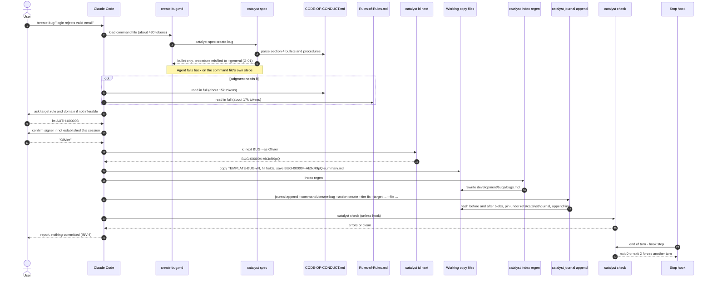

### D2 — Journal write flow (`catalyst journal append`)

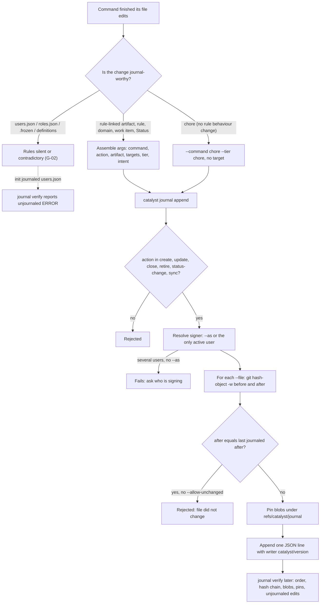

### D3 — Change control: tier, sign-off and gates

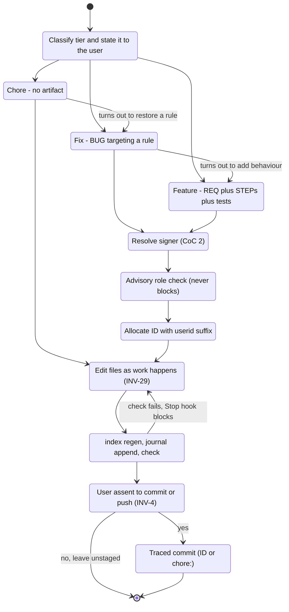

### D4 — Reconciliation (`RECON-`) state machine, with the `/status` bypass

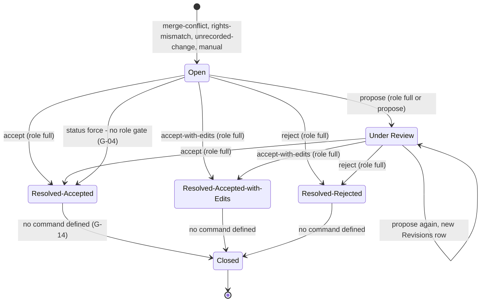

### D5 — `/sync-framework` flow (as SYNC + CoC prescribe it)

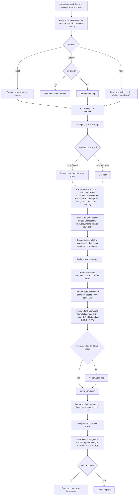

### D6 — One-time migration selection and execution

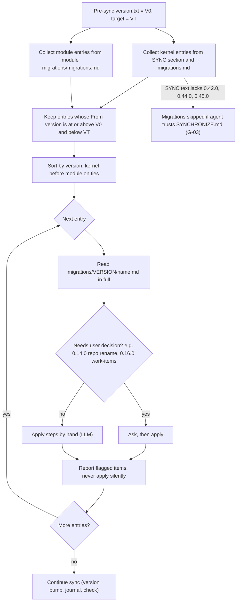

### D7 — Four-eyes analysis (`/run-analysis`)

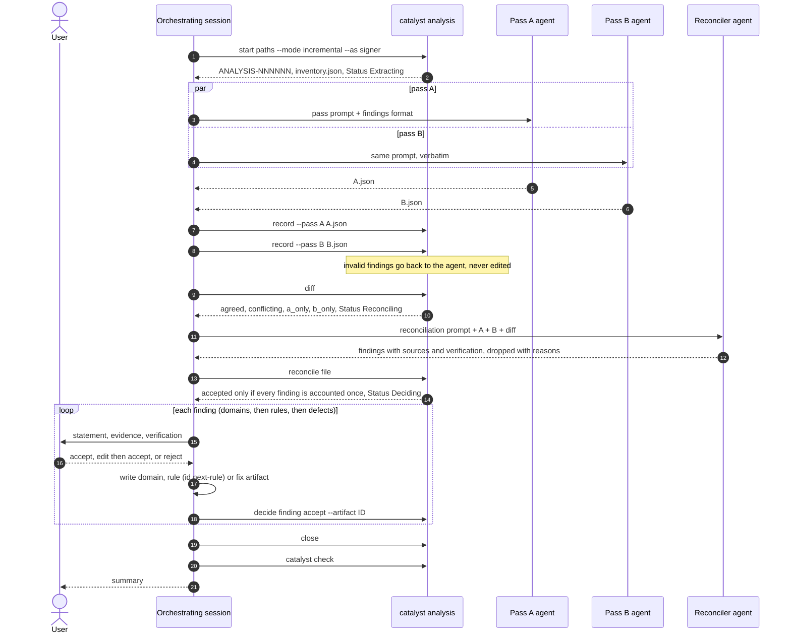

### D8 — Command taxonomy (current 38, grouped by what they really do)

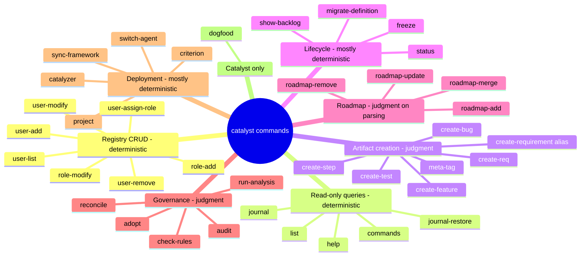

### D9 — Rule-family map: who defines what, who duplicates whom

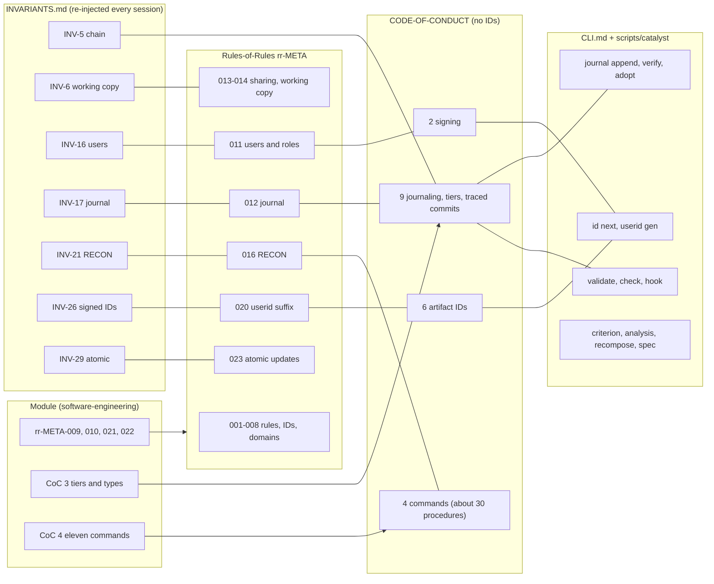

### D10 — Roadmap item lifecycle (module rr-META-010)

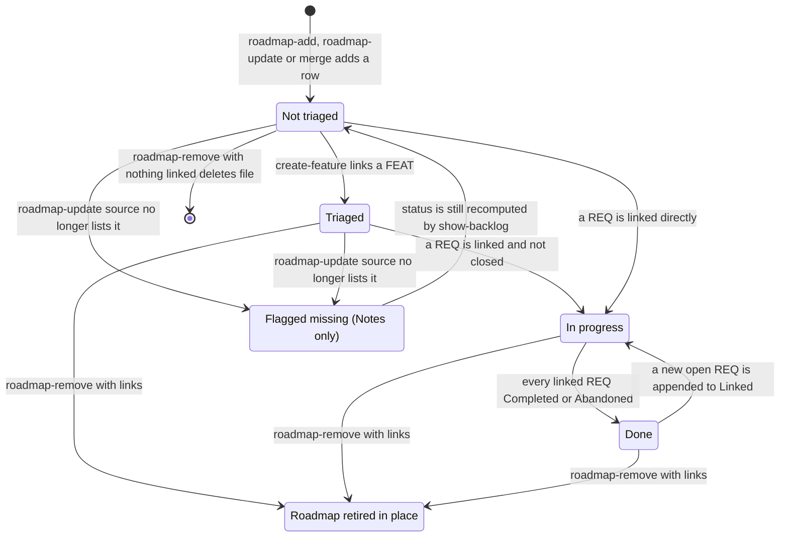

### D11 — Artifact status state machines (module ETDs; kernel `/status` validates only the value set)

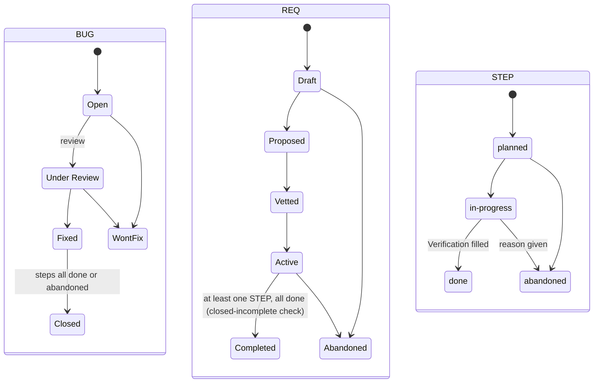

Note: transitions are **not** enforced; `/status` checks membership in `allowed_values`
only, so `Draft → Completed` or `Open → Closed` is accepted (and `force` accepts any
string). Only `closed-incomplete` (REQ `Steps`) is mechanical.

### D12 — The atomic-update rule (rr-META-023 / INV-29) as an agent would have to apply it

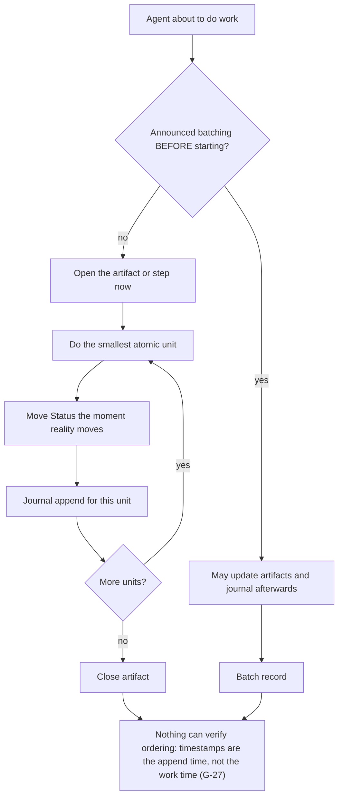

### D13 — `catalyst criterion push` (shared deployments)

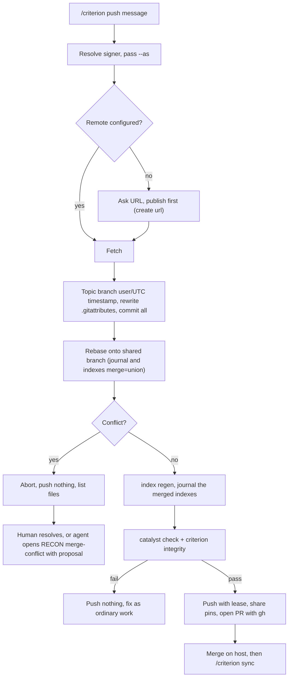

### D14 — `/adopt` (changes made outside catalyst)

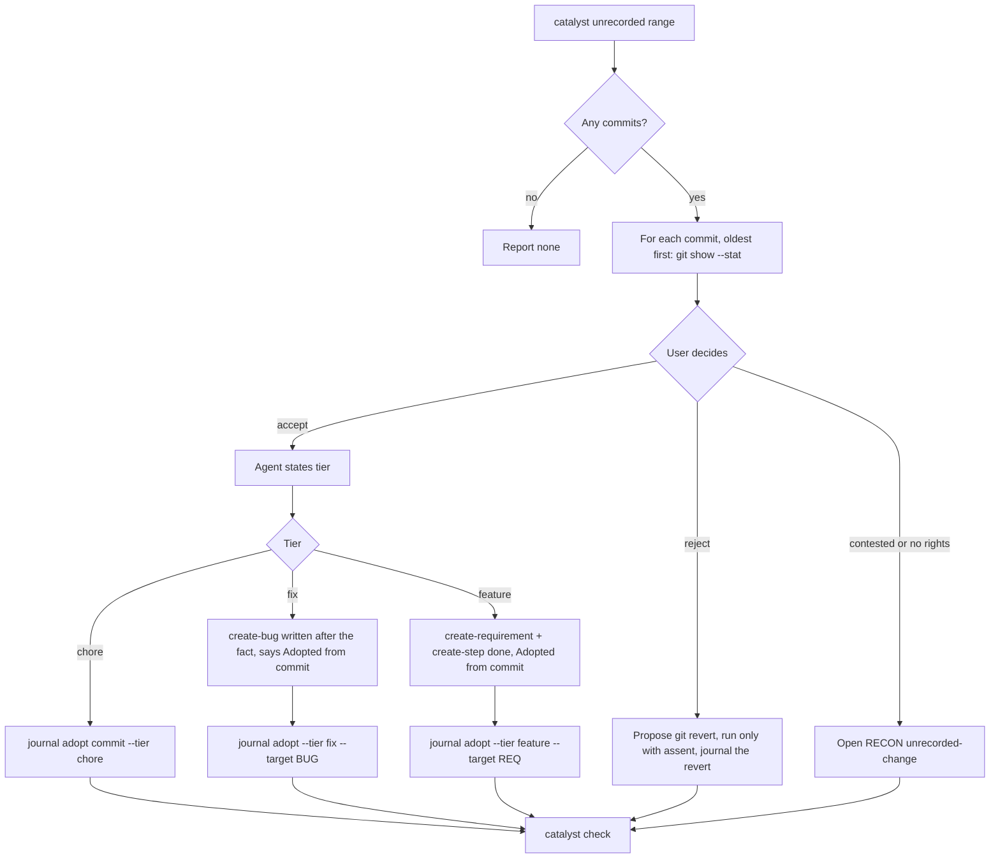

### D15 — Signer resolution: prose (CoC §2) vs code (CLI)

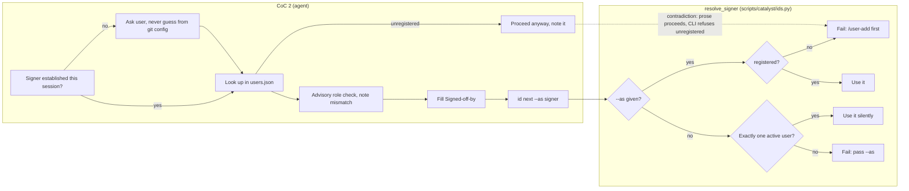

### D16 — How `catalyst spec` assigns §4 paragraphs (root cause of G-01)

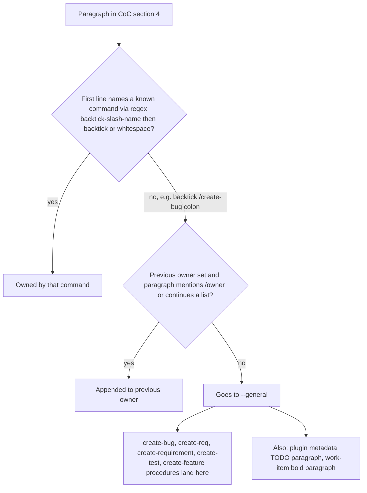

### D17 — Proposed target: judgment in prose, mechanics in one CLI

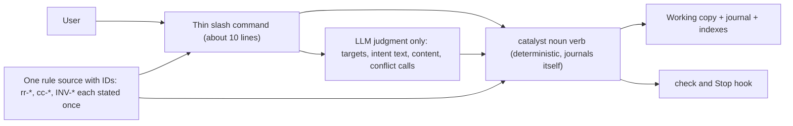

---

## 6. Gaps, bugs and issues

Severity: **Critical** (breaks a guarantee or a command in normal use), **High** (wrong
behaviour likely, or a rule cannot be followed as written), **Medium** (inconsistency
that will cause drift or confusion), **Low** (cosmetic, stale text). "Verified" means
reproduced or read in code.

### 6.1 Mechanical defects (code vs spec)

**G-01 — `catalyst spec` drops the procedures of five module commands. Critical, verified.**

- Evidence: `scripts/catalyst/spec.py`: ``MENTION = re.compile(r"`/([a-z][a-z0-9-]*)(?=[`\s])")`` .
  SE `code-of-conduct.module.md`: ``When the user enters `/create-bug: ...` ``,
  ``When the user enters `/create-req:` or `/create-requirement: ...` ``, ``/create-test: ...``,
  ``/create-feature: ...``. `catalyst spec create-bug` prints only the bullet (117 words);
  `catalyst spec --general` contains "When the user enters `/create-bug: ...`" at line 53.
- Effect: the "canonical text" principle (`templates/slash-command.template.md`: "Keep it a thin,
  procedural pointer back to CODE-OF-CONDUCT.md §4") fails for the most frequently used artifact
  commands; the command files, which duplicate the procedure, are what actually runs. Any future
  §4 change to these procedures will not reach agents.
- Fix: allow `:` in the lookahead (``(?=[`\s:])``), and add a test in the spec suite asserting every
  bullet command has ≥1 procedure paragraph unless whitelisted. Better: give each procedure an
  explicit anchor (`<!-- spec:create-bug -->`) instead of heuristic ownership.

**G-02 — User/role registry writes are never journaled, but `users.json` is journaled at install. Critical, verified.**

- Evidence: `scripts/catalyst/init.py` journals `IAM/users/users.json` in the install entry
  (`files=[... root / "IAM" / "users" / "users.json"]`). `journal.verify` raises `unjournaled`
  at `level(cli)` (error for CLI-written entries) when "current content differs from their last
  entry". `.claude/commands/user-add.md`, `user-remove.md`, `user-modify.md`,
  `user-assign-role.md`, `role-add.md`, `role-modify.md` have no journal step. RoR §12 "What must
  append an entry" lists only "rule-linked artifact, rule, domain, or work item, or … Status",
  yet the same section's `targets` description says `[]` "for non-rule-linked artifacts (users,
  roles …)", implying such entries exist.
- Effect: after any `/user-*`, `catalyst check` fails and the Stop hook blocks the turn; the agent
  invents an ad hoc journal entry (catalyst's journal has 64 entries under invented commands such as
  `(direct correction)`).
- Fix: decide once: registry writes **are** journaled (they change who can sign). Implement
  `catalyst user add|remove|modify|assign-role` and `catalyst role add|modify` that edit JSON and
  journal in one call; add IAM and `.frozen` and `definitions/` to RoR §12's list.

**G-03 — `SYNCHRONIZE.md` omits the 0.42.0, 0.44.0 and 0.45.0 migrations. Critical, verified.**

- Evidence: SYNC's last entry is "### From `0.40.0`: traced commits, the on-disk format version".
  `framework/kernel/migrations/` contains `0.42.0/changes-outside-catalyst.md`,
  `0.44.0/four-eyes-analysis.md`, `0.45.0/workspace-scope.md`, and `migrations/migrations.md` lists
  them. SYNC item 10: "Check `## Version-specific one-time migrations` below — and the active module's
  own `migrations/migrations.md`" — it never tells the agent to read the kernel's `migrations.md`.
- Effect: a deployment synced from ≤0.41 by following SYNC never gets `journal_since` (so
  unrecorded-change detection is off — CLI only warns), never gets `ANALYSIS-PLAYBOOK.md`
  ("deployed (it never was)" per 0.44.0) and never reinstalls the routing commit hook.
- Fix: make `migrations/migrations.md` (machine-readable: from, to, file, needs_decision) the single
  index; delete the prose list from SYNC; have `catalyst sync plan` compute pending migrations.
  Add a CI check that every `migrations/<v>/` directory is indexed.

**G-04 — `/status` bypasses the RECON role gate and signer resolution. High.**

- Evidence: RoR §16: "Who can do what is genuinely gated by role — the one deliberate exception …
  the command genuinely stops". `.claude/commands/status.md` and CoC `/status` paragraph: no role
  check, no signer, and "If the status is invalid and the command includes the word `force`, change
  it to that invalid value anyway". CoC §2: "Before an artifact-creating or work-item-status-changing
  command completes, resolve who is signing it".
- Fix: `catalyst status set` refuses `RECON-` targets (point to `/reconcile`), runs signer
  resolution, and validates transitions (not just membership) from the ETD.

**G-05 — Roles created by `/role-add` lack `reconciliation`. High.**

- Evidence: RoR §11: roles are `{name, actions, reconciliation}`; CoC §2: "a JSON array of
  `{name, actions}` objects"; `.claude/commands/role-add.md` step 4: append `{"name": "<role>",
  "actions": [<actions>]}`. `/reconcile` step 2 gates on that field.
- Effect: a user with only a custom role gets undefined behaviour at `/reconcile` (refuse? treat as
  `none`?). Migration 0.22.0 says custom roles default to `propose`, but new ones get nothing.
- Fix: `/role-add <role> <actions> [--reconciliation full|propose|none]`, default `propose`; CLI
  validates the schema (`schemas/` already exists for other files).

**G-06 — Signer semantics differ between CoC §2 and the CLI. Medium, verified.**

- Evidence: CoC §2 step 2: "If unregistered, proceed anyway, noting that the signer isn't
  registered … doesn't gate this write". CoC §2 step 5: "the CLI's own fallback to the git identity
  is not a confirmation". CLI.md "Signer": "It never guesses from git config … An unregistered user
  fails". `ids.resolve_signer` raises `IdError` for unregistered users and silently uses the sole
  active user.
- Effect: the prose permits a write the code refuses, and describes a git fallback that does not
  exist.
- Fix: rewrite CoC §2 as: "the CLI resolves the signer; an unregistered signer must `/user add`
  first". Delete steps 2–3's "proceed anyway".

**G-07 — Journal `actor` is sometimes `name`, sometimes `git_username`. Medium, verified.**

- Evidence: RoR §12 schema: `"actor": "<name from IAM/users/users.json>"`. `init.py`:
  `actor=req.git_username or req.user`. catalyst's own journal contains both `"Olivier Steck"` and
  `"olivier-steck"`.
- Effect: `/journal --actor` and `catalyst report` per-actor counts split one person in two.
- Fix: always record `userid` (immutable) plus display name; normalise on read.

**G-08 — `/sync-framework` with no argument is self-contradictory. Medium.**

- Evidence: SYNC item 2: "If no version argument is provided, synchronize against the currently
  installed local version rather than looking up a remote release". Checklist item 1: "Check the
  framework repository on the `release` branch for the latest version"; item 8: "Update the deployed
  framework's `version.txt` to the latest released version".
- Fix: define no-arg as "repair against installed version" (idempotent re-apply) and never bump.

**G-09 — `recompose --force` is boolean; the spec promises scoped forcing. Medium, verified.**

- Evidence: CoC: "`--force <type>`, `--force <item-id>`, or `--force all`". `__main__.py`:
  `p.add_argument("--force", action="store_true", help="also merge documents listed in .frozen")`.
  `compose.frozen_paths` reads both `.criterion/.frozen` and its parent's `.frozen`, while CoC says
  "root-level `.frozen`" without saying which root.
- Fix: one `.frozen` location (working-copy root), scoped `--force`, implemented in the CLI.

**G-10 — IAM file shape described as "a JSON array"; it is an object. Low, verified.**

- Evidence: RoR §11 "a JSON array of `{name, roles, …}` objects"; CoC §2 same; INV-20 "each
  registry is one JSON array"; `templates/users.template.json` is `{"users": []}`, roles template is
  `{"roles": [...]}`; command files say "append to the `users` array".
- Fix: correct the three texts or, better, point to the JSON schema.

**G-11 — Journal `action` enum is too narrow; commands misuse it. Low/Medium, verified.**

- Evidence: CLI `ACTIONS = ("create", "update", "close", "retire", "status-change", "sync")`.
  `/project import` journals `--action sync`; `/roadmap-remove` journals `retire` even when it
  deletes the file; `/adopt` writes `update`; legacy entries carry `delete`/`migrate`.
- Fix: add `delete`, `import`, `adopt`, `migrate`; or drop `action` (derivable from before/after
  nulls plus Status diff).

**G-12 — Composed Rules-of-Rules has duplicate section numbers. Low, verified.**

- Evidence: deployed `.criterion/rules/Rules-of-Rules.md` has two `## 9.`, `## 10.`, `## 21.`,
  `## 22.` (placeholder + module section).
- Fix: `compose.py` should replace the placeholder section with the module's section, not append.

**G-13 — `create-req` and `create-requirement` are two hand-maintained files. Low, verified.**

- Evidence: the files differ only in `--command /create-requirement` vs `/create-req`; both call
  `catalyst spec create-req`. Journal statistics and `--command` filters split.
- Fix: `catalyst init --commands-dir` should generate alias files from `module.yaml` aliases, all
  journaling the primary name.

**G-14 — RECON `Resolved-*` → `Closed` has no owner. Medium.**

- Evidence: RoR §16: "`Status` moves `Open` → `Under Review` → one of `Resolved-*` → `Closed`".
  `/reconcile` sets `Resolved-*` only; `.claude/commands/reconcile.md` step 1 "refuse if its Status
  is already Closed (point to `/status` for reopening)". Nothing closes.
- Fix: either drop `Closed` (Resolved-* are terminal) or let `/reconcile` close once the Entity
  change has landed.

**G-15 — INV-21's trigger list is stale. Low.**

- Evidence: INV-21: "a conflict that stopped `/criterion push` (INV-18), a rights-mismatch …, or a
  manually opened one" — no `unrecorded-change`, which RoR §16 and CoC `/adopt` use.

### 6.2 Rule contradictions and wrong references

**G-16 — Rule storage model contradicts itself. High.**

- Evidence: RoR §5: "Each rule must be stored as its own markdown file … Aggregating multiple rules
  into one file … is not permitted." RoR §1: "Each document's Cross-Cutting Notes heading … Linked
  Artifacts — Quick Index"; RoR §2: "added to the correct rule document, under the functionality
  domain … with a `file:line` citation"; RoR §7: "The `##` heading in the rule document itself
  carries only a one-line pointer"; module "Rule documents' Linked Artifacts quick index". catalyst's
  own deployment: every rule in `.criterion/rules/framework/fw-framework-rules.md`.
- Effect: §5 is violated by the reference deployment; validators only check `rules.md`.
- Fix: pick one. Rule-per-file (with frontmatter) is the one that the CLI, union merges and
  `validate` can handle; then rule *documents* become generated views.

**G-17 — Rule-template location contradiction. Medium.**

- Evidence: RoR preamble: "There must be exactly one template file at `{{RULES_DIR}}/TEMPLATE-RULE.md`
  and no `TEMPLATE-RULE.md` files inside the rule-type directories." RoR §5 and INV-8: "the current
  `{{RULES_DIR}}/templates/TEMPLATE-RULE-vN.md` … never at the rules root directly".
- Fix: delete the preamble sentence.

**G-18 — 3-digit vs 6-digit rule numbers everywhere outside §3. Medium.**

- Evidence: RoR §3: "a zero-padded **6-digit** sequence number … never left half-done across a
  document". Same file: "Take the next unused `NNN` in that domain" (Adding a new rule step 2);
  §7 "`ui-GATE.DOCKER-004`", "`NNN` starting at `001`"; "Domain code — this file … `rr-META-NNN`";
  every heading `rr-META-001`…`rr-META-023`; module and command files cite `rr-META-009` etc.
  Deployed headings are `rr-META-000001-yCNjAMXO`.
- Fix: one sweep of the template; have `check_kernel_purity`-style lint reject `-[0-9]{3}\b` IDs.

**G-19 — Rule authorship: three different answers. Medium.**

- Evidence: RoR §20: "use the sole registered active user; if more than one is active, use whichever
  was most recently registered." INV-26: "the sole or most-recently-active registered user". CLI
  `id next-rule … [--as <user>]` + `resolve_signer` fails with several users and no `--as`; CoC §2
  step 5: "Always pass the signer confirmed in step 1 as `--as`".
- Fix: rules are signed like everything else (`--as`); delete the "known limitation" text.

**G-20 — Wrong section cross-references. Medium.**

- CoC §6: "Per `Rules-of-Rules.md` §5: `<PREFIX>-(NNNNNN)-(userid)`" — ID scheme is §6.
- PLAY step 5: "`rules/domains/<prefix>-<CODE>-<short-description>.md` per `Rules-of-Rules.md` §6" —
  domains are §7.
- RoR §14 "Per hard rule 4" and CoC `/switch-agent` "hard rule 6", `/project create` "per hard rule
  4" — the "hard rules" are `BOOTSTRAP.md` §0, which is not deployed; in a deployment these dangle.
- `templates/slash-command.template.md` step 5: "(`Rules-of-Rules.md` INV-4)" — INV-4 is in
  `INVARIANTS.md`.
- `.claude/commands/create-feature.md` step 1 cites "`Rules-of-Rules.md` §9" — correct only after
  composition; the module itself warns numbers are deployment-relative.
- Fix: cite stable IDs only (`rr-META-NNNNNN`, `INV-N`, and new `cc-*` IDs for CoC — see G-41);
  add a link checker over `§N` references.

**G-21 — `ANALYSIS-` is a kernel entity with no meta-rule. Medium.**

- Evidence: PLAY: "(`Rules-of-Rules.md`, the kernel's analysis rule; the `ANALYSIS-` entity)";
  `framework/kernel/entities/analysis.yaml` exists; RoR has no analysis section; RoR §15's "Where every
  artifact type actually sits" omits `analyses/`; RoR §20's suffix list ("every rule, `WORKFLOW-`,
  `RECON-`, and active-module `<PREFIX>-` ID") omits `ANALYSIS-`.
- Fix: add `rr-META-024 Four-eyes analysis records` and list `analyses/` in §15/§20/INV-20/INV-26.

**G-22 — Is `ANALYSIS-PLAYBOOK.md` deployed or not? Medium.**

- Evidence: PLAY: "This file ships in every working copy as `.criterion/ANALYSIS-PLAYBOOK.md`".
  `templates/slash-command.template.md`: "`/sync-framework` and `/run-analysis` additionally need this
  framework's own repository content (`SYNCHRONIZE.md`, `ANALYSIS-PLAYBOOK.md`) that isn't part of
  the deployed project — fetch it". Combined with G-03, pre-0.44 deployments do lack it.
- Fix: update the template; let `catalyst check` report its absence.

**G-23 — Version-check paragraphs pasted into unrelated rules. Medium.**

- Evidence: RoR §6 (dev-artifact IDs) opens with "If the deployed framework is missing `version.txt`
  … must be synchronized before further work proceeds." RoR §8 (agile work items) opens with "The
  kernel version is tracked in `version.txt` … must be synchronized".
- Effect: a hard "stop all work until synced" gate hidden inside unrelated sections; contradicts
  INV-25 (act without asking) and the "exactly one confirmation" model.
- Fix: delete both; `catalyst check` can warn on version lag.

**G-24 — SYNC's "Rule" contradicts INV-2/INV-4/INV-25 and the confirmation model. High.**

- Evidence: SYNC "Rule": "Whenever a project is active, it must check the catalyst framework for
  changes, load the latest version into memory … The synchronization process must apply the changes
  automatically and repeatedly … If the deployed framework does not exist, or if its version is
  missing or lower … apply this synchronization process immediately." Same section: "requires exactly
  one confirmation". INV-2: "Loading or reading catalyst never installs it".
- Effect: "deployed framework does not exist → apply immediately" is an install without request.
  "Check for changes whenever a project is active" is a network fetch per session.
- Fix: rewrite as "offer"; never auto-apply; never install.

**G-25 — CoC `/catalyzer` contradicts the prototyping exemption. Low.**

- Evidence: CoC: "Each plugin must live in its own repository, with no exceptions". RoR §17 and
  INV-22: plugins under `plugins/_prototyping/` are exempt from INV-11.

**G-26 — "Framework startup" and "memory" do not exist for an LLM agent. High (unverifiable hard rule).**

- Evidence: CoC `/catalyzer`: "on framework startup the framework must scan the installed plugin
  list and activate only those marked active. This is a hard rule." "deactivate … remove it from
  memory"; "If a plugin with the same name is already loaded, replace it in memory". INV-12: "The
  framework reads `Active` at startup".
- Effect: no hook, script or BOOTSTRAP step performs this; the rule cannot be followed or checked.
- Fix: define activation as files on disk (`plugins/<type>/<name>/` + `active: true`) checked by
  `catalyst check`, and a `SessionStart` hook that prints the active plugins' operational loops.

**G-27 — rr-META-023 / INV-29 (atomic updates) is unverifiable and conflicts with practice. Medium.**

- Evidence: "a journal entry is appended as each qualifying action completes … never accumulated and
  appended in bulk at session end". `journal append` timestamps are the append time; nothing links an
  entry to when the work happened. Module `/adopt` text admits artifacts are "written after the
  work, which INVARIANTS.md INV-29 otherwise forbids". `/sync-framework` journals one entry for a
  whole sync.
- Fix: keep it as guidance, not an invariant; or make it checkable (e.g. step `Status:
  in-progress` must have a journal entry before the product commit that implements it — `trace`
  could check that the cited STEP existed before the commit).

**G-28 — "Exactly one journal entry" per command vs reality. Low.**

- Evidence: INV-17 / CoC §9: "appends exactly one journal entry as its last step". `catalyst
  analysis` journals every phase; `criterion push` adds its own entry; `/adopt` writes one per
  commit; `/roadmap-*` IDs consecutive in one write.
- Fix: "at least one entry covering every touched file".

**G-29 — `/dogfood` "reports, never fixes" vs "ends with fixes applied". Low.**

- Evidence: `.claude/commands/dogfood.md`: "Never fix anything automatically". RoR §13: "After every
  `/dogfood` run that ends clean, or ends with fixes applied and reverified". The journal holds 17
  `/dogfood` entries (writes attributed to a read-only command).
- Fix: fixes after dogfood run under their own tier/command.

**G-30 — Meta-tag folder and naming contradict the hard rules. Low.**

- Evidence: CoC §3 table: folder `meta-tags/`; RoR §15: "`development/` — `meta-tags/` promoted to a
  full artifact-type folder"; `.claude/commands/meta-tag.md` template path
  `.criterion/development/meta-tags/templates/…` but saves `meta-tags/tag-<key>-<artefact-id>.md`.
  CoC §6 hard rule: "every item name must be more than the bare ID". Two `comment` tags on the same
  artifact collide on one filename. CoC §1's sentence "and no meta-tag, may start without citing …
  when the tag is used to annotate a rule-linked artifact" is ungrammatical and unenforceable.
- Fix: drop meta-tags (zero uses in catalyst's journal) or make them a list field on the artifact.

**G-31 — `/catalyzer` resolves against a path a deployment cannot see. High.**

- Evidence: CoC: "registry file `framework/kernel/plugins/<type>/catalog.md` in catalyst's own
  repository … sole source of truth". SYNC item 12: the deployed project's own
  `plugins/<type>/catalog.md` is "project-owned state" that sync merges into. INV-1 forbids naming
  local paths to catalyst.
- Effect: two catalogs, two sources of truth; a deployed agent has no catalyst checkout to read.
- Fix: the deployed catalog is the source; sync refreshes it from the release.

**G-32 — RoR §17 hardcodes `.claude/commands/` in the agent-agnostic kernel. Low.**

- Evidence: "copy the named command file(s) into `.claude/commands/`". Same in INV-22 ("slash-command
  file(s) it deploys into the target project").
- Fix: "the agent's commands directory (the pointer's `commands_dir`)".

**G-33 — Stale claim that no cross-reference checker exists. Low.**

- Evidence: RoR §20: "there is no dedicated cross-reference-checking script today (`/check-rules` and
  `/audit` are agent-judgment procedures)". CLI `validate` reports `dangling-ref`, `backref`,
  `ref-type`, `index-orphan`.
- Fix: replace with "run `catalyst validate`; free-text mentions remain the agent's job".

**G-34 — `INVARIANTS.md` is not "short", and it is re-injected every session. Medium.**

- Evidence: "Keep this file short … A bloated invariants file decays faster". It is 19 KB (~4.8k
  tokens), with INV-6 ≈ 330 words and INV-17 ≈ 300 words restating RoR §12/§14, re-injected by the
  `SessionStart` hook (CLAUDE.md) on every session and compaction.
- Fix: one sentence per invariant + ID of the governing rule; ~1.2k tokens.

**G-35 — CoC orphan TODO paragraph is served to every command. Low, verified.**

- Evidence: CoC §4: "Each plugin must be defined by the following minimum metadata fields … The
  plugin definition template must be updated to include these fields" — an implementation task, not a
  rule; `catalyst spec --general` includes it (line 38), and every spec's PREAMBLE points to
  `--general`.
- Fix: move to `/catalyzer`'s procedure or delete (INV-12 already states it).

**G-36 — Spec for `/sync-framework` (the canonical text) omits migrations and recomposition. High.**

- Evidence: CoC `/sync-framework` paragraph mentions `.frozen`, plugins, `catalyst.pyz`, journal,
  check, four-eyes; it does not mention migrations, recomposition, renames, definitions, IAM. Those live
  only in SYNC, which the command file says is "not part of the deployed project — fetch if not already
  available".
- Fix: `catalyst sync` does the mechanics; the spec lists only the judgment points.

**G-37 — SYNC never references `catalyst recompose`. High.**

- Evidence: CLI.md: "`catalyst recompose` … Used by `/sync-framework`". SYNC checklist 6 describes
  recomposition as prose ("recompose the deployed `rules/Rules-of-Rules.md` from
  `rules-of-rules.template.md` plus the module's …") and never names the command or its `--base-*`
  inputs.
- Effect: an agent following SYNC rebuilds 32k tokens of governing documents by hand, losing local
  edits that `git merge-file` would have kept.

**G-38 — Four-eyes sync verification is undefined and expensive. Medium.**

- Evidence: SYNC item 13: "one sub-agent verifies the deployment against the checklist in
  `INSTANTIATION-GUIDE.md`, and a second independent sub-agent repeats the verification". CoC: "against
  `INSTANTIATION-GUIDE.md` and the framework rules". No pass criteria, no output format, no CLI phase
  gate (unlike `catalyst analysis`). INSTANTIATION-GUIDE is not deployed.
- Fix: replace with `catalyst check --strict` + `catalyst recompose --check` + `check_command_parity`
  equivalent in the CLI; reserve sub-agent review for migrations flagged `needs_decision`.

**G-39 — `/project create` command file hand-builds the deployment. Medium.**

- Evidence: `.claude/commands/project.md` `create` steps 2–4: "Run the instantiation procedure …
  Write `<app-name>.catalyst` … from `templates/catalyst-pointer.template.json` … Create the
  `.criterion` symlink". CoC: "run `catalyst init --name <project name> ...`, which builds the working
  copy, writes `<app-name>.catalyst` …".
- Fix: make the file call `catalyst init` and only gather inputs.

**G-40 — `/project export` has no size bound and no secret filter. Medium.**

- Evidence: "reads every file under the working copy and writes one JSON bundle — relative path →
  file content". Includes binary `bin/catalyst.pyz` (not valid UTF-8 JSON content), the 341 KB journal,
  and the working copy's `.git`? (unspecified). Journal blob hashes become meaningless on import
  without the object store (restore/verify break: blobs are not exported).
- Fix: `git bundle` of the working copy repository (includes journal blobs and pins) instead of a
  JSON dump.

### 6.3 Ceremony, token burn, and steps an LLM will skip

**G-41 — CoC has no rule IDs. Medium.**

- Evidence: CoC sections are cited by number (`CODE-OF-CONDUCT.md` §2/§9), and the module re-uses
  numbers ("Section numbers cited in this file … are the deployed `CODE-OF-CONDUCT.md`'s"). A journal
  entry or a commit cannot target "no development without a targeted rule".
- Fix: introduce `cc-*` IDs (or fold CoC rules into `rr-*`).

**G-42 — The conflict check (rr-META-001) scales with the whole rule base and has no tooling. High.**

- Evidence: "check it against the rules already recorded in **every** rule document … not just the
  document that seems most relevant". Required before every `/create-req`, `/create-test` and every
  accepted analysis rule.
- Effect: O(all rules) tokens per artifact; an LLM will sample, not read. No record that the check
  happened.
- Fix: `catalyst rules related <text|domain>` (keyword/embedding search over rule files) and a
  `Conflict check:` field on REQ/TEST recording which rules were compared.

**G-43 — "Tested — at least one test" (rr-META-002) is not checkable. Medium.**

- Evidence: rr-META-002 requires ≥1 test per rule; `validate` has no rule→test coverage check, even
  though the module's `TEST-` artifacts carry `Targets`.
- Fix: `validate` warning `untested-rule` for ✅ rules with no `TEST-` targeting them.

**G-44 — Per-change ceremony is disproportionate for chores. Medium.**

- Evidence: CoC §9 tier rules: chore = "one `catalyst journal append --tier chore`", plus the agent
  "states it to the user before starting", plus commit must start `chore:`, plus `index regen`,
  plus `check`. Each `journal append` hashes every file and creates a pin commit under
  `refs/catalyst/journal`.
- Effect: in catalyst's own journal, 30 of 64 tiered entries are chores. Blob pinning makes the
  object store grow with every typo.
- Fix: chores need only the `chore:` commit (already traced); journal only working-copy changes.

**G-45 — `/journal` makes the LLM read the whole journal. High (token burn).**

- Evidence: CoC `/journal`: "read `development/journal.jsonl` (one JSON object per line) and apply
  whichever filters were given". catalyst's journal: 341,502 bytes, longest line 12,682 bytes (≈85k
  tokens total).
- Fix: `catalyst journal show --since --artifact --actor --rule [--json]`.

**G-46 — Signer re-confirmation per session. Low.**

- Evidence: CoC §2 step 1: "the user established earlier this session, or ask if not yet established
  (don't guess from git config — confirm with the user)". With one active user, the CLI resolves it
  silently anyway.
- Fix: ask only when `resolve_signer` fails.

**G-47 — `/show-backlog` re-derives a report the CLI could compute. Medium.**

- Evidence: module `/show-backlog`: compute open bugs by severity, open requirements, rules with no
  open work, features with no requirement, every roadmap, then "overwrite `BACKLOG.md` in full" and
  recompute every roadmap row's `Status` from links. All inputs are in the corpus the CLI parses
  (`scripts/catalyst/corpus.py`); `catalyst report` already counts artifacts per type/Status.
- Fix: `catalyst backlog` (deterministic), module supplies a template.

**G-48 — Retroactive renaming on every sync. Medium.**

- Evidence: RoR §3: "must also be applied retroactively to existing deployed items during framework
  deployment or synchronization … every index entry and link that references the old name must be
  updated". SYNC item 9 repeats it for artifacts and domain files.
- Effect: an LLM-driven global search/replace each sync; `id-shape` already rejects bare filenames,
  so after 0.27.0 this is dead weight.
- Fix: one migration, then `validate` keeps it true.

**G-49 — Steps an LLM will routinely skip (no mechanical backstop).**

- rr-META-001 conflict check across **every** rule document (G-42).
- rr-META-002 "Tested" and `file:line` citation freshness.
- CoC §2 step 3 advisory role check (actions are prose like "approve rule changes and new domains";
  there is nothing to match against).
- Module "states the tier to the user before starting".
- rr-META-023 opening artifacts *before* work.
- rr-META-020 free-text cross-reference sweep after renames.
- `/create-test` back-reference maintenance (`Tests` on REQ/STEP) — `validate backref` only warns.
- SYNC item 9 rename normalisation, item 12 catalog merge semantics, item 13 four-eyes.
- `/catalyzer activate` "fulfil its Operational-loop section".
- `/check-rules` judgment half ("artifacts whose content no longer matches the rule they cite").

**G-50 — Roles' `actions` are free text, so the "advisory role check" is theatre. Low.**

- Evidence: `templates/roles.template.json`: `"actions": ["create the active module's planning and
  new-work artifacts", "approve/prioritize new work"]`, while Admin lists real commands
  (`"/user-add"` …). CoC §2 step 3: "check whether the action being performed is one that role
  covers".
- Fix: actions are command names (globs); `catalyst` warns on mismatch and records it in the
  journal entry.

**G-51 — `/freeze <type>` resolves to "a backing file path" (singular). Low.**

- Evidence: CoC `/freeze`: "resolve the item to its backing file path"; argument may be "a type".
  Freezing is not journaled though it changes what sync does.

**G-52 — `/switch-agent` mirror is destructive without confirmation. Medium.**

- Evidence: RoR §14: "mirror it into the new location: … removing anything at the new location the
  old one doesn't have"; `/switch-agent` runs "unconditionally". INV-25 keeps gates for "destructive"
  operations, yet no confirmation is required here, and the agent may target an arbitrary
  `[agent-id]` location.
- Fix: `catalyst agent switch --dry-run` first; confirm when the destination is non-empty.

**G-53 — `/user-modify` cannot edit `git_username` or `userid`, and nothing removes a role. Low.**

- Evidence: CoC: editable fields are `notes`/`active`; `git_username` is optional and used by
  `criterion push`; `/user-assign-role` is additive only. A wrongly assigned role (e.g. `Admin`, which
  carries `reconciliation: full`) can never be revoked by command.

**G-54 — Module commands name module-specific statuses inside generic CoC flows. Low.**

- Evidence: `.claude/commands/show-backlog.md` hardcodes "`Draft`/`Proposed`/`Vetted`/`Active`" —
  fine for the module, but the same lists also appear in rr-META-021 and module §3; three copies of
  each ETD's `allowed_values`.
- Fix: read status sets from the ETDs (`catalyst` already does for `enum-value`).

---

## 7. Prose that should be code

Each row is a step an LLM currently performs by following paragraphs, although the
result is fully determined by its inputs. "Exists?" says whether the CLI already has
something close.

| # | Step (where) | Inputs → output | Why deterministic | Proposed CLI | Exists? |
|---|---|---|---|---|---|
| 1 | Register user (`/user-add`, CoC §4) | name, role, roles.json → users.json entry + userid | Template fill + `userid gen` + uniqueness check | `catalyst user add <name> --role R [--git-username]` (journals) | `userid gen` only |
| 2 | Deactivate / modify / assign role (`/user-*`) | users.json → users.json | Field edits with guards (last active user) | `catalyst user remove\|set\|assign\|unassign` | no |
| 3 | List users with filters (`/user-list`) | users.json → table | Filter | `catalyst user list [--role] [--active-only] [--json]` | no |
| 4 | Add/modify role (`/role-*`) | roles.json → roles.json | Schema edit | `catalyst role add\|modify [--reconciliation]` | no |
| 5 | List artifacts/rules/templates (`/list`) | indexes/corpus → table | Filter over parsed corpus | `catalyst list <type\|all> [--filter k=v]` | corpus parser exists |
| 6 | Query journal (`/journal`) | journal.jsonl → filtered entries | Filter | `catalyst journal show …` | `report` partial |
| 7 | Set Status (`/status`) | ID, value, ETD → file edit + regen + journal | ETD has `allowed_values`; transitions can be declared | `catalyst status set <ID> <value> [--force] --intent` | `validate enum-value` |
| 8 | RECON role gate (`/reconcile` step 2) | actor, roles.json → allow/deny | Lookup | `catalyst reconcile <ID> <verb>` enforcing gate, setting Status/Resolver | no |
| 9 | Create artifact scaffold (`/create-*` steps 2–6) | prefix, title, fields → file + index + journal | Template copy, ID, filename slug, regen, journal | `catalyst new <PREFIX> --title … --target … --field k=v` | `id next`, `index regen` |
| 10 | Back-references (`/create-step` parent `Steps`, `/create-test` `Tests`) | links → edits on other files | ETD declares backrefs (`validate backref`) | done inside `catalyst new` | `validate backref` detects only |
| 11 | Meta-tag file + hand row (`/meta-tag`) | key, value, target → file + row | Template | `catalyst tag add` (or drop) | no |
| 12 | Freeze/unfreeze (`/freeze`) | id/path/type → `.frozen` lines | Path resolution | `catalyst freeze\|unfreeze\|frozen` | `recompose` reads `.frozen` |
| 13 | Migrate definition (`/migrate-definition`) | type, version, release tag → file | Existence check + copy | `catalyst definition migrate <type> <v>` | no |
| 14 | Agent switch (`/switch-agent`, RoR §14) | old/new location → mirror + symlink + pointer | rsync + symlink + JSON edit | `catalyst agent switch [--to <dir>] [--dry-run]` | no |
| 15 | Project remove/export/import (`/project`) | pointer, working copy → bundle / install | File ops | `catalyst project remove\|export\|import` (use `git bundle`) | `init` only |
| 16 | Pre-pointer migration (RoR §14) | legacy layout → new layout | Move + symlink + pointer | `catalyst migrate legacy-layout` | no |
| 17 | Backlog regeneration (`/show-backlog`) | corpus → BACKLOG.md + roadmap Status | Aggregation + rule-based status | `catalyst backlog [--write]` | `report` partial |
| 18 | Roadmap Status/Linked refresh (module rr-META-010) | links, REQ statuses → row Status | Pure function (Not triaged/Triaged/In progress/Done) | inside `catalyst backlog` | no |
| 19 | Roadmap remove/retire (`/roadmap-remove`) | file, Linked column → delete or retire | Branch on emptiness | `catalyst roadmap remove <name>` | no |
| 20 | Roadmap ID numbering (consecutive RM IDs) | count → ID list | Arithmetic; `id next` "allocates nothing" | `catalyst id next RM --count N` | no (`--count` missing) |
| 21 | Version freshness (SYNC Rule, RoR §6/§8) | `version.txt` vs release tag → lag | Compare | `catalyst check` warning `kernel-behind` | no |
| 22 | Sync target resolution, diff, file copy (SYNC 1–8) | release tag → changed files | Diff + copy rules (create-only, never-overwrite, merge) | `catalyst sync plan\|apply <version>` | `recompose` covers 4 files |
| 23 | Frozen handling + unfreeze on refresh (SYNC 7–8) | `.frozen` → skip list | Set ops | inside `catalyst sync` | partial in `recompose` |
| 24 | Plugin catalog merge (SYNC 11–12) | old/new catalog tables → merged table | Row merge by name, column refresh | `catalyst catalog merge` | no |
| 25 | Definitions create-only (SYNC 7, INV-23) | ETD list, deployed dir → new files | Missing-file creation | inside `catalyst sync` | `init` does it at install |
| 26 | Command-file and Taskfile refresh (SYNC 7) | §4 command list → files/tasks | Template per command (`init --commands-dir` already does) | `catalyst commands write` | `init` only |
| 27 | Pending-migration selection (SYNC 10) | V0, VT, kernel+module indexes → ordered list | Version comparison | `catalyst sync plan` | no |
| 28 | Rename normalisation (SYNC 9, RoR §3) | bare-ID files → renamed + refs | Slug from H1/Scope + reference rewrite | `catalyst rename <old> <new>` (rewrites structured refs, lists free-text hits) | no |
| 29 | Last-active-user guard (INV-16) | users.json → ok/refuse | Count | inside `catalyst user remove`; `check` error if 0 | not verified in this audit |
| 30 | Sync four-eyes verification (SYNC 13) | deployment → pass/fail | Every item it checks is structural | `catalyst check --strict` + `recompose --check` + parity | mostly |
| 31 | Command/§4 parity (CLAUDE.md, `check_command_parity.py`) | §4, commands dir → diff | Set diff | `catalyst check` (deployments, not only catalyst) | catalyst-only script |
| 32 | `/commands list` and `/help` listing | §4 → names + one-liners | Already `catalyst spec` with no argument | `catalyst spec` (list) | yes |
| 33 | Plugin activation state (`/catalyzer`, INV-10/12) | contract metadata → active list | File read | `catalyst plugin list\|activate\|deactivate` + SessionStart print | no |
| 34 | Journal-restore side-dir naming (`/journal-restore`) | timestamp → dir | Formatting | default `<out>` in `catalyst journal restore` | yes, minus default |
| 35 | Tier → required artifacts check (module §3) | tier, artifact presence → ok | Lookup | `journal append --tier fix` requires a `--target` resolving to a BUG | no |
| 36 | Rule→test coverage (rr-META-002) | rules, TEST targets → missing | Join | `validate untested-rule` | no |

Result: roughly **80% of the steps in the 38 command files are deterministic**. The
judgment that remains is narrow: choosing targets and tier, writing intent and artifact
content, extracting roadmap items, conflict/overlap calls between rules, accepting or
rejecting adopted commits and analysis findings, and merge decisions in RECON.

---

## 8. Duplication matrix (same rule, multiple texts)

| Topic | RoR | CoC | INVARIANTS | CLI.md | SYNC | Command files | Copies |
|---|---|---|---|---|---|---|---|
| userid generation | §11 (full algorithm) | §4 `/user-add` | INV-26 | `userid gen` | — | user-add.md | 5 |
| Signer resolution | §11, §20 | §2 (5 steps) | INV-16, INV-26 | "Signer" | — | ~15 files ("Resolve who is signing this per §2") | 5+ |
| Journal schema & obligations | §12 | §4 ending, §9 | INV-17 | `journal append`, conventions | checklist 8 | every writing command | 6+ |
| Last active user | §11 | §2, §3, §4 `/user-remove` | INV-16 | — | checklist 7 | user-remove.md, user-modify.md | 6 |
| RECON role gate | §16 | §4 `/reconcile` | INV-21 | — | — | reconcile.md | 4 |
| Working-copy model | §14 | §4 `/project`, `/switch-agent` | INV-6, INV-19 | Invocation | — | project.md, switch-agent.md | 6 |
| Shared deployments | §13 | §4 `/criterion` (6 paragraphs) | INV-18 | `criterion` (full) | — | criterion.md | 4 |
| Plugin sync preservation | — | §4 `/sync-framework` | — | — | items 11, 12, checklist 4 | sync-framework.md | 4 |
| Frozen definitions | — | §4 `/migrate-definition` | INV-23 | — | checklist 7 | migrate-definition.md | 4 |
| Descriptive naming | §3 | §6 | INV-7 | `id-shape` | item 9 | every create-* | 5+ |
| Ceremony tiers | — | §9 | (module INV-27) | `--tier` | — | spec PREAMBLE, module §3 | 4 |

Every one of the contradictions in §6.2 sits in a row of this table with ≥4 copies.

---

## 9. Recommendations (ordered by value / effort)

1. **Fix G-01, G-02, G-03 now** (regex lookahead; journal registry writes in code; index
   migrations from `migrations.md`). Each is small and each currently breaks a normal flow.
2. **Introduce noun CLIs and collapse commands**: `catalyst user|role|status|list|journal show|freeze|definition|agent|project|backlog|roadmap remove|new`.
   Each writes and journals in one call. Reduce the slash surface from 38 to ~16 (§4.3).
3. **Make `catalyst sync` real**: `plan` (target tag, pending migrations from a machine-readable
   index, files to create/refresh/merge), `apply` (copy, `recompose`, re-vendor, write commands,
   bump, journal), `check`. Keep the LLM for migrations marked `needs_decision` and conflict
   markers from `recompose`. Replace the four-eyes sub-agent pair with deterministic checks.
4. **One statement per rule, with IDs**: give CoC rules `cc-*` IDs (or fold them into `rr-*`);
   cut INVARIANTS to one line per invariant pointing at its rule; move non-rule material out of
   RoR (§12–§18 are specs of mechanisms that the CLI and `FORMAT.md` already document).
5. **Make status transitions and gates declarative in ETDs** (`transitions:`, `gate: reconciliation`)
   and enforce them in `catalyst status set` and `validate`.
6. **Decide the rule storage model** (G-16) and make `validate` enforce it.
7. **Demote unverifiable "hard rules"** (plugin startup activation, atomic updates, advisory role
   check) to guidance, or give each a mechanical check; a rule nobody can verify trains agents to
   treat all rules as optional.
8. **Budget the session baseline**: INVARIANTS (~4.8k tokens) is re-injected every session; command
   specs average ~300 words but `--general` adds ~1.2k; `/journal` and `/project export` can read
   100k+. Target: < 1.5k tokens of instructions for any CRUD command.
