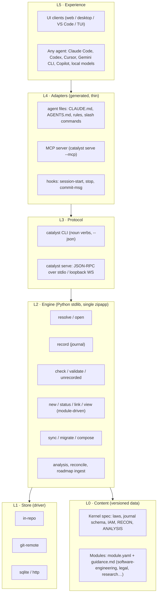
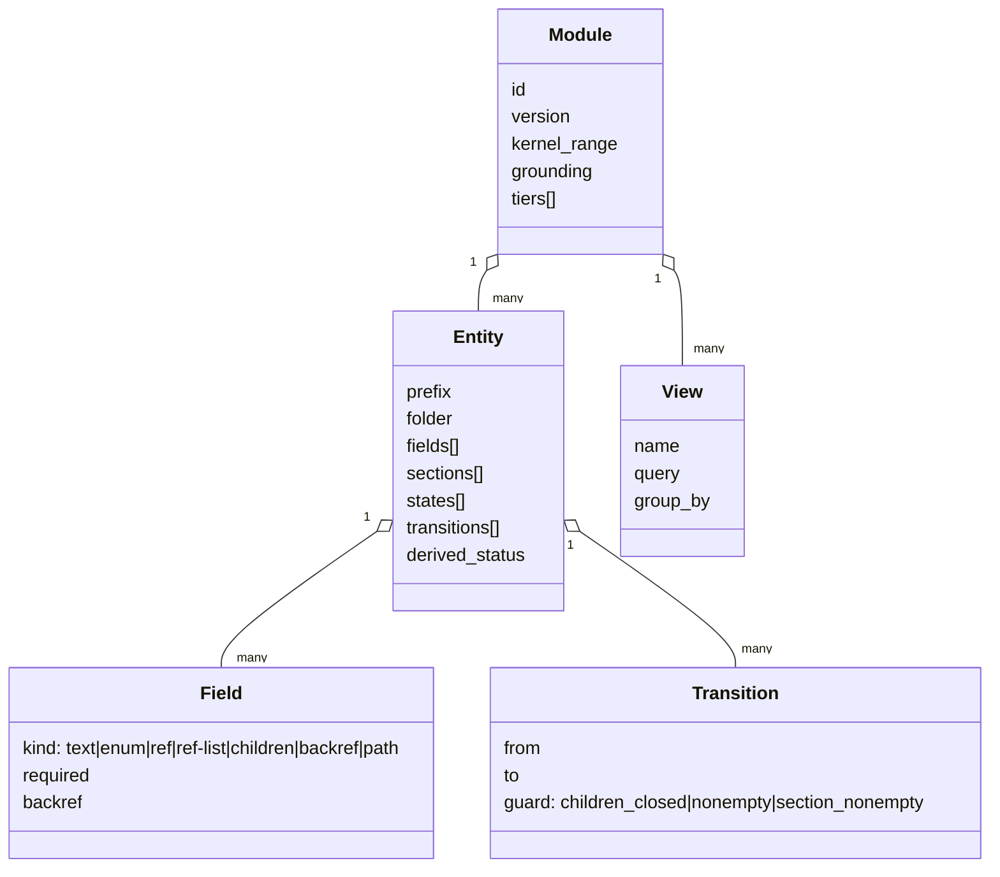
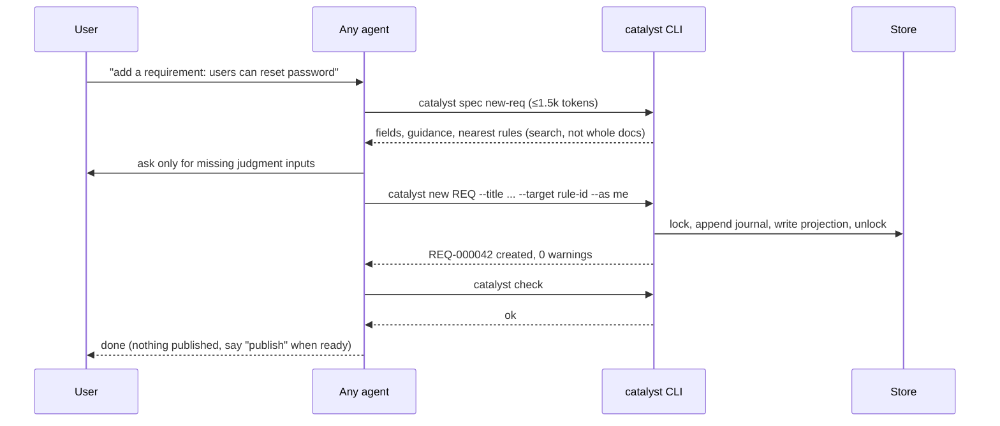
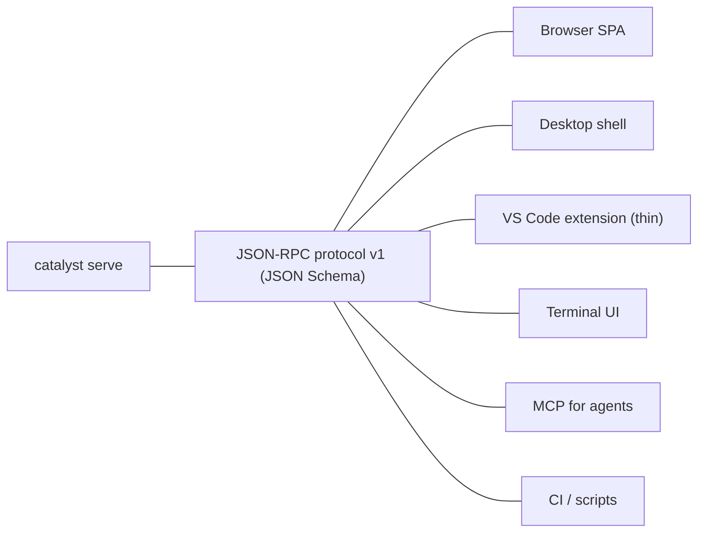
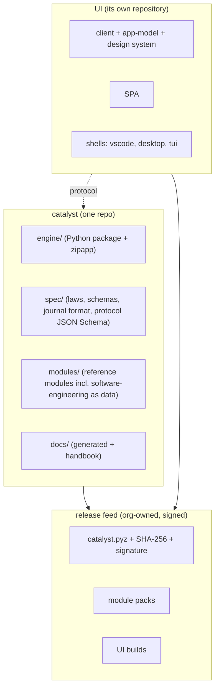

# 07 — Ideal architecture ("Catalyst 1.0 target")

Scope: what catalyst should *be* if redesigned today with everything learned in `01a`…`05`, keeping every
existing capability and the KISS rule. The path from here to there is `06-roadmap-streamline.md`.
The single-source-of-truth question is detailed in `08-criterion-proposals.md` (this document assumes its **D + A** recommendation).

---

## 1. What catalyst is (one sentence, then the promise)

> **Catalyst gives an AI agent a verifiable memory of *why* a project is the way it is: rules, the work that serves
> them, and an append-only, hash-chained journal of every change.**

Four promises that fully define the product (everything else is mechanism):

| # | Promise | Mechanism (today's word) |
|---|---|---|
| 1 | **Every change is recorded** — who, when, why, what | journal |
| 2 | **Every change is grounded** — traced to a rule/target a human accepted | rules, domains, artifacts |
| 3 | **Nothing consequential happens unasked** — publish, commit, conflict decisions need a human | assent, four-eyes, reconciliation |
| 4 | **Any agent, any model, any machine** can pick it up in seconds | CLI + generated adapters + one declared store |

## 2. Design rules (the KISS contract)

| Rule | Consequence |
|---|---|
| **Code decides how; prose decides when.** | ~80% of today's command steps (01b §7) become CLI verbs; prompts shrink to judgment only. |
| **One source of truth per fact; everything else is generated.** | Invariants, command lists, file layouts, version numbers, indexes, UI models are generated, never hand-copied. |
| **The agent reads *briefs*, not documents.** | `catalyst brief` (≤ 600 tokens) at session start; `catalyst spec <cmd>` (≤ 1.5k) per command. No agent ever reads the 380 KB docs. |
| **Kernel knows no module; module knows no agent; agent knows no storage.** | Strict layers (§3). |
| **Declare, never infer.** | One locator file declares store, project, module, versions. |
| **Record locally, publish deliberately.** | Instant offline recording; sharing is a separate, assented verb. |
| **Small surface.** | ≤ 16 slash commands, ≤ 12 CLI nouns, ≤ 10 laws, ≤ 3 doc pages for a human newcomer. |

## 3. Layered architecture



Dependency rule: arrows only point downward. The UI never parses files; agents never edit governed files by hand; the
engine never mentions a concrete module or agent by name.

### 3.1 Why Python for the engine (and when to revisit)

Keep **Python 3 stdlib-only, zipapp** for 1.0: the engine exists (12k LOC, 20+ test files), is already vendored, and
needs no build step. Windows is a **decided 1.0 target**, so the plan must ship a bundled Python runtime (or evaluate a single static
binary, Go/Rust) by R3/R5; also revisit if `catalyst serve` startup time hurts the desktop shell. The protocol (§6) makes the engine replaceable
without touching anything above it.

## 4. Content model — kernel and modules as *data*

### 4.1 Kernel (what every deployment has, whatever the process)

| Kernel entity | Purpose | Notes |
|---|---|---|
| **Law** (≤10) | the non-negotiables | replaces INV-1…30 (§7) |
| **Rule** (+ domain) | the project's own constraints, grouped in rule documents | grounding target for work |
| **Journal entry** | append-only, hash-chained, per-actor shard | the truth (D in 08) |
| **User / Role** | identity + advisory permission | IAM |
| **Reconciliation (RECON)** | durable record of diverging versions, human-resolved | |
| **Analysis** | four-eyes extraction of rules/defects from existing code | |
| **Workflow** | declared state machine (generic) | now declared by modules |
| **Meta-tag** | *removed* (0 uses) — a `tags:` field in any entity covers it | |

### 4.2 Module = one `module.yaml` + one `guidance.md`

Generalising the proposal in `02` §5. A module declares entities, fields, states, transitions, guards, tiers and views.
The kernel turns this into templates, indexes, validation, command specs and UI forms. A *legal-review* or *research*
module is then ~150 lines of YAML, not 130 KB of prose.



Generic engine verbs that make the module work with no module-specific code:

| Verb | Does | Replaces |
|---|---|---|
| `catalyst new <PREFIX> …` | scaffold, ID, slug, backrefs, index, journal | `/create-*` procedures |
| `catalyst status <ID> <state>` | validate transition + guards + RECON gate, journal | `/status`, prose closing rules |
| `catalyst link A.field B` | write both sides of a reference | back-ref prose |
| `catalyst view <name>` | render backlog/roadmap/board from queries | `/show-backlog`, BACKLOG.md |
| `catalyst list …` | filtered listing, `--json` | `/list`, `/user-list` |

Several modules per deployment become possible (ordered list, prefix/folder collision check) which retires the
plugin machinery (§8).

## 5. The agent contract (portable to any agent and model)

### 5.1 One file, three lines of grounding

Every agent gets the *same* 25-line instruction block, generated per agent into its native file
(`CLAUDE.md`, `AGENTS.md`, `.cursor/rules/catalyst.mdc`, `GEMINI.md`, `.github/copilot-instructions.md`). Draft:

```markdown
# Catalyst (generated — do not edit; regenerate with `catalyst adapters write`)
This project is governed by catalyst. You do not read catalyst documents; you call the CLI.
1. At session start run: `catalyst brief`   (≈500 tokens: laws, state, what needs you).
2. Before any command listed by `catalyst help`, run `catalyst spec <command>` and follow it.
3. To create or change governed things use `catalyst new|status|link|record`, never edit .catalyst/ by hand.
4. Before finishing a turn run `catalyst check`; fix what it reports.
5. Never commit, push, publish or resolve a conflict without the user's explicit yes.
6. If unsure what applies: `catalyst why <path|ID>` shows the rule and history behind it.
```

Why this works for *small* models too: every step is "run X, read ≤ 1.5k tokens of output, do exactly that". There is
no 90 KB document to hold in context, no cross-reference to chase, no jargon to look up (`catalyst glossary <term>`).

### 5.2 Token budget by design

| Moment | Today | Target | How |
|---|---|---|---|
| Session start (catalyst repo) | ~10k | **≤ 0.7k** | `catalyst brief` replaces CLAUDE.md + INVARIANTS + BOOTSTRAP |
| Session start (deployed project) | 0 (ungrounded!) | ≤ 0.7k | hook runs `brief` — fixes G-02 |
| Install | 72–81k | **≤ 3k** | `catalyst init` interactive/flags; agent only asked judgment questions |
| One CRUD command | 5–22k | **≤ 2.5k** | spec ≤1.5k + guidance ≤1k; rule search instead of reading all rule docs |
| `/journal`, `/list`, backlog | up to 85k | **≈ 0** LLM tokens | CLI filters, returns JSON/table |
| Sync | 60–200k | **≤ 5k** | `catalyst sync plan/apply`; LLM only for `needs_decision` migrations |
| Agent switch | prose mirror | 0 | removed (agent-neutral store) |



### 5.3 What stays LLM-only (the real judgment)

Choosing targets/tier, writing intent and artifact content, extracting roadmap items from a document, deciding rule
conflicts/overlaps, accepting or rejecting adopted changes and analysis findings, merging diverged content in RECON.
Each of these is a **"decision request"** the CLI can *emit* (`catalyst todo`) and the UI can show in an inbox.

### 5.4 Agent-agnostic enforcement

| Concern | Mechanism |
|---|---|
| Grounding at session start | `catalyst hook install --agent <x>` writes the agent's native session/startup hook; fallback = instruction file §5.1 |
| End-of-turn gate | agent's stop hook where it exists; otherwise git `pre-commit`/`commit-msg` and CI (`catalyst check`) |
| Commands | generated per agent from one source (`catalyst adapters write`): Claude slash commands, Cursor commands, `AGENTS.md` table, MCP tools |
| Tools | `catalyst serve --mcp` exposes `brief, spec, new, status, link, list, check, why, journal` as MCP tools for any MCP-capable agent |

## 6. Protocol and the UI (portable, richer)

Detailed in `09-ui-brand-portability.md` (summarising `05`). Architectural commitments:

* **One engine, one protocol, many shells.** `catalyst serve` (JSON-RPC 2.0; stdio + loopback WebSocket with token auth).
* The TypeScript parser/validator/graph are **deleted after parity**; the UI is a client of the engine.
* **Module-driven rendering** (forms, boards, timelines come from `module.yaml`), so a new module needs no UI release.
* Shells: browser at `localhost`, desktop (Electron with sidecar; Tauri spike on a branch), VS Code webview views + native tree adapter, TUI.



## 7. The laws (30 invariants → 10 laws + generated checks)

Principle: an invariant that can be **checked by code** becomes a `check` rule (not prose); what remains is a *law*.

| # | Law | Absorbs (today) | Enforced by |
|---|---|---|---|
| L1 | **Record every change** with actor, time, intent, targets, content hashes. | INV-17, 14, 29, 24 | journal, `check`, `unrecorded` |
| L2 | **Ground every change** in a rule/target the project accepted. | INV-5, 8, 9, 13 | module `grounding`, `validate` |
| L3 | **Ask before you publish.** No push/commit/publish/conflict decision without an explicit yes. | INV-4, 18, 21, 25 (the exception rule is tooling, not law) | hooks, `publish` assent token |
| L4 | **One declared store**; no machine-specific path in tracked files. | INV-6, 19, 1 | locator, `where` |
| L5 | **Humans own decisions, agents own labour.** Conflicts, findings, sign-off go to a human inbox. | INV-16, 20, 21, 26 | RECON, `todo` |
| L6 | **Generated is never hand-edited.** | INV-14, 7 | `check` hash of projections |
| L7 | **Definitions are versioned; changing them is a migration** (code, tested), never an edit. | INV-23, 10, 11, 12 | `migrate`, frozen definitions |
| L8 | **Kernel knows no module; module knows no agent.** | INV-3, 22, 30 | purity check in CI |
| L9 | **Install and sync only when asked.** | INV-2 | CLI requires explicit verb |
| L10 | **Name it "catalyst"; say what you checked.** (communication & honesty) | INV-3 (naming), 15 | — |

The remaining INV-n are either folded into laws, become machine checks (`check` rule ids `C-001…`), or are retired as
SE-specific (module `guidance.md`). Mapping table lives in the roadmap phase R1 deliverable.

## 8. What is removed, merged or demoted (without losing a feature)

| Today | Fate | Where the capability goes |
|---|---|---|
| 38 slash commands | **≈16**, generated | noun CLI + wrappers (01b §4.3) |
| `/user-*`, `/role-*` (7) | → `/user`, `/role` → CLI | `catalyst user|role …` |
| `/roadmap-add|update|merge|remove` | → `/roadmap …` | `catalyst roadmap …` |
| `/audit`, `/commands` | merged | `/check-rules`, `/help` |
| `/meta-tag` | dropped (0 uses) | `tags:` field |
| `/catalyzer` + plugin catalog + 3 personal commands | parked | **modules** (data) + **adapters** (agents); revisit when a second real plugin exists |
| `catalyst-git` plugin | kept as optional extension, not core | `extensions/` |
| pointer + symlink + submodule + agent dir | → the home store `$HOME/.catalyst/projects/<name>/criterion`, named by the tracked `catalyst.toml` (renamed from `<name>.catalyst`; Python floor 3.11 for `tomllib`); no symlink, submodule or working copy in the project (owner requirement 2026-10-08, `13`; was `.catalyst/catalyst.toml`) | 08, 13 |
| `/switch-agent`, `/project export|import` | removed / `catalyst move` (R2 W5; `agent switch` only until `move` exists) | agent-neutral store |
| INVARIANTS.md (19 KB) + BOOTSTRAP §0 + CLAUDE.md copies | → generated `brief` (~0.7k tokens) | laws |
| rules-of-rules (67 KB) + code-of-conduct (55 KB) templates | → one **Handbook** of 12–15 KB, with IDs on every rule, generated per module | §9 |
| `scripts/*.py` + `scripts/catalyst/*` | one package `catalyst/` | 06 phase R3 |
| UI TS parser/validator | deleted after parity | engine |
| UI-only entities PROP-/RUN- | registered as real entities or removed | engine |

## 9. Documentation architecture (3 pages for humans, 0 for agents)

| Audience | Artifact | Size |
|---|---|---|
| Newcomer | `README.md`: what it is, 5-minute quickstart, the 10 laws | 1 page |
| User | `docs/handbook.md` (rules of rules + code of conduct, deduplicated, every rule has an ID) | ≤ 15 KB |
| Module author | `docs/modules.md` + `module.yaml` reference + JSON Schema | ≤ 8 KB |
| Contributor | `CONTRIBUTING.md`, ADRs | — |
| Agent | **none** — `brief`, `spec`, `why`, `glossary` generated from the above | ≤ 1.5k tokens each |

Everything in `FORMAT.md`, `ARTIFACT-LAYOUT.md`, `INSTANTIATION-*`, `GLOSSARY.md`, `SYNCHRONIZE.md`, `CLI.md`
(~170 KB) is **generated from code/schemas** (so they cannot drift again) or deleted.

## 10. Repository and distribution architecture



* Modules live as folders in the core repo until a third-party module appears; `catalyst module install <url|path>` verifies
  signature/hash. No submodules inside the kernel.
* Versioning: **one product version** for core+reference modules, SemVer; protocol and module format versioned
  separately; migrations keyed by *format* version (not kernel version).
* CI gate runs the CLI **pinned by hash from the base branch** (fixes the self-modifiable gate).

## 11. Brand architecture

| Layer | Name | Notes |
|---|---|---|
| Framework + CLI | **Catalyst** | keep; add a distinctive wordmark and one-line promise (§1) |
| Governance data | **the criterion** (kept, owner 2026-10-08: the root of the work, the single truth it is based on) | was proposed: "the Record" — dropped |
| Process packs | **Modules** | e.g. "Software Engineering", "Legal Review" |
| UI | named by its own product | the kernel serves any client and names none |
| Agent helpers | **Adapters** | replaces "catalyzer/plugins" for agents |
| Wire format | **Catalyst Protocol** | |
| Company | Cantica Tech | visible in About/releases only |

Name hygiene: "catalyst" is crowded (Apple Mac Catalyst, Perl Catalyst). Before investing in brand, run a trademark and
package-name search (npm/PyPI/Marketplace) and decide whether to keep it with a distinctive suffix ("Catalyst Record") or
rename the product (the CLI binary name can stay).

## 12. Feature-preservation matrix (nothing lost)

| Capability today | In the target |
|---|---|
| Hash-chained journal, pins, restore | journal shards + content blobs in store; `journal verify|restore` |
| Four-eyes analysis (`run-analysis`) | `catalyst analysis …` + `/run-analysis` judgment wrapper |
| Reconciliation (RECON) | `catalyst reconcile` with role gate in code |
| Sync framework + migrations | `catalyst sync plan|apply` + migrations as tested code |
| Frozen items | `catalyst freeze` |
| Adopt manual changes (unrecorded) | `catalyst unrecorded|adopt` (content-hash based) |
| IAM users/roles | `catalyst user|role` |
| Roadmaps ingest/merge/update/remove | `catalyst roadmap …` |
| SE entities & lifecycle | `module.yaml` v3 (software-engineering) |
| Nested deployments, `.catalystignore` | one `scope` implementation, shared by CLI/UI |
| Shared (multi-user) criterion + PR flow | store driver `git-remote` + `publish` |
| Module UI components | ETD-driven generic rendering; sandboxed custom views later |
| Task runner integration | generated `Taskfile` snippet from the command list (optional) |
| Release tooling (`/cut-release`) | stays as maintainers' tool, outside the product |

## 13. Quality bars for 1.0

* `catalyst brief` ≤ 700 tokens; `spec <cmd>` ≤ 1.5k; measured in CI (**token-budget tests**).
* Install in ≤ 3 commands, ≤ 3k agent tokens, tested on macOS/Linux/Windows.
* Parity: UI and CLI agree on a golden corpus (no TS validator).
* A second module (legal-review) is a CI fixture that runs init → new → status → view.
* Every state transition is a CLI verb with tests; zero procedures that exist only as prose.
* Mutating commands are concurrency-safe (lock + shards) and idempotent.
