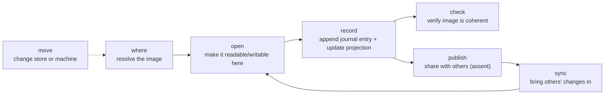
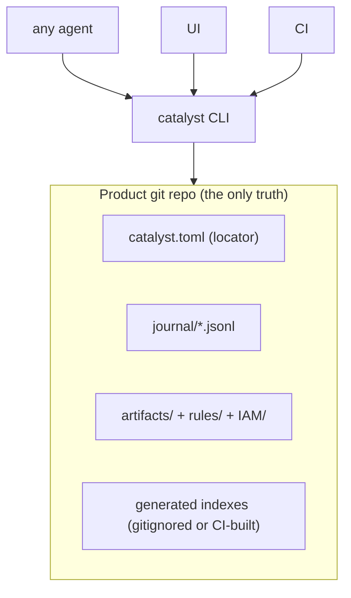
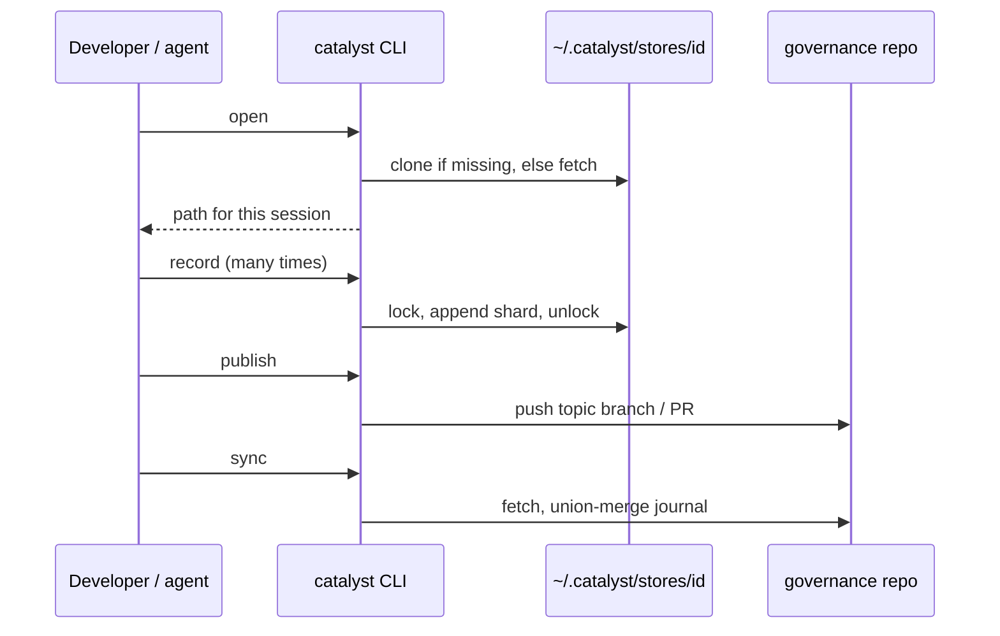
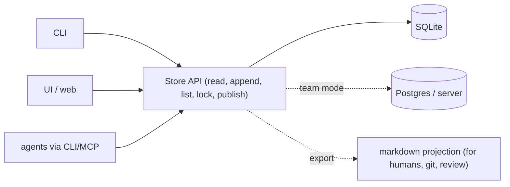
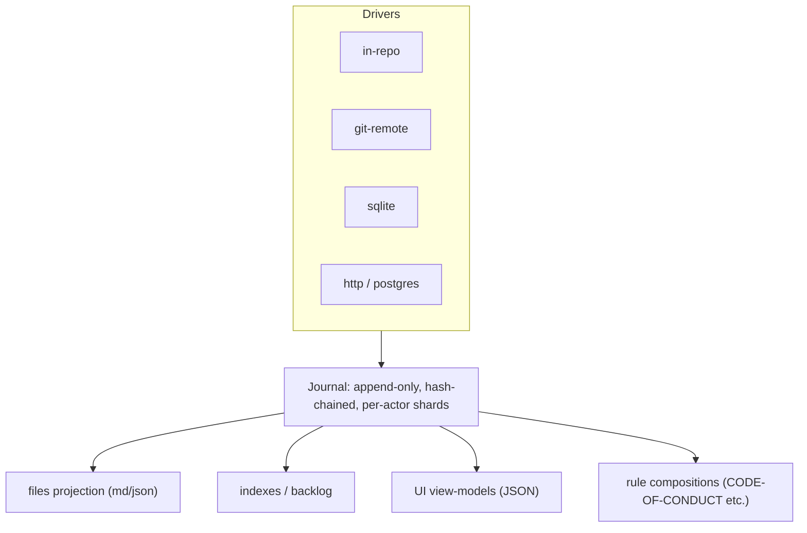
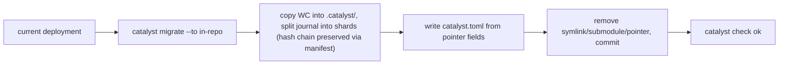

# 08 — One truthful image: criterion redesign proposals

Companion to `04-criterion-analysis.md` (the audit; requirements **R1–R33** are defined there, §5).
Goal stated by the owner: *use catalyst against a single truthful image, whether it is kept in a repo, a database or
elsewhere; clarify the processes that govern it; KISS; lose no existing feature.*

---

## 0. Diagnosis in five lines

1. Today the "image" is ~36 parts over 6 locations, found by 3 different resolvers, with mode **inferred** from 4–6 signals.
2. The product commits a pointer; the data lives elsewhere (symlink / submodule / folder) → per-machine, per-agent, per-path.
3. Local-only can't travel (2nd machine, 2nd user, CI, container). Shared costs a PR per edit.
4. 12 of 36 parts are maintained by an LLM following prose (agent switch, symlink repair, export/import…).
5. Four overlapping audit trails; no locks; a gate that the gated change can modify.

**Root cause:** the *location* of the truth is a runtime guess instead of a declared fact, and *how* it is reached is
spread across prose, Python and TypeScript.

## 1. Design principles (shared by every proposal)

| # | Principle | Fixes |
|---|---|---|
| P1 | **One declared locator.** A tiny committed file says *what* the truth is (`store: git-in-repo` / `git-remote <url>` / `sqlite <path>` / `http <url>`) and *which project id*. Nothing is inferred. | R1 R2 R3 |
| P2 | **One resolver, one binary.** `catalyst where` is the only code that resolves; UI, hooks, CI, agents call it (or its JSON). | R2 R23 R30 |
| P3 | **Journal is the truth; everything else is a projection.** Files/indexes/UI models can be rebuilt from the journal. | R4 R8 R6 |
| P4 | **Store interface with a handful of verbs.** Any backend that implements `read / append / list / lock / publish` is valid. | the "repo, DB, …" ask |
| P5 | **Record locally, publish deliberately.** Recording is instant and offline; publishing/review is a separate, batchable verb. | R18 R20 R26 |
| P6 | **Code decides how, prose decides when.** Every state transition (open, switch, move, repair, export) is a CLI verb with tests. | R27 |
| P7 | **Agent-neutral.** The agent never owns the data; at most it owns a *cache* that can be deleted. | R11 R14 |

## 2. The six operations that govern the image (the "criterion process", clarified)

The current process has dozens of procedures. They collapse into **six verbs**; each is one CLI command, idempotent, journaled.

| Verb | Replaces today | Contract |
|---|---|---|
| `where` | pointer + symlink + memory scan + slug probe + Taskfile shell | prints store kind, location, project id, branch, state; exit ≠ 0 if ambiguous. JSON for UI. |
| `open` | init `--at`, symlink repair, join, switch-agent, import | idempotent: after it, `.catalyst/` (or the API) is usable. Safe to run every session (hook). |
| `record` | `journal append` + hand-edits + indexes regen | atomic: lock → append → project → unlock. |
| `check` | `check`, `integrity`, `unrecorded`, `validate` | incremental (since last checked entry); read-only. |
| `publish` | `criterion push`, PRs, pins sharing | explicit assent (INV-4); batches many records. |
| `sync` | `criterion sync`, pin fetch, gitlink moves | fetch + merge by rules (union journal, RECON on real conflict). |
| `move` *(rare)* | export/import, convert local↔shared, switch store | one verb with `--to <store>`; history preserved. |

## 3. The proposals

### Proposal A — "Governance lives in the product repo" (default for most projects)

`.catalyst/` is an ordinary committed directory in the product repo. One file `.catalyst/catalyst.toml` is the locator
(project id, kernel/module versions, `store = "in-repo"`). No symlink, no pointer, no submodule, no agent-owned dir.

* **Pros:** zero ceremony; clone = join (R15); works in CI, containers, Windows (R21); rename-proof; backup = git (R28);
  the product commit *is* the rules-in-force pin (R19) — no gitlink; no PR-per-edit (R18); one trail: git + journal (R8).
* **Cons:** governance changes show in product history/diff (mitigation: path filters, `.gitattributes linguist-generated`,
  separate `governance/` commit convention, or CODEOWNERS); some teams don't want governance in the product repo;
  secrets-in-journal risk is the same as any committed file (but removable — see §5 redaction).
* **Features lost:** none (INV-6's "keep governance out of the product tree" is the one deliberate reversal — its stated
  goal, *one access path, no path in tracked files*, is met better by a path that is simply relative).

### Proposal B — "Sibling governance repo, found by id" (teams that want separation)

Product commits `catalyst.toml` containing `store = "git"`, `remote = <url>`, `project = <id>`. The CLI keeps a **cache
clone** at `~/.catalyst/stores/<project-id>/` (never agent-owned, never a symlink). The product has *no* gitlink.

* **Pros:** separate access control and review for governance; one cache location for *every* agent (R11); fresh clone +
  `open` = joined (R15); no gitlink churn; product CI needs only `catalyst open` (R22).
* **Cons:** two repos to host; product commit no longer pins rules (R19 needs `rules_commit = <sha>` written by `publish`
  into the locator — one field, still committed); cache can be deleted (that's fine: it is a cache, remote is truth).
* **Backup:** the remote. Local-only mode is *not offered* here (that is Proposal A or C).

### Proposal C — "Local database + optional server" (single user → team, UI-first)

The truth is a **SQLite file** (`journal`, `entities`, `refs` tables; the journal table is append-only with hash chain).
Locator: `store = "sqlite"`, `path = .catalyst/catalyst.db` (in-repo, ignored) or a user-level path; team mode flips
to `store = "http"`, `url = https://…` served by `catalyst serve` (same schema over Postgres).

* **Pros:** real transactions (R12 solved natively: no races, unique ids from a sequence — R17); fast incremental checks (R29);
  trivial UI/query layer (R23: SQL/JSON, no parallel parser); redaction = delete/tombstone row (R10);
  `catalyst serve` gives the web/desktop/VS Code UI the same API (see `09-ui-brand-portability.md`).
* **Cons:** binary file is not diff/review friendly → needs the **markdown projection** (generated, committed or published)
  to keep human review and git history; SQLite in git is a no-go (so backup/share needs `publish` to a server or an export bundle);
  more code to own than A.
* **Feature parity:** every current artifact is a row with a path-like key; the markdown projection preserves today's files.

### Proposal D — "Journal-first, backend-agnostic" (the *architecture* behind A, B and C)

Not a competing option: the **abstraction** that makes A/B/C interchangeable. Define the truth as the hash-chained
journal (already the best-engineered part). Entities/indexes/UI models are **projections**. A `Store` driver implements
five verbs. Shipped drivers: `in-repo` (A), `git-remote` (B), `sqlite` (C), later `http`, `postgres`, `s3`.

Key design choices that remove today's pain at the root:

* **Per-actor journal shards** (`journal/<actor>/<YYYY-MM>.jsonl`, one hash chain per shard + a root manifest): no cross-session
  append races (R12), no union-merge conflicts, same user on two machines gets distinct shards by `actor@host`, ids
  `PREFIX-<seq>-<actor-short>` (R17).
* **Incremental check:** `check` remembers the last verified entry per shard (R29). A dirty working tree in *another* session
  no longer blocks the gate: the hook checks *only its own session's recorded scope* (R13).
* **Unrecorded changes** are decided by **content hash vs. last journaled `after`**, never wall-clock (R9).
* **Gate integrity (R25):** CI runs the CLI **pinned by hash from the base branch**, not from the PR; workflows are
  `workflow_call` of a fixed reusable workflow.
* **Redaction (R10):** tombstone entries (`redacts: <entry-id>`, content replaced by its hash) keep the chain verifiable.
* **Agent preference** (`agent=`) moves to a per-user, untracked file (R14).

## 4. Comparison

Scored against the requirements that discriminate (✔ meets, ◐ partial, ✘ fails). "Today" from `04` §5.7.

| Req | Today | A in-repo | B git-remote | C sqlite/server | D-core (applies to all) |
|---|---|---|---|---|---|
| R1/R2 single image, one resolver | ✘ | ✔ | ✔ | ✔ | enforces |
| R3 explicit mode | ✘ | ✔ | ✔ | ✔ | locator |
| R6 restore on any clone | ◐ | ✔ | ✔ | ◐ (needs server/export) | pins disappear: journal holds content hash + blob in store |
| R8 one trail | ✘ | ✔ | ◐ | ✔ | journal is the trail |
| R10 redaction | ✘ | ◐ | ◐ | ✔ | tombstones |
| R11/R14 agent-neutral | ✘ | ✔ | ✔ | ✔ | |
| R12 concurrency | ✘ | ◐ (shards) | ◐ (shards) | ✔ | shards or DB tx |
| R15 any machine, one command | ◐ | ✔ | ✔ | ✔ (server) / ◐ (local) | |
| R18 proportionate ceremony | ✘ | ✔ | ✔ (batch publish) | ✔ | |
| R19 rules↔code coherence | ◐ | ✔ (same commit) | ◐ (`rules_commit`) | ◐ | |
| R20 offline | ✔ | ✔ | ✔ (cache) | ✔ | |
| R21 portable | ✘ | ✔ | ✔ | ✔ | no symlinks/colons/abs paths |
| R22 CI-capable | ✘ | ✔ | ✔ | ◐ (needs server) | pinned CLI |
| R23 UI contract | ✘ | ✔ via CLI JSON | ✔ | ✔ | `catalyst serve` |
| R28 recoverable | ✘ (local) | ✔ git | ✔ remote | ◐ | |
| Complexity to build | — | **low** | medium | high | medium |

## 5. Recommendation

> **Superseded in part (owner requirement, 2026-10-08, `13`):** governance never sits in the product. The default
> driver becomes a **home store** at `$HOME/.catalyst/projects/<name>/criterion` (Proposal B's cache location made the
> working location, local-only by default), with a workspace meta criterion at `$HOME/.catalyst/workspaces/<name>/criterion`
> and a uv venv per criterion. B (git remote) and C (server) remain the sharing drivers; D is unchanged.
>
> **Owner decisions (2026-10-07):** governance inside the product repo is acceptable (A is the default); a multi-user
> server is needed within ~6 months (so Proposal C's `sqlite`/`http` driver is scheduled, not deferred); Windows is a 1.0
> target; the three existing deployments stay legacy (no mandatory migration).

**Ship D as the architecture and A as the default driver; offer B as the team option; keep C as the v2 "UI-first / server" driver.**

Why: A removes the symlink, pointer, submodule, agent-owned dir, export/import and agent-switch procedures **entirely**
(24 of the 36 parts disappear — see §6). B is a ~200-line variation for teams who want separation. C is where the
richer UI and multi-user server naturally land, and D guarantees we can get there without redoing the rules/journal layer.

### What disappears vs. what stays

| Today (36 parts) | After (A default) |
|---|---|
| P1 pointer, P2 symlink, P3 agent dir, P4 fallback WC, P7 submodule, P8 topic branches, P9–P11 CI/protect scaffolding for a separate repo | **`.catalyst/catalyst.toml`** (locator) — one file |
| P5 WC git, P6 criterion remote, P13 pins ×2 | product git (A) / one remote (B) |
| P12 journal, P14 indexes, P15–P17, P19 module copy | stay, as projections; journal sharded |
| P18 vendored pyz | pinned by hash in `catalyst.toml`; CI downloads the same |
| P20 `.frozen`, P21 `.catalystignore`, P22 nested | stay, one scope implementation (`catalyst where --scope`) |
| P24/P25 hooks | stay; installed by `catalyst hook install` for any agent |
| P26 slash commands | generated per agent from one source (see 06) |
| P27 Taskfile include, P28 memory note, P29 ledger, P30 restore dirs, P31 export bundle, P33–P36 UI caches/proposals | removed or become cache/`move` |

### Migration (R32), mechanical, history preserved

For shared deployments, `--to git-remote` keeps the existing criterion repo and merely drops the submodule/gitlink.

## 6. How this simplifies the processes (and the agent's token bill)

| Process today | After | Token effect |
|---|---|---|
| Bootstrap/install reads ~72–81k tokens (see `01a`) | `catalyst init` + 1 page of instructions | −90% |
| Session start: prose symlink repair, memory note, agent-switch check | hook runs `catalyst open --quiet` | ~0 tokens |
| Agent switch (prose mirror) | none — agent-neutral | −100% |
| Join a project | `git clone && catalyst open` | ~0 |
| Convert local↔shared | `catalyst move --to …` | ~0 |
| `/journal` (LLM reads whole journal, ~85k) | CLI filters → JSON | −99% |

## 7. Risks and mitigations

| Risk | Mitigation |
|---|---|
| Governance noise in product history (A) | `.catalyst/` path filters, `linguist-generated`, bot-only commits, or choose B |
| Existing deployments' history | `migrate` keeps the chain; legacy entries stay readable (`--legacy`) |
| SQLite not git-friendly (C) | markdown projection is the reviewable artefact; DB is never committed |
| Regression of INV-6 intent | Rewrite INV-6 as "one declared locator, no machine path in tracked files" — satisfied by A/B/C |
| Over-building a server | C is optional, behind the same Store interface; defer until the UI needs it |

## 8. Questions to settle before building

1. Is "governance inside the product repo" acceptable as the default (A), or is separation a hard requirement for you/your clients?
2. Do you need multi-user/server mode in the next 6 months (decides when C is built)?
3. Must today's three deployments be migrated, or may we start clean and keep them as legacy until 1.0?
4. Is Windows a supported target now?
