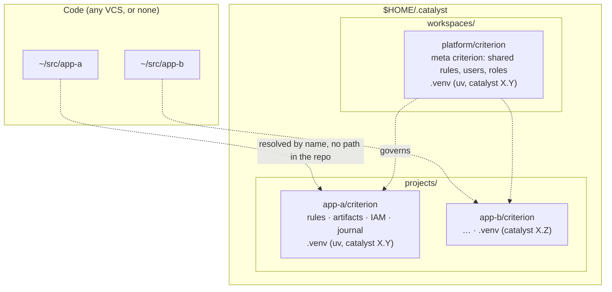
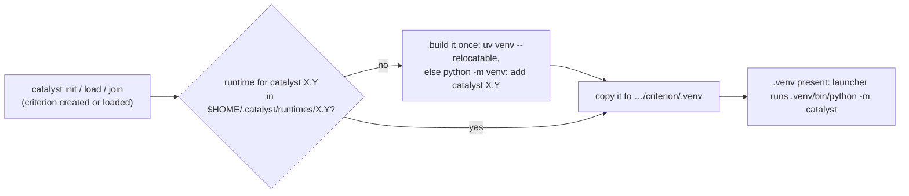

# 13 — Requirement: the criterion lives in `$HOME/.catalyst`, never in the project (2026-10-08)

> **Owner requirement, 2026-10-08 — high importance.** It supersedes decision A1 (governance inside the product repo,
> `10`), the in-repo default of Proposal A (`08` §5), the locator path of ADR-010 (`.catalyst/catalyst.toml`), and the
> agent-owned working copy reached through a `.criterion` symlink (kernel 0.37.0 → 0.46.1).

## 1. The requirement

1. **Nothing of the criterion sits in the project.** No `.criterion` directory, symlink or submodule, nothing a version
   control system (git or any other) could pick up as part of the code base.
2. **A project's criterion** lives at `$HOME/.catalyst/projects/<project name>/criterion`.
3. **A workspace** — several projects governed together (a "project of projects") — has a **meta criterion** at
   `$HOME/.catalyst/workspaces/<workspace name>/criterion`.
4. **The Python side runs from a virtual environment inside each criterion**, `…/criterion/.venv`, built with
   **uv** (or Python's own `venv` when uv is absent, §7) and present as soon as the criterion is created or loaded. Each criterion pins its own catalyst version, so several catalyst versions run side by side on one machine.
5. The location is **catalyst's own**, not an agent's (today: `~/.claude/projects/<slug>/.criterion` under Claude
   Code). Every agent, the UI, hooks and CI reach the same place.

## 2. The layout



```
$HOME/.catalyst/
├── projects/<project name>/criterion/        # one per governed project
│   ├── .venv/                                # uv-managed; catalyst pinned for this criterion
│   ├── rules/ … IAM/ … development/journal.jsonl …
│   └── (its own git repository, optionally pushed to a shared remote)
└── workspaces/<workspace name>/criterion/    # one per workspace (project of projects)
    ├── .venv/
    └── shared rules, users, roles; the list of member projects
```

## 3. What it replaces

| Today (0.46.1) | After |
|---|---|
| `.criterion` symlink in the project, gitignored | nothing in the project |
| working copy in agent-owned space (`~/.claude/projects/<slug>/.criterion`) | `$HOME/.catalyst/projects/<name>/criterion`, agent-neutral |
| shared deployment = `.criterion` as a git **submodule** of the product | the criterion is its own repo with a remote; no gitlink in the product |
| vendored `bin/catalyst.pyz`, run with whatever `python3` is on `PATH` | `…/criterion/.venv`, created by `uv`, catalyst version pinned per criterion |
| one catalyst version per machine in practice | several versions side by side (one per criterion `.venv`) |
| nested deployments inside one repository (0.45.0) | a **workspace** criterion above its projects' criteria |
| `/switch-agent`, agent-dir mirroring | gone: the location does not depend on the agent |

What it keeps: the criterion's content and format, the journal and its hash chain, IAM, the CLI as the single engine,
sharing through a git remote (Proposal B), the multi-user server (decision A2) as another driver behind the same API.

## 4. What it changes in the plan

* **`08` Proposals.** The default driver is no longer A ("in the product repo") but a **home store**: Proposal B's
  cache location made the working location, local-only by default, with a git remote (B) or a server (C) for sharing.
  Proposal D (journal-first, driver-based) is unchanged and is what makes this a driver choice.
* **`07` §8 / §10.** "pointer + symlink + submodule + agent dir → `.catalyst/catalyst.toml`" becomes "→ the home store,
  resolved by project name". Distribution adds: catalyst installable into a uv-managed venv (a wheel on the release feed),
  not only the zipapp.
* **`06` roadmap.** R3.1 (locator) and R3.2 (store) are rewritten around the home store; new items for uv/venv, the
  workspace criterion and the project → criterion resolution (`06` R3).
* **ADR-010** (accepted 2026-10-08 with `.catalyst/catalyst.toml`) must be revised or superseded by a new ADR; the
  feature register rows K-19, K-20 (and K-22/K-23 for sharing) follow.
* **Windows (A4)** gets simpler: no symlink is needed anywhere.

## 5. Design consequences to settle

| Area | Consequence | Proposed answer |
|---|---|---|
| **Finding the criterion** | The CLI must map a working directory to a project name. | **Decided (Q1, Q6):** the tracked `catalyst.toml` at the project root names it; `catalyst where` reads it and returns `$HOME/.catalyst/projects/<name>/criterion`. |
| **Project name** | It is the directory key: must be unique per machine and safe on every OS. | `init --name` validated (letters, digits, `.`, `_`, `-`); a clash is refused. |
| **Workspace** | What makes a workspace, and what the meta criterion holds. | **Decided (Q2):** a VS Code `<name>.code-workspace`; its folders with a `catalyst.toml` are the members; the meta criterion holds what is shared (rules, users, roles). |
| **The venv** | The CLI must be a package (wheel), not only a zipapp. | **Decided (Q3), §7:** a runtime per catalyst version, built once (uv, else `python -m venv`) and copied into `criterion/.venv` when a criterion is created or loaded; the launcher runs the venv's Python directly, no activation. |
| **Hooks and agents** | `.claude/settings.json` today runs `python3 .criterion/bin/catalyst.pyz hook …`. | Hooks call the launcher (`catalyst hook start`), which resolves the criterion and its venv. |
| **Commit-msg hook / CI** | Product CI and the commit-msg hook read the criterion; CI has no `$HOME/.catalyst`. | CI clones the shared criterion into its own `$HOME/.catalyst/projects/<name>/criterion`; local-only projects cannot be checked in CI (as today). |
| **Command files** | Claude Code reads `.claude/commands/` in the project. | Unchanged for now (an agent's discovery path, not governance data); generated per agent in R4.5. |
| **Legacy deployments** | Existing pointer + symlink/submodule deployments. | `catalyst migrate --to home` (moves the working copy, writes the registry, removes symlink/submodule); legacy stays readable for one minor (A3). |

## 6. Owner answers (2026-10-08)

| # | Question | Answer | Consequence |
|---|---|---|---|
| Q1 | A tracked file in the project? | **Yes: one file at the project root, naming the project (and its workspace), never a path** — renamed **`catalyst.toml`** (Q6) | The CLI resolves `catalyst.toml` → `$HOME/.catalyst/projects/<name>/criterion`; a fresh clone finds its criterion on any machine. The file sits at the project root (not `.catalyst/catalyst.toml`) and holds no governance data. |
| Q2 | What is a workspace? | **A VS Code workspace** (a `<name>.code-workspace` file) | Workspace name = the file's name; members = its folders that carry a `catalyst.toml`; the meta criterion is `$HOME/.catalyst/workspaces/<name>/criterion`. The file is plain JSON, so the CLI reads it whatever the agent or editor. |
| Q3 | Without uv? | **Find another way; the venv must be copied and present when a criterion is created or loaded** | See §7. |
| Q4 | Keep the name "criterion"? | **Yes.** It is the root of the work, the single truth the work is based on | `07` §11's "the Record" rename is dropped; "criterion" stays in the CLI, docs and paths. |
| Q5 | Sharing remotes | **To be explored** (owner, 2026-10-08): git repository, relational database (down to SQLite) or NoSQL; something easy now | Evaluation and plan: `14-sharing-backends.md` — git stays the driver now; SQLite index next; `catalyst serve` (SQLite/PostgreSQL) and CouchDB explored behind one interface |
| Q6 | Rename `<name>.catalyst` to `catalyst.toml`? | **Yes** (owner, 2026-10-08) | One fixed name at the project root (no `*.catalyst` globbing; the project name lives in the content). TOML read with the stdlib `tomllib`, so **the Python floor rises to 3.11 from R3.1** (3.9 is past end of life; the uv-built runtime brings its own Python, only the `python -m venv` fallback needs a system 3.11+). Existing `<name>.catalyst` files are read for one minor (ADR-009); `catalyst migrate` renames them; the UI's reader accepts both during that minor. |

**Q5, reworded.** When several people work on one project, each has their own `$HOME/.catalyst/projects/<name>/criterion`.
They stay in step through one shared copy, which today is a separate GitHub repository per project (for example the UI
repository's `…-criterion`). Should that stay so — one git repository per project's criterion, pushed and pulled by
`catalyst criterion push/sync` — until the multi-user server (decision A2) replaces it?

## 7. The virtual environment without uv (Q3)

Checked on this machine (uv 0.11.26, macOS):

* **No activation is needed.** Activation only edits the shell's `PATH`. The launcher, hooks and CI call the venv's
  interpreter directly — `…/criterion/.venv/bin/python -m catalyst` (`.venv\Scripts\python.exe` on Windows) — so
  nothing ever "activates" a venv.
* **Copying works on the same machine, not across machines.** `uv venv --relocatable` builds a venv whose scripts use
  relative paths; a copy of it ran from its new place. Every venv still names its base interpreter by absolute path
  (`pyvenv.cfg` `home = …`), so a venv cannot travel to another machine.
* **uv is not required to build one.** catalyst is stdlib-only: a venv made by Python's own `python -m venv` with the
  catalyst package added (wheel, or the zipapp's contents) works the same. (Debian/Ubuntu need the `python3-venv`
  package for that.)

**Proposed mechanism ("copied and present"):**



1. One **runtime per catalyst version**, built once per machine at `$HOME/.catalyst/runtimes/<X.Y>/`: uv when present
   (`uv venv --relocatable` + the catalyst wheel), else `python -m venv` + the same wheel.
2. **Creating or loading a criterion copies that runtime into `…/criterion/.venv`** (copy, so each criterion is
   self-contained and can be pinned independently), and re-copies it if it is missing or names another version.
3. **`.venv` is never shared**: ignored in the criterion's git repository; on another machine, loading the criterion
   rebuilds or copies the runtime there.
4. Several catalyst versions coexist: each criterion's `.venv` holds the one its project's `catalyst.toml` pins.

## 8. Implementation plan

Staged plan (A floor 3.11 + `catalyst.toml` → B resolver → C runtime → D `init` → E `catalyst move` → F sharing →
G workspace → H release 0.48.0): `docs/plans/r3-1-home-store.md` in the catalyst repository.

## 9. Owner requirement (2026-10-09): catalyst touches no project file but `catalyst.toml`

> **Owner, verbatim:** "I do not want catalyst to modify any taskfile in the host project. It should sit entirely
> outside of any code artifacts" — "aside from the toml file that is".

`catalyst.toml` is the **only** file catalyst (the CLI, the agent following its procedures, the UI) may create or edit
in a host project. INV-6 says so since this change.

| What catalyst put in the project | Status |
|---|---|
| The root `Taskfile.yml`: agent vars plus an `includes: common:` of the criterion's `Taskfile.common.yml` (INSTANTIATION-GUIDE §1 step 5) | **Done.** The step is gone from BOOTSTRAP, the guide, the checklist and CLAUDE.md; catalyst's and the UI's Taskfiles no longer include or call catalyst. The criterion's `Taskfile.common.yml` runs on its own: `catalyst task <command> -- <args>` (new verb), every task with `dir: '{{.USER_WORKING_DIR}}'` |
| `.claude/commands/*.md` (one per §4 command, written by `catalyst init --commands-dir`) | **Open.** Candidate: a user-scope catalyst Claude Code plugin carrying the commands, each a no-op outside a project with a `catalyst.toml` |
| `.claude/settings.json` hooks (`catalyst hook start|stop`) | **Open.** Same plugin (its hooks), or the user-scope `~/.claude/settings.json`, both no-ops without a `catalyst.toml` |
| `.git/hooks/commit-msg` (`catalyst hook install`, opt-in) | **To decide.** Inside `.git/`, never tracked: not a code artifact, but in the project's directory |
| `.gitignore` `/.criterion` line | Legacy deployments only; `catalyst move` removes it |
| The UI's extension writes | `catalyst.toml` only (`join-criterion.ts`) |
