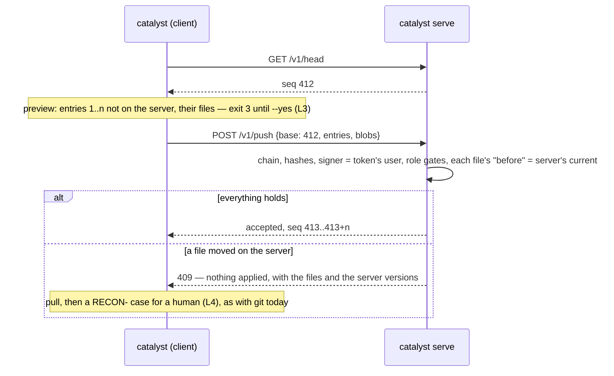

# 19 — The multi-user server (R3.9 design note for the owner, 2026-10-10)

> **Status: approved (owner, 2026-10-10)**: every recommendation in §9. The server is a share driver, with each
> person's criterion staying on disk. There is no standalone local index. Every push needs its own yes. Pushes apply
> directly once the structural checks pass. Tokens per user make identity verified. PostgreSQL waits for S5. The
> server is self-hosted. **S1 and S2 built on `development` (2026-10-10, unreleased; `REQ-000018`, `STEP-000014`):**
> `scripts/catalyst/serve.py`, 11 tests; measured on a copy of catalyst's own criterion, import 0.61 s, one journaled
> change pushed in 0.25 s. Where the build differs from this note, §10 says so.
>
> Decision A2 (`10`) asks for a multi-user server within about six months. `14` §3 sketched it as SQLite (PostgreSQL
> later) behind `catalyst serve`, reached through the same share interface as git. This note says what the server is
> for, where the truth lives, how a push works, and what it changes in the laws.

## 1. What the server is for, and what it is not

Measured on the largest deployment then available (374 governed documents, 283 journal entries, kernel 0.52.1):

| Command | Time |
|---|---|
| `catalyst list REQ` | 0.40 s |
| `catalyst view <REQ>` | 0.28 s |
| `catalyst backlog` | 0.37 s |
| `catalyst journal show --since …` | 0.27 s |
| `catalyst check` | 1.99 s |

Reads are already fast, so **a standalone local SQLite index no longer pays for itself**. `14` §5 recommended one
"to make `list`/`view`/`backlog` fast"; at this size there is nothing left to speed up, and an index brings a second
copy to keep in step. It comes back only as the server's storage (§4), where it is needed anyway.

What the server solves is **sharing**, not speed. With the git driver, several people sharing one criterion pay for:

* **one pull request per change, or direct pushes with merge risk.** Per-author journal shards (R3.3) removed journal
  conflicts, but each push is still a branch, a CI run and a merge;
* **no live view.** A colleague's change is invisible until it is merged and pulled;
* **declared identity.** Anyone with write access can sign as anyone (`ACCESS-CONTROL.md`; branch protection and
  review are the only controls);
* **role gates checked only on the signer's machine.** `catalyst reconcile` checks the signer's level locally, so a
  modified CLI can skip it;
* **a second parser in every client.** A user interface reads and parses the markdown and the journal itself, and
  breaks when the format moves (the journal shards needed a UI change).

## 2. Where the truth lives

| | **A. The server is a share driver** (recommended) | **B. The server is the single source** |
|---|---|---|
| Each person's criterion | stays in `$CATALYST_HOME/projects/<name>/criterion`, files on disk, as today | a cache, or nothing; every command writes through the server |
| Offline work | yes: work locally, push when back (`14` §1 requires it) | no |
| Change to the CLI | one new driver behind the `Share` protocol (`info/status/head/preview/pull/push`) | every writing command goes through a remote store |
| Git driver | stays; a criterion moves between drivers | replaced or kept in parallel |
| Size | ≈ 600 lines server and driver (`14` §4) | several thousand lines |

**Recommendation: A.** The server is a remote that understands catalyst. It holds the journal and the content it
names, takes pushes one batch of entries at a time, and serves pulls and queries. Every command keeps working
offline, unchanged. The laws keep their wording: the criterion still lives outside the project (L5), and nothing
leaves the machine without a yes (L3).

## 3. A push and a pull



* **Push** sends the journal entries the server does not have and the content (blobs) of every file they name. The
  server checks them all, then applies them **all or nothing** in one transaction. A conflict is
  *optimistic*: each entry carries its file's `before` hash, and the push is refused if the server's current version
  of any file differs. Refusing the whole push matches the git driver ("a conflict stops the push with nothing
  pushed", rr-META-013).
* **Pull** fetches the entries after the client's last known sequence number, plus their blobs. The client writes
  the files, appends each entry to its author's shard (the same layout as today, so `check` and `journal show` see
  no difference) and commits locally. A local unpushed change to the same file stops the pull, and a human decides,
  the same rule as for git.
* **IDs** need no server help. Every ID ends with its signer's `userid`, so two people never collide. The one
  remaining case, one person on two machines, is covered by the server refusing a second artifact with the same ID
  on push.

## 4. Storage

Two tables are the truth, as `14` §3 sketched. Everything else is derived and can be rebuilt from them at any time.

```sql
-- truth
entries(seq INTEGER PRIMARY KEY, shard TEXT, hash TEXT UNIQUE, prev_hash TEXT,
        actor TEXT, userid TEXT, time TEXT, command TEXT, artifact TEXT, json TEXT)
blobs(sha TEXT PRIMARY KEY, bytes BLOB)
-- derived (rebuilt from entries + blobs)
files(path TEXT PRIMARY KEY, sha TEXT, seq INTEGER)
artifacts(id TEXT PRIMARY KEY, prefix TEXT, status TEXT, title TEXT, path TEXT, fields TEXT)
-- server-only
tokens(hash TEXT PRIMARY KEY, userid TEXT, created TEXT, revoked TEXT)
```

The server derives `artifacts` with the CLI's own corpus loader on the projected files: one parser, in Python. A
client asks the server instead of parsing the markdown itself. SQLite is in the standard library, so the server needs
nothing beyond the per-criterion runtime. PostgreSQL uses the same schema through a small dialect layer and needs a
client library; it goes into the server's environment only, never the CLI's, and only when someone needs it.

## 5. The API

JSON over HTTP, `http.server` (threading) on the server side, `urllib` on the client side: no dependency. Versioned
under `/v1`.

| Method and path | Purpose |
|---|---|
| `GET /v1/head` | latest sequence number and hash |
| `GET /v1/entries?after=<seq>` | entries for a pull, paged |
| `GET /v1/blobs/<sha>` | one file version |
| `POST /v1/push` | apply a batch, all or nothing (§3) |
| `GET /v1/artifacts?prefix=&status=` | the same rows as `catalyst list`, for a client UI |
| `GET /v1/view/<id>`, `GET /v1/backlog` | the same as `catalyst view` and `backlog` |
| `GET /v1/events` | server-sent events: a new sequence number, for live views |

`catalyst serve` binds to `localhost` by default. Anything wider runs behind a reverse proxy that terminates TLS;
the server never handles certificates. `catalyst.toml` names it the way it names git:
`share = { driver = "serve", url = "https://…" }`.

## 6. What changes in the rules

* **Identity becomes verified on a served criterion.** Each user holds a token in `$CATALYST_HOME/credentials`
  (outside every criterion and project). The server refuses an entry whose signer is not the token's user.
  `catalyst user add` on a served criterion also issues a token. L4's "declared, never guessed" still applies on the
  client; the handbook's "identity is declared, not verified" (rr-META-013) gets a served-criterion clause.
* **Role gates are enforced server-side.** `reconcile`'s levels, and any future gate, are checked on push as well as
  locally.
* **The CI gate moves into the push.** The structural checks (chain, hashes, signers, role gates, unique IDs) run
  synchronously and refuse the push. A full `catalyst check` on the resulting tree takes about 2 s. It runs after
  the push is accepted and publishes its findings without blocking (decision 4).
* **L3 stays as written.** Every push previews and waits for a yes. Decision 3 asks whether a served criterion may
  carry a standing yes.

## 7. Moving between drivers

* **git → serve:** `catalyst share create --driver serve <url>` uploads every entry and the blobs of every current
  file, then rewrites `catalyst.toml`'s `share` line (a journaled change). The git remote is left untouched.
* **serve → git:** `catalyst share export --git <url>` writes the projection as a git history, one commit per pushed
  batch. It doubles as backup and as a reviewable mirror.
* `catalyst open` joins either driver the same way. Only the URL scheme differs.

## 8. How it lands

| Step | Content | Size |
|---|---|---|
| S1 | Schema; `catalyst serve` (head, entries, blobs, push with the structural checks); the `serve` share driver (status, preview, pull, push); tests with two clients and a conflict | ≈ 600 lines |
| S2 | Tokens and verified signers; server-side role gates; `user add` issues a token | ≈ 200 lines |
| S3 | Query endpoints and events, for a client UI; derived tables | ≈ 250 lines |
| S4 | `share create --driver serve` (import) and `share export --git` (mirror) | ≈ 200 lines |
| S5 | PostgreSQL dialect, when someone needs it | ≈ 150 lines |

Each step is a kernel minor release with a migration note. S1 and S2 together are the smallest useful server.
Without S2, a served criterion is no safer than git, so they ship together.

## 9. Decisions for the owner

1. **Where the truth lives** (§2): the server as a share driver, each person's criterion staying on disk
   (recommended), or the server as the single source.
2. **No standalone local index** (§1): the index exists only as the server's storage. This reverses `14` §5 step 2,
   on the measurements above.
3. **Assent on a served criterion**: keep a yes per push (L3 as written, recommended at first), or allow a standing
   yes recorded per user and per criterion (`catalyst share auto --yes`). A standing yes would need L3 to say so.
4. **Review**: pushes apply directly once the structural checks pass, with `check` findings after the fact and the
   git mirror for audit (recommended), or a proposal queue where a second user approves each batch (closer to pull
   requests, heavier).
5. **Verified identity** (§6): tokens per user, with the server refusing any other signer (recommended; it is most of
   what a server adds over git).
6. **PostgreSQL**: deferred to S5, behind the same schema (recommended), or designed in from S1.
7. **Hosting**: a self-hosted process (`catalyst serve`) behind the user's own proxy, with no managed service in
   scope (recommended).

## 10. As built (S1 and S2), and where it differs from the above

* **Storage.** The truth is `batches(seq, userid, time, message)`, `changes(seq, path, before, after)` and
  `blobs(sha, bytes)`; `files(path, sha, seq)` and `ids(id, path)` are derived and `rebuild` recomputes them; tokens
  are `tokens(id, hash, userid, created, revoked)`. There is no `entries` table: the journal's shards are files like
  any other, append-only and checked as such, because the journal chains each file through its `before` and `after`
  rather than entry by entry. `artifacts` and the query endpoints are S3.
* **What is shared** is every file git would track in the criterion, as git blobs, each checked against its id on
  arrival. A push carries every file that differs from the server's version the client last saw, plus every version
  the new journal entries name, so `journal verify` holds on every client.
* **Tokens are issued on the server's host** (`catalyst serve token issue|list|revoke`), not by a `full`-level user
  through the API: a token is what proves a user, so issuing one cannot rest on a signature not yet verified. The
  host is the trust root, as the git host is for the git driver.
* **The first push is an import**: it brings everyone's history, so its signers are not checked; every later entry
  must be the token's user's.
* **Found while building:** git does not always store the empty blob, so both sides treat it as known; a token never
  starts with `-` (prefix `cst_`); `share create --driver serve --as <user>` journals its `catalyst.toml` change and
  is signed by the declared user; `catalyst open` joins a served criterion and creates nothing before the server
  accepts the token. A separate bug found on the way (`journal append` called a mistyped path "unchanged") is
  `BUG-000004`.
* **Not built yet:** S4 (`share export --git`, import from a git-shared
  criterion keeping its remote), S5 (PostgreSQL).

## 11. As built (S3, the read side)

Built on `development` (2026-10-10, unreleased; `REQ-000019`, `STEP-000015`). It folds roadmap R5.2: the server is
HTTP, not stdio or WebSocket, and answers the CLI's own read commands rather than a separate method list.

* `GET /v1/list?type=&filter=`, `/v1/view/<id>`, `/v1/backlog`, `/v1/journal?since=&artifact=&actor=&rule=` return
  exactly what `catalyst list|view|backlog|journal show --json` return; the batch they answer for is in
  `X-Catalyst-Batch`. They run `views.py` over the server's current files, materialised as a directory beside the
  database when the batch moves (never the truth), with the corpus loaded once per batch.
* `GET /v1/events` is a server-sent event stream: the current batch on connect, each new batch as it lands, a comment
  every 15 s.
* Measured on a copy of catalyst's own criterion: first read after a push 0.08 s, later reads 0.01 s or less.
* **Next, in the UI's repository:** read through these endpoints, then delete its own parser and validator once a
  parity suite on real deployments agrees (R5.3).

## 12. Every criterion through one API (owner decision, 2026-10-10)

A client reads every criterion through `catalyst serve`, served or not; the catalyst side and a parity suite come
first, the client's switch after (R5.3). Built on `development` (unreleased; `REQ-000020`, `STEP-000016`):

* `catalyst graph [--json]` and `GET /v1/graph`: rules (with their domain), domains, artifacts with their links, and
  each entity type's definition, so a client needs neither a parser nor the module's type list.
* `catalyst serve --local [--project]`: a project's own criterion, read-only, on 127.0.0.1, with a token made for the
  run and printed as one JSON line; the read endpoints and `events` as on a server (the batch is a change counter,
  polled every second); `GET /v1/check` returns `catalyst check --json` (501 on a server, whose tree has no git
  history); writes answer 405.
* Measured on that deployment: start 0.15 s, a change-detection pass 18 ms, `/graph` 0.08 s cold, `/check` 1.25 s once per
  change.
* **Parity (2026-10-10).** A UI client's parity suite showed `catalyst graph` missing
  table-row items (`BUG-000005`) and the IDs an item's text mentions, which the UI draws as edges: the graph now carries
  both (`mentions` apart from field links). With mentions counted, on catalyst's own deployment and a second one no node
  is missing from catalyst, no status differs and no edge is the UI's alone; catalyst adds each artifact's link to its
  domain. On the largest deployment every remaining difference is the client parser's (no per-file rules or sub-domains).
* **Next, in the UI's repository:** the switch to `catalyst serve` (local or served) and the parser's removal.
