# Roadmap: streamline, simplify, clarify

Goal (the owner's): reduce token consumption, make a clear pathway to developing software (or any other module),
keep every feature, KISS. Target state: [`07`](design/07-ideal-architecture.md). Single-truth design:
[`08`](design/08-criterion-proposals.md). Evidence: [`01a`](design/01a-kernel-concepts-install.md),
[`01b`](design/01b-kernel-rules-sync-commands.md), and the owner's working notes `02` to `05`. Decisions:
[decisions.md](decisions.md). A number in backticks names a design note (`design/`).

Reading guide: effort **S** ≤ 2 days, **M** ≤ 1–2 weeks, **L** > 2 weeks (one developer + agent). Token figures are the
analysts' estimates (bytes/4) and should be re-measured by the budget tests from R1.

---

## 0. Strategy in one picture

```mermaid
flowchart LR
    R0["R0 · Stop the bleeding<br/>fix broken flows<br/>(days)"] --> R1["R1 · Measure & freeze<br/>token budget tests,<br/>feature freeze on prose<br/>(1 wk)"]
    R1 --> R2["R2 · Code replaces prose<br/>noun CLI, sync, status,<br/>user/role, new/link/view<br/>(3–5 wks)"]
    R2 --> R3["R3 · One truth<br/>locator + store drivers +<br/>journal shards + migrate<br/>(3–4 wks)"]
    R3 --> R4["R4 · Slim the content<br/>laws, handbook, module.yaml v3,<br/>generated adapters<br/>(3 wks)"]
    R4 --> R5["R5 · Engine as service<br/>catalyst serve, protocol,<br/>UI parity<br/>(3–4 wks)"]
    R5 --> R6["R6 · A UI on the engine<br/>reads, runs and writes<br/>through its host<br/>(the UI is its own product)"]
    R6 --> R7["R7 · Prove & release 1.0<br/>second module, beta trial,<br/>signed releases"]
```

Principles for sequencing: (1) fix what is *broken today* first — each R0 item blocks a normal flow; (2) **measure before
cutting** so savings are proven; (3) move behaviour into code *before* deleting prose; (4) change the storage model only
after the CLI is the single gateway (so there is one place to change); (5) UI last, because it consumes the protocol.

## Audit (2026-10-13, kernel 0.57.1)

Every row of R0 to R5 checked against the repositories. **How far the check goes:** presence of the code, its tests,
the CLI's own help and the status notes (`11`, `12`); behaviour was not re-tested row by row. "Not audited" means
exactly that.

| Item | State | Evidence, or what is missing |
|---|---|---|
| R0.1–R0.4, R0.6–R0.8, R0.10–R0.20 | done | `11` (released 0.46.0) |
| R0.5 session-scoped Stop hook | done | 0.66.0 (REQ-000035): a baseline at session start, the Stop hook blocks on new failures only; `agent install` must be run again |
| R0.9 one model for rule storage | partly | ADR-001 accepted; per-file rules recognised since 0.52.1; whether `validate` enforces one model: not audited |
| R0.21 Python floor, Windows | done | CI runs Ubuntu, macOS and Windows on 3.11 and 3.13 |
| R1.1, R1.2, R1.4, R1.5, R1.6 | done | `12`; `tests/test_token_budgets.py`, `docs/golden-corpus`, `docs/adr` (19 ADRs) |
| R1.3 feature register | done | accepted by the owner 2026-10-16 (all proposed verdicts); refreshed against kernel 0.71.0 and module 3.2.0 (163 shipped, 11 settled, 29 no item, 35 open) |
| R2 W1–W5 verbs | done | `list`, `view`, `backlog`, `journal show`, `new`, `status set`, `link`, `user`, `role`, `freeze`, `unfreeze`, `definition migrate`, `sync plan\|apply`, `move` |
| R2 slash surface 38 → ~16 | done | 34 → 17 (2026-10-15/16): ADR-020 (kernel 0.68.0, module 3.1.1) merged the user, role, audit, commands, journal-restore and roadmap commands; ADR-021 (kernel 0.69.0, module 3.2.0) made one `/create <type>` with a part per type and dropped `/meta-tag` (B4). Old names stay aliases |
| R2 one command registry | done | kernel 0.70.0: the deployed §4 is the registry; MCP prompts and the Taskfile are generated from it; command names for collisions read from bullet heads. `module.yaml` `commands:` is optional, cross-checked by the parity script |
| R2 exit: `spec` ≤ 1.5k tokens | met | largest is `/share`, 809 tokens |
| R2 exit: ≥ 80% of command steps in code | met (kernel 0.71.0, 2026-10-16) | `01b` §7: 29 of 34 applicable rows (85%), after `rename`, `id next --count`, a default `journal restore` directory and the tier artifact check; open: roadmap Status refresh and removal (module verbs), kernel-behind warning, untested rules (a module notion); two rows concern parked plugins |
| R2 exit: install = `init` + ≤ 3 judgment questions | met | `BOOTSTRAP.md` §2: name and git username default; module, rule documents with prefixes, and greenfield or retrofit remain |
| R3.1, R3.1a, R3.2, R3.3, R3.5, R3.6 | done | `where`, `runtime`, `share`, journal shards, `open` |
| R3.1b workspace criterion | done, in part not audited | `workspace init\|status` and tests; inheritance of rules, users and roles not audited |
| R3.1c agent adapters at user level | done | `catalyst mcp`; `agent install` for claude-code, copilot, vscode, cursor, codex, gemini |
| R3.4 legacy deployments | decided | `move --to-home` exists; `catalyst migrate` was not built (optional) |
| R3.7 pinned CLI hash | done | `bin/catalyst.pyz.sha256`, verified by the gate |
| R3.7 redaction tombstones | done | A5 decided 2026-10-14; 0.67.0 (REQ-000036): `catalyst journal redact`; purging git history stays the owner's |
| R3.8 Python consolidation | done, but `catalyst dev` | 0.65.2 (HK-000001): one git runner, no PyYAML, `stop_hook.py` gone; repo-only checks under `catalyst dev` and the plugin scripts left out |
| R3.9 server | done | S1–S3 and the local read side released in 0.53.0 and 0.54.0 |
| R4.1, R4.2, R4.3 | done | 0.52.0, 0.57.0; R4.3's 15 KB target missed (23.6 KB) |
| R4.4 generated docs | partly | 0.66.1 (HK-000002): the command index and the kernel's types generated into `CLI.md` and `FORMAT.md`, with a check; the prose is still hand-written (a content decision) |
| R4.5 generated agent adapters | superseded | by R3.1c: nothing is written per project |
| R4.6 unverifiable hard rules | partly | plugin invariants parked; the role check is still advisory (INV-16) |
| R4.7 park the plugin system | done (removed) | kernel 0.72.0, 2026-10-16 (ADR-022, REQ-000043): the plugin tree, the `catalyst-git` submodule, the plugin checks and their workflow removed; the plugin invariants and meta-rules retired in place; `catalyst-git` an optional extension |
| R4.8 journal hygiene | not audited | |
| R4.10 configurable four-eyes analysis | **open** (owner decision B5, 2026-10-16) | four-eyes stays the default; a deployment default and a per-analysis choice of one or two passes (`catalyst analysis start --passes`); a single pass still ends with a person's decision, and is recorded as single-pass |
| R4.9 module install | done but N4 | `catalyst module install\|list\|verify\|upgrade`, several modules per deployment (0.58.0–0.60.0); signatures (N4) wait for R7 |
| R5.1 JSON Schemas in `spec/` | done for the read side | 0.65.0 (2026-10-14): nine schemas, every read payload and `check`; `validate`, `journal verify` and `report` left out |
| R5.2 `catalyst serve` | done differently | HTTP with events (0.53.0, 0.54.0), not JSON-RPC over stdio |
| R5.3 parity suite, TS parser deleted | partly | the UI reads through `serve --local` since 0.54.0; deletion of its parser not audited |
| R5.4 MCP for agents | done differently | `catalyst mcp` (stdio), not `serve --mcp` |
| R5.5 agent dispatch with streamed output | done (Claude Code adapter) | 0.76.0 (2026-10-16, REQ-000048): `catalyst agent run <command> [--json]`, events with turns, token usage, cost and denied tools (`spec/run-event.schema.json`); catalyst widens no permission and a denied run is not ok; no `serve` route starts a run (a UI's host starts it, owner decision C2). Copilot and Gemini CLI adapters open (B2) |
| R5.6–R5.9 | done | 0.61.0–0.64.0 (2026-10-13/14): `impact`, an entity's history, `inbox`, `serve --static`, with schemas in `spec/` for the first three |

Measured against "Expected outcome" (below): session start 634 tokens since 0.75.2 (HK-000004; was 785, target ≤ 700);
install documents about 3.5k tokens since 0.75.1 (HK-000003; was about 9.7k, target ≤ 3k); slash commands 17 (target
~16); the largest single command spec 809 tokens (`/share`; budget 1,000 words, enforced). "Agent-readable prose ≤ 30 KB"
is retired as a metric (owner, 2026-10-16): agents no longer read the kernel's documents whole — a session loads the laws,
a command its `catalyst spec`, a rule its `catalyst why` — so what counts is the load per task, above. The 278 KB of
kernel documents is reference reading; generating it from the code is R4.4's open content decision.

## R0 — Stop the bleeding (S–M, do first, no design decisions needed)

> **Status 2026-10-07:** implemented and tested, uncommitted — see `11-r0-status.md`. R0.5 and R0.9 await an owner decision; R0.21 is partial (Windows CI not yet run).

Each item is a verified defect from the reports; none changes the architecture.

| # | Fix | Evidence | Effort |
|---|---|---|---|
| R0.1 | `catalyst spec` regex: allow `/create-bug:` colon form so module command procedures are not lost to `--general` | 01b G-01, 02 G-01 | S |
| R0.2 | Make `/user-*`, `/role-*` journal their writes (or make init not journal the IAM files); stop the `unjournaled` repair loop | 01b G-02 | S |
| R0.3 | Install order: BOOTSTRAP §2 creates `.criterion/.ledger/` before `init`, which refuses a pre-existing `.criterion`; reconcile `--at` semantics (dir vs parent) | 01a G-01/G-03/G-13 | S |
| R0.4 | Deploy a SessionStart hook + `INVARIANTS` (or the future `brief`) to deployed projects; today they have no grounding | 01a G-02 | S |
| R0.5 | Stop hook must only fail on **this session's** unjournaled changes (or add advisory lock) — one parallel edit currently blocks every session | 04 §2.11, E1 | M |
| R0.6 | Add `0.42/0.44/0.45` migrations to `SYNCHRONIZE.md` / machine-readable index; mention `recompose` | 01b G-03 | S |
| R0.7 | `/status` must enforce the RECON role gate; `/role-add` writes `reconciliation` | 01b | S |
| R0.8 | Fix wrong frozen definitions via v2 + migration (bug folder; step parents) | 02 G-09 | M |
| R0.9 | Rule numbering/storage contradiction: pick one model (recommendation: one file per rule document with IDs) and make `validate` enforce it | 01b G-16 | M |
| R0.10 | Unrecorded-change warnings ignore nested deployments and `.catalystignore` (`check.py:113-133`) — reuse `scope.py` | 04 §4.2 | S |
| R0.11 | UI security and correctness fixes (shell injection, unsanitised markdown, a client validator's false errors), tracked in the UI's repository | 05 B-01…B-09 | S–M |
| R0.12 | `sync`/`push` must fetch product pins (contributors' local `check` fails while CI passes) | 04 §4.2 | S |
| R0.13 | CI gate must run the CLI/workflow from the **base branch**, not the PR | 04 §4.4 | S |
| R0.14 | Remove stale/dangling references (`rules-of-development.md`, `../../.criterion`, lowercase analysis-playbook, `/create-workflow` in BOOTSTRAP) | 01a G-xx | S |

Gate and security defects from the Python audit (`03`), all confirmed in scratch clones:

| # | Fix | Evidence | Effort |
|---|---|---|---|
| R0.15 | CI deployment and command-parity checks never check anything: a clean checkout has no `.criterion`, so they print "skipping" and exit 0 | 03 B1 | S |
| R0.16 | The deployed Stop hook **fails open**: any unexpected exception exits 1, which Claude Code treats as non-blocking (one bad journal byte disabled enforcement). Map every exception to exit 2 | 03 S2 | S |
| R0.17 | Git option injection: `catalyst trace -- --output=F` writes a file and reports "passed"; a `--upload-pack=` URL passed to `criterion` runs a command. Add `--` separators and argument validation | 03 S3 | S |
| R0.18 | `init` and `journal append` write blobs and `refs/catalyst/journal` into the product repo's `.git` without telling the user: document and make it opt-in or announce it | 03 S4 | S |
| R0.19 | `catalyst check` ignores `.catalystignore` and nested deployments for uncommitted files (`.DS_Store` warns every turn); `init` rollback leaves files when `--at` is an existing empty dir; `id next-rule` can reuse a number; parallel sub-agents can get the same ID | 03 | S–M |
| R0.20 | Shipped builds are indistinguishable: `dist/`, `.criterion/bin/` and the published pyz all report 0.45.0 yet differ from HEAD. Embed the git sha in the version string | 03 | S |
| R0.21 | Declare the Python floor (real: 3.9; docs say "3" or "3.11+"; CI tests only 3.11; `git init -b` needs git 2.28+) and test the floor in CI | 03 | S |

**Exit:** a fresh install by following the docs literally succeeds on macOS/Linux; `catalyst check` is green on all three
deployments with no manual journaling; CI gates demonstrably fail on a deliberately broken fixture.

## R1 — Measure and freeze (S)

| # | Deliverable | Why |
|---|---|---|
| R1.1 | **Token-budget tests** in CI: measure `brief` (when it exists: BOOTSTRAP+INVARIANTS today), every `spec <cmd>`, install path; fail on regression. | You cannot reduce what you do not measure; keeps savings from decaying. |
| R1.2 | **Install simplification**: fewer install questions through real, tested detection (git user, agent location); `--module` keeps no default. | Install is the first thing a user meets. |
| R1.6 | **Feature freeze on prose**: no new rules/commands until R2 verbs exist; additions go through the CLI-first rule (ADR-017). | Version 0.35→0.45 shipped in ~7 days; INV-6 rewritten 7×. Stabilise. |
| R1.3 | **Inventory lock**: turn `01a` K-01…K-73, `01b` process table, `02` SE table into `docs/feature-register.md` with owner and a **keep/merge/drop** verdict. | Guarantees "no lost features": each is tracked to its new home (07 §12). |
| R1.4 | Golden corpus: 3 real deployments (catalyst's own and two others) snapshotted as fixtures for parity/migration tests. | Needed by R3 (migrate) and R5 (client parity). |
| R1.5 | Decision log (ADR) started: store model (08), module format, product/brand names. | Decisions in §"Questions" of `10`. |

## R2 — Code replaces prose (M–L): *the biggest token win*

Principle: for every row of 01b §7 ("prose that should be code", 36 rows) ship the CLI verb, then shrink the command file
to "run X; apply judgment Y". Order by token saving × frequency:

| Wave | Verbs | Replaces | Token effect |
|---|---|---|---|
| W1 | `catalyst list|journal show|backlog|view` (read-only) | `/list`, `/user-list`, `/journal` (~85k), `/show-backlog` | −95% on these; zero LLM for reads |
| W2 | `catalyst new <PREFIX>`, `status set`, `link` (+ backref maintenance, ETD-validated transitions, RECON gate) | 6 `create-*` command procedures, `/status`, back-ref prose | 5–22k → ≤2.5k per artifact |
| W3 | `catalyst user|role …`, `freeze|unfreeze`, `definition migrate` (roadmap verbs move to R4.3: roadmaps are a module entity, so their verbs come from the module's declared verbs) | 15 command files | −60% each |
| W4 | `catalyst sync plan|apply` (+ machine-readable migration index), `recompose` as sub-step | `/sync-framework` (60–200k) | −90% |
| W5 | `catalyst move` (replaces `/project export|import|remove`), `agent switch` only until `move` exists | `/project`, `/switch-agent` prose | procedures become tested code |

Collapse the slash surface from 38 → ~16 in the same wave (alias files generated, not hand-kept; `/create-requirement`
alias dropped from hand maintenance). Generate `Taskfile.common.yml`, command files and the §4 list **from one registry**
(`commands.yaml`), ending the 5-places registration and the parity script.

**Exit:** ≥ 80% of command steps in code (01b §7), each verb has tests and `--json`; `catalyst spec <cmd>` ≤ 1.5k tokens
for all commands; install = `catalyst init` + ≤ 3 judgment questions.

## R3 — One truth (L) — see `08-criterion-proposals.md`

| # | Deliverable | Notes |
|---|---|---|
| R3.1 | **Home store** (owner requirement 2026-10-08, `13`): the criterion lives at `$HOME/.catalyst/projects/<name>/criterion`, nothing in the project; single resolver `catalyst where` (the project's tracked `catalyst.toml` → `$HOME/.catalyst/projects/<name>/criterion`; `13` Q1, Q6); `<name>.catalyst` read for one minor and renamed by `catalyst migrate`; **Python floor 3.11** (stdlib `tomllib`); delete the TS/shell resolvers. Replaces the `.catalyst/catalyst.toml` locator (ADR-010 to revise) | R1/R2/R3 of the requirements; no symlink (A4) |
| R3.2 | **Store interface** (read/append/list/lock/publish) with the `home` driver first (was `in-repo`); sharing drivers behind one 5-operation interface — git now, SQLite index next, `catalyst serve` (SQLite/PostgreSQL) and CouchDB explored (`14`) — **done (2026-10-09, released 0.50.0)**: `scripts/catalyst/store.py` — `Store` (read/list/append/lock, driver `home`; the journal goes through it) and `Share` (info/status/head/pull/push, drivers `local` and `git` over `criterion.py`); `catalyst share info\|status\|pull\|push`; `share = "<driver>"` in `catalyst.toml` | default |
| R3.1a | **Per-criterion runtime** (`13` §7): a runtime per catalyst version built once in `$HOME/.catalyst/runtimes/<X.Y>` (uv `--relocatable`, else `python -m venv`), copied into `…/criterion/.venv` when a criterion is created or loaded; a `catalyst` launcher on `PATH` resolves the criterion and runs its `.venv` Python directly (no activation); catalyst published as a wheel as well as the zipapp; hooks call the launcher | multi-version, no `python3` guessing |
| R3.1b | **Workspace criterion** at `$HOME/.catalyst/workspaces/<name>/criterion` for a VS Code `<name>.code-workspace`: its folders with a `catalyst.toml` are the members; shared rules/users/roles, inherited by each project criterion (`13` Q2) | project of projects |
| R3.1c | **Agent adapters at user level** (owner, 2026-10-09, `15`): `catalyst mcp`, a stdlib stdio MCP server in the kernel — prompts = the project's composed §4 (module commands found at runtime), tools = the deterministic verbs, instructions = the invariants; thin user-level adapters per agent (Claude Code plugin: MCP + start/stop hooks; Copilot, Cursor, Codex, Gemini: user MCP config + hooks where supported). Retires `.claude/commands/` and project `.claude/settings.json` hooks | only `catalyst.toml` in a project (`13` §9); agent-agnostic |
| R3.3 | **Journal shards + lock + content-hash unrecorded detection** — **done (2026-10-09, released 0.50.0)**: `development/journal/<actor>@<machine>/<YYYY-MM>.jsonl`, legacy `journal.jsonl` read-only; appends/adopt under the criterion's journal lock (`catalyst.lock`, shared with IDs); causal merge (chains decide, timestamps break ties); unrecorded = result not reached by the file's chain after its parent state | fixes concurrency, wall-clock bug |
| R3.4 | **Decided: the 3 existing deployments stay LEGACY** (read-only support for the old pointer/symlink/submodule models for one minor). `catalyst migrate` becomes optional: build it only if cheap, off the critical path. New deployments use the locator. | R32 relaxed; removes the largest chunk of R3 |
| R3.5 | `catalyst open` as session hook (replaces symlink repair/agent switch/memory note) — **done (2026-10-10, released 0.51.0)**: `catalyst open [--fetch] [--agent]` joins a missing criterion (and the product's pins), fills the runtime from the vendored CLI, installs the launcher, reports versions/shared copy/to-do; `hook start` leads with the report (no writes, no network); the agent is per user in `$CATALYST_HOME/projects/<name>/agent`; agent-switch procedure and `/switch-agent` reduced to `catalyst open --agent` | removes 12 prose-only parts |
| R3.6 | `git-remote` driver (teams), `publish` with assent and batch PR; `criterion integrity` becomes a `catalyst check` rule, `protect` a `publish` option — **done (2026-10-09, released 0.50.0)**: `share create <url> [--protect]`, `share join`; every publishing command previews (uncommitted changes, local commits, open PR = one batch) and exits `3` without `--yes` (INV-4 enforced); `check` runs integrity when the criterion's HEAD is a merge (cached per HEAD); two-machine home-store test | **required** (owner, 2026-10-08): teams and the ~6-month server need it |
| R3.7 | Redaction tombstones; pinned CLI hash for CI gate | R10, R25 |
| R3.8 | Python consolidation (`03`): one package `catalyst/`. Today there are 8 top-level scripts (2,466 LOC) beside the shipped CLI (4,965 LOC, 19 modules), and the Stop hook runs the structure check twice. Target: ~17 verbs (about 10 new: `new`, `set`, `iam`, `sync`, `list`, `backlog`, `freeze`, `project`, `journal show`, …); repo-only checks under `catalyst dev …`; delete `stop_hook.py`, the pre-commit sample and ~60 LOC of dead loader API; one pointer reader (8 copies today), one git wrapper (7), one §4 parser (2), one module finder (3); drop the optional PyYAML import that changes parsing by environment; every gate fails closed. Cut the Stop hook (~6.5 s per turn) with incremental checks — **Stop hook part done (2026-10-10, released 0.51.0)**: one journal read and one blob lookup per run, legacy paths normalised once, HEAD comparison batched; `check` ≈1 s (was 2 s on a second deployment, 10 s on catalyst's own); the structure check runs once | `03` |
| R3.9 | **Decided: multi-user server needed within ~6 months.** Promote the `sqlite` + `http` driver (`catalyst serve`) from 'later' into R3/R5: same Store interface, Postgres optional, markdown projection for review — **design `19` approved (owner, 2026-10-10)**: server as a share driver, no standalone local index (reads already 0.3–0.4 s); **S1+S2 released in 0.53.0** (`catalyst serve`, the `serve` driver, verified signers); **S3 released in 0.54.0**: the read endpoints and events, folding R5.2, with the local read-only serve, `graph` and `check` over HTTP (`19` §12) | moved up |

**Exit:** fresh clone + `catalyst open` works on a second machine, CI and Windows; `where` is identical from CLI/UI; the 36
criterion parts reduce to the locator, the store and the generated projections.

## R4 — Slim the content (M–L)

| # | Deliverable | Result |
|---|---|---|
| R4.1 | **10 laws** (07 §7) + generated `brief`; INVARIANTS.md becomes a generated artifact — **done (2026-10-10, released 0.52.0; `17`, owner decisions)**: `INVARIANTS.md` = the ten laws, a brief marker, the index (INV-n → law → enforcement) and the full invariants; `catalyst why`; `hook start`/MCP carry the laws only (≈0.8k tokens, was 4.8k); module law SE-L1; INV-19 retired, INV-10–13/22 parked | session start ≤ 0.7k tokens |
| R4.2 | **Handbook**: merge rules-of-rules + code-of-conduct into one deduplicated document, **IDs on every rule**, fix the 15 spec/file drifts, duplicate headings, stale cross-references — **done (2026-10-10, released 0.52.0; `18`, ADR-018)**: `Rules-of-Rules.md` = the handbook (12.9 KB composed), `CODE-OF-CONDUCT.md` = the command catalogue; `/share` replaces `/criterion`, `/project` and `/switch-agent` removed, `/catalyzer` parked; `catalyst reconcile`; ten contradictions fixed | 122 KB → ≤ 15 KB for humans; agent reads via `why`/`rules search` |
| R4.3 | **`module.yaml` v3** + generic engine verbs; convert software-engineering (130 KB → ~17 KB); namespaced module rules; module-declared tiers (kernel stops hardcoding `chore|fix|feature`)  — **design `20` decided (owner, 2026-10-11)**: module text ≈ 68.5 KB today (was ≈ 129.5 KB); five steps M1–M5 — **M1 released (0.55.0 / 2.8.0), M2 released (0.56.0 / 2.9.0)**; **M3, M4 and M5 released (0.57.0 / 3.0.0, 2026-10-12)**: the v3 `module.yaml` is 23.6 KB against 32.9 KB for the v2 files it replaces (46 files instead of 68), so the 15 KB target is not met without trimming prose, a separate proposal. Publishing catalyst's own deployment found BUG-000007 (the share guard took renamed meta-rules as lost, fixed in 0.57.0) and the upgrade order for a criterion shared on git: kernel first, then the module, which `sync` enforces since 0.57.1 (released 2026-10-13 with two more fixes from that release: BUG-000009 to BUG-000011) | the "second module in an afternoon" goal |
| R4.4 | **Generated docs**: `FORMAT`, `ARTIFACT-LAYOUT`, `CLI`, `GLOSSARY`, instantiation docs from code/schemas; delete hand copies | no more 4-way drift |
| R4.5 | **Agent adapters** generated per agent (`catalyst adapters write --agent …`): native instruction file, slash commands, hooks; MCP server | any agent/model |
| R4.6 | Demote or mechanise unverifiable "hard rules" (plugin startup activation, atomic updates, advisory role check) | rules agents can obey |
| R4.7 | Plugin/catalyzer: park; keep `catalyst-git` as an optional extension; drop catalog commands and 12 KB of always-loaded rules | smaller baseline |
| R4.8 | Journal hygiene: actor identity normalisation, IDs/registration of CoC rules, tier vocabulary; stop "direct correction" entries by making direct edits impossible to miss (`unrecorded`) | audit quality (64/173 entries today are off-process) |
| R4.9 | **`catalyst module install|list|verify|upgrade`** (07 §4.2, §10): several modules per deployment (owner, 2026-10-08), `install` adds one beside the others with collision checks; one seeding path for `init` and later installs, hash recorded and checked, git URLs, upgrade through `sync plan|apply`, signature once the release feed exists. Plan: `docs/plans/r4-9-module-install.md`; **design `21` decided (owner, 2026-10-13)**: four steps N1–N4; **N1 released (0.58.0, 2026-10-13)**: one seeding path, `modules/modules.json`, `catalyst module list\|verify`; **N2 released (0.59.0, 2026-10-13)**: `module install\|upgrade`, `init --no-module`, git repositories as sources; **N3 released (0.60.0, 2026-10-13)**: several modules per deployment; N4 (signatures) waits for R7 | modules installable without a full sync |

**Exit:** a human reads 3 pages; an agent reads ≤ 2.5k tokens per task; kernel purity check passes with 0 warnings.

## R5 — Engine as a service (M–L)

| # | Deliverable |
|---|---|
| R5.1 | JSON Schemas for model/entity/check/journal payloads in `spec/` (source of truth for Python and TS types) |
| R5.2 | `catalyst serve` (stdio first, loopback WS second; token auth) exposing the 25 methods in `05` §5.3 |
| R5.3 | Golden-corpus parity suite; delete TS parser/validator when green |
| R5.4 | `catalyst serve --mcp` for agents |
| R5.5 | Agent dispatch with streamed output + token usage (`claude -p --output-format stream-json`; adapters for others) |
| R5.6–R5.9 | **design `22` decided (owner, 2026-10-13)**: the four additions below as read-only verbs and routes, one release each; **R5.6 released (0.61.0)** and **R5.9 released (0.62.0)**, 2026-10-13; **R5.7 released (0.63.0)** and **R5.8 released (0.64.0)**, 2026-10-14: R5.6–R5.9 done |
| R5.6 | **Impact closure**: what an entity depends on and what depends on it, transitively, from `graph`; served and as `catalyst impact <id>`. Feeds a UI's traceability and impact views |
| R5.7 | **Decision requests**: one list of what waits for a human — unrecorded changes to adopt or revert, findings, sign-offs, `RECON-` cases — each with its evidence and the verb that settles it (`catalyst inbox`) |
| R5.8 | **`catalyst serve --local --static <dir>`**: the server also serves a UI's static bundle at localhost |
| R5.9 | **Per-entity history**: the journal's entries for one ID with before/after content, served. Feeds a UI's timeline, diff and change history |

The UI's own roadmap notes (2026-10-08) assumed a JSON-RPC 2.0 engine and a record in `.catalyst/`. What was built
since is `catalyst serve` over HTTP with events (R3.9, [`19`](design/19-server-design.md)) and a criterion in the
user's home ([`13`](design/13-criterion-home-requirement.md)); a UI reads through `serve --local` (kernel 0.54.0).

## R6 — A UI on the engine (L)

The UI is its own product, planned in its own repository; the kernel names it nowhere and serves any client. What
this roadmap owns is the engine's side: what a UI can read, and what it may run.

| Owed to a UI | State |
|---|---|
| Reads: `graph`, `view` (sections, next states, a rule's text), `impact`, an entity's history, `inbox`, `journal`, `check`, `backlog`, the commands and their specs, `head` with the deployment's versions, events | done, 0.53.0–0.76.0, schemas in `spec/` |
| A served page: `serve --local --static <dir>` | done, 0.64.0 |
| Runs: `catalyst agent run --json`, started by a UI's host after the person confirms; no `serve` route starts one | done, 0.76.0 (R5.5) |
| Writes: a UI's host runs catalyst's own verbs after the person confirms (owner decision W1, recorded with the UI); no `serve` route writes | the verbs exist; each needs `--json` output where it lacks one |
| `catalyst restore <id> --to <timestamp|#N>`: an earlier version written back as a new journaled change, its derived fields recomputed | done, 0.77.0 (REQ-000049) |
| `check --json` names the entity of each finding, so a UI can mark drift where it shows the entity | open |
| Coverage counts (rules with targeting work, linked tests) in `backlog` or `graph` | open |
| A run log kept by `agent run` (who, command, ok, usage, cost), for run history and a cost meter | open |
| Approval gates, opt-in (decision G): a gate model, approvals journaled, enforced by `status set`, rule edits and `check` | open |
| A proposal path for rules and changes; a rule typing field (must, should, may) | open |
| `analysis` and `module` verbs with `--json`, a dry run of `module upgrade` | open |

## R7 — Prove and release 1.0 (M)

* Second module as CI fixture and a real pilot: **risk management** (owner decision B1, 2026-10-17: software engineering first, with a foray into risk management; not a 1.0 product promise).
* Human beta trial (RM-026/028/029 in the existing roadmap were waiting on this) using `beta/` material rewritten for the new flow — **the owner is the first beta tester** (D3, 2026-10-17), so it can start.
* First-class agents at 1.0: **Claude Code, GitHub Copilot and Gemini CLI** (B2, 2026-10-17): `catalyst agent install` wires all three; `catalyst agent run` needs Copilot and Gemini CLI adapters (R5.5 follow-up).
* Format changes keep coming as many small releases, each with its migration (B6, 2026-10-17).
* Signed releases from an org-owned feed; deprecation window for 0.x pointers (read-only support for one minor).
* Manual-change detection: warn at 1.0-rc, error at 1.0 (existing plan, kept).
* A UI at 1.0 is its own repository's plan; the engine's side of R6 is what 1.0 owes it.

## Cross-cutting tracks

| Track | Action |
|---|---|
| Security | CI from base branch; signed releases; UI fixes in the UI's repository; secrets redaction; local server token |
| Portability | **Windows is a 1.0 target (decided)**: no symlinks / abs paths / colons in names; Windows in CI from R0.21; containers/WSL |
| Testing | token-budget tests, golden corpora, migration tests on real deployments, protocol contract tests, concurrency tests |
| Compatibility | every migration keeps the journal chain; legacy read-only support; `sync` is code with `plan` preview |
| Governance of catalyst itself | catalyst dogfoods itself *after* R3 (during R0–R2, don't add journal ceremony to refactors) |
| Naming | one glossary: Catalyst, the criterion, Module, Adapter; retire catalyzer, corpus and "UI module" in user-facing text |

## Sequencing risks

| Risk | Mitigation |
|---|---|
| Rewriting while 3 deployments depend on it | R1.4 fixtures; `sync plan` preview; migrations tested on copies |
| Prose deleted before code exists | rule: delete prose only in the PR that ships the verb |
| Scope creep into UI | R6 gated on R5 parity; UI fixes in R0 limited to security + false errors |
| Brand churn | decide names in R1 ADR, apply in R4/R6 |
| Single-developer bandwidth | R0+R1+R2 give ≥80% of the token savings and need no architectural decisions; stop there if needed |

## Expected outcome (re-measure in R1)

| Metric | Today | After R2 | After R4 |
|---|---|---|---|
| Session start tokens | 10k (catalyst) / 0 ungrounded | 10k | **≤ 0.7k grounded** |
| Install tokens | 72–81k | ≤ 10k | **≤ 3k** |
| Create one requirement | 5–22k | ≤ 2.5k | ≤ 2.5k |
| `/journal` on 1.3k entries | ~85k | ~0 LLM | ~0 |
| Sync | 60–200k | ≤ 10k | ≤ 5k |
| Slash commands | 38 | ~16 | ~16 |
| Largest load per task (session start, one command's spec, install) | 10k / 5–22k / 72–81k | — | **≤ 0.7k / ≤ 1k words / ≤ 3k** (replaces "agent-readable prose ≤ 30 KB", 2026-10-16) |
| Parts of the criterion | 36 in 6 places | 36 | locator + store |
